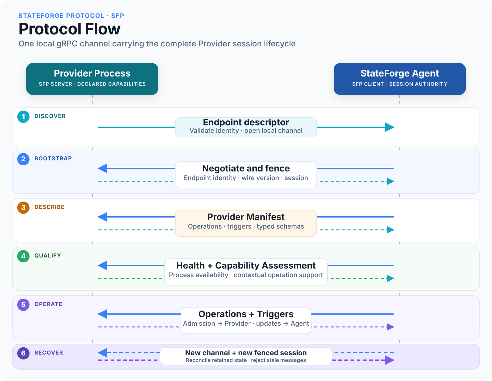

<p align="center">
  
</p>

<h1 align="center">StateForge Protocol</h1>

<p align="center">
  The versioned local protocol connecting StateForge Agents and Providers.
</p>

<p align="center">
  <a href="https://github.com/stateforge-org/stateforge-protocol/actions/workflows/protocol-ci.yml"></a>
  <a href="https://github.com/stateforge-org/stateforge-protocol/blob/mvp/implementation/LICENSE"></a>
  
  
</p>

<p align="center">
  <a href="https://stateforge.net">StateForge</a> ·
  <a href="docs/v0.1.0/index.md">Documentation</a> ·
  <a href="docs/v0.1.0/procedures/index.md">Procedure map</a> ·
  <a href="docs/v0.1.0/reference/python-contracts.md">Python contracts</a>
</p>

StateForge Protocol (SFP) defines how a StateForge Agent discovers, identifies,
monitors, and operates independently running Provider processes. One
multiplexed local gRPC channel carries the complete Provider session lifecycle,
from endpoint discovery and version negotiation through operations, triggers,
and recovery.

> [!IMPORTANT]
> StateForge Protocol is in pre-alpha development. Wire contracts and public
> Python APIs may change before the first stable release.

## Protocol flow

[](docs/v0.1.0/assets/diagrams/protocol-flow.svg)

1. A Provider publishes an endpoint descriptor and the Agent opens a local
   channel.
2. Bootstrap confirms endpoint identity, negotiates a protocol version, and
   establishes a fenced session.
3. The Agent retrieves the Provider manifest, including declared operations,
   triggers, and schemas.
4. Health monitoring establishes process availability while capability
   assessment evaluates operation support for the current runtime context.
5. The Agent admits operations and consumes lifecycle updates; Providers
   publish triggers and receive acknowledgement dispositions.
6. Reconnection creates a new session and reconciles retained state without
   accepting stale messages.

## Contract surface

| Surface | Contract |
| --- | --- |
| Endpoint discovery | Filesystem descriptor shape, identity, generation, transport, and socket semantics |
| Bootstrap | Endpoint confirmation, wire-version negotiation, session creation, and fencing |
| Provider description | Manifest identity, operations, triggers, schemas, health, and contextual capability assessment |
| Operations | Immutable admission, idempotency, progress, results, cancellation, and terminal-state rules |
| Triggers | Provider-originated publication, replay, deduplication, and acknowledgement |
| Recovery | Reconnection classification, stale-session rejection, and retained-state reconciliation |

Endpoint discovery is a filesystem contract. Provider health uses the standard
`grpc.health.v1` service. Other RPC procedures use versioned StateForge
protobuf packages on the same channel.

## Python distribution

The `stateforge-protocol` distribution gives Agent and Provider implementations
one authoritative Python contract surface:

- generated protobuf and gRPC modules;
- versioned service identities, RPC paths, limits, and shared scalar rules;
- context-independent semantic validation APIs;
- packaged JSON Schemas and conformance fixtures; and
- the complete shared-endpoint service inventory and transport ceilings.

Install the current checkout with:

```bash
python -m pip install .
```

Public modules and supported imports are documented in the
[Python contract reference](docs/v0.1.0/reference/python-contracts.md). Generated
`*_pb2.py`, `*_pb2.pyi`, and `*_pb2_grpc.py` modules are derived artifacts and
must not be edited manually.

## Documentation

- [Protocol overview](docs/v0.1.0/index.md)
- [SFP procedure map](docs/v0.1.0/procedures/index.md)
- [Generated Python contracts](docs/v0.1.0/reference/python-contracts.md)
- [Runtime responsibility boundaries](docs/v0.1.0/reference/responsibility-boundaries.md)
- [Conformance coverage](docs/v0.1.0/reference/conformance-coverage.md)

Build the documentation locally with:

```bash
python -m mkdocs serve
```

## Development

Python 3.11 or newer and Buf are required. Create an isolated environment and
install the development and documentation dependency groups:

```bash
git clone https://github.com/stateforge-org/stateforge-protocol.git
cd stateforge-protocol
python -m venv .venv
source .venv/bin/activate
python -m pip install --upgrade pip
python -m pip install --group dev --group docs .
```

When a `.proto` source changes, regenerate its checked-in Python bindings with
`buf generate`. Keep protobuf sources, generated bindings, validation schemas,
and conformance vectors in the same change.

Run the complete local verification suite with:

```bash
buf lint
buf format --diff --exit-code
python scripts/check_generated.py
buf breaking --against '.git#branch=origin/mvp/implementation'
python -m ruff format --check .
python -m ruff check .
python -m mypy src
python -m pytest
python -m build
python -m mkdocs build --strict
```

Maintainers can find the reusable workflow interfaces and evidence model in
[CI/CD and artifact verification](docs/v0.1.0/reference/ci-automation.md).

## License

StateForge Protocol is licensed under the
[Apache License 2.0](LICENSE).
