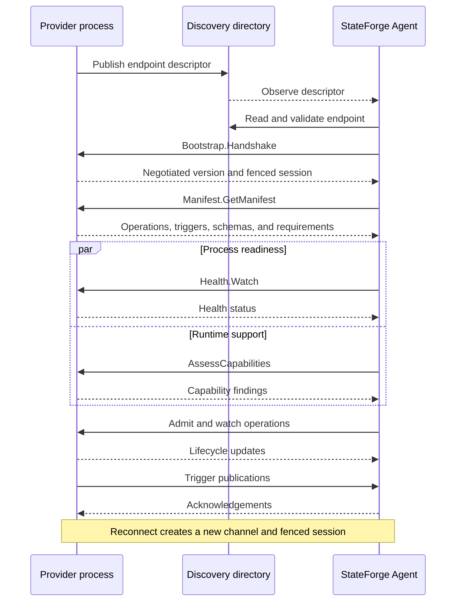

<p align="center">
  
</p>

<h1 align="center">StateForge Protocol</h1>

<p align="center">
  The versioned local protocol connecting StateForge Agents and Providers.
</p>

<p align="center">
  <a href="https://github.com/stateforge-org/stateforge-protocol/actions/workflows/protocol-ci.yml"></a>
  <a href="https://github.com/stateforge-org/stateforge-protocol/blob/mvp/implementation/LICENSE"></a>
  
  
</p>

<p align="center">
  <a href="https://stateforge.net">StateForge</a> ·
  <a href="https://docs.stateforge.net/sfp/latest/">Documentation</a> ·
  <a href="https://docs.stateforge.net/sfp/latest/getting-started/">Getting started</a> ·
  <a href="https://docs.stateforge.net/sfp/latest/procedures/">Procedure map</a> ·
  <a href="https://docs.stateforge.net/sfp/latest/reference/python-contracts/">Python contracts</a>
</p>

StateForge Protocol (SFP) defines how a StateForge Agent discovers, qualifies,
and exchanges work with independently running Provider processes. It provides
versioned contracts for identity, session fencing, capabilities, operations,
triggers, and recovery.

> [!IMPORTANT]
> StateForge Protocol is in pre-alpha development. Wire contracts and public
> Python APIs may change before the first stable release.

## Protocol lifecycle



Endpoint discovery is a filesystem contract. Provider health uses the standard
`grpc.health.v1` service. Other RPC procedures use versioned StateForge
protobuf packages on the same channel.

## Python distribution

The `stateforge-protocol` distribution gives Agent and Provider implementations
one authoritative Python contract surface:

- generated protobuf and gRPC modules;
- versioned service identities, RPC paths, limits, and shared scalar rules;
- context-independent semantic validation APIs;
- packaged JSON Schemas and conformance fixtures; and
- the complete shared-endpoint service inventory and transport ceilings.

Install the current checkout with:

```bash
python -m pip install .
```

Public modules and supported imports are documented in the
[Python contract reference](https://docs.stateforge.net/sfp/latest/reference/python-contracts/). Generated
`*_pb2.py`, `*_pb2.pyi`, and `*_pb2_grpc.py` modules are derived artifacts and
must not be edited manually.

## Documentation

- [Protocol overview](https://docs.stateforge.net/sfp/latest/)
- [Getting started](https://docs.stateforge.net/sfp/latest/getting-started/)
- [SFP procedure map](https://docs.stateforge.net/sfp/latest/procedures/)
- [Generated Python contracts](https://docs.stateforge.net/sfp/latest/reference/python-contracts/)
- [Versioning and compatibility](https://docs.stateforge.net/sfp/latest/reference/versioning-compatibility/)
- [SFP status and error handling](https://docs.stateforge.net/sfp/latest/reference/status-errors/)
- [Security model and local trust boundary](https://docs.stateforge.net/sfp/latest/reference/security-trust-boundary/)
- [SFP terminology glossary](https://docs.stateforge.net/sfp/latest/reference/glossary/)
- [Runtime responsibility boundaries](https://docs.stateforge.net/sfp/latest/reference/responsibility-boundaries/)
- [Conformance coverage](https://docs.stateforge.net/sfp/latest/reference/conformance-coverage/)

Build the documentation locally with:

```bash
python -m mkdocs serve
```

## Development

Python 3.11 or newer and Buf are required. Create an isolated environment and
install the development and documentation dependency groups:

```bash
git clone https://github.com/stateforge-org/stateforge-protocol.git
cd stateforge-protocol
python -m venv .venv
source .venv/bin/activate
python -m pip install --upgrade pip
python -m pip install --group dev --group docs .
```

When a `.proto` source changes, regenerate its checked-in Python bindings with
`buf generate`. Keep protobuf sources, generated bindings, validation schemas,
and conformance vectors in the same change.

Run the complete local verification suite with:

```bash
buf lint
buf format --diff --exit-code
python scripts/check_generated.py
buf breaking --against '.git#branch=origin/mvp/implementation'
python -m ruff format --check .
python -m ruff check .
python -m mypy src
python -m pytest
python -m build
python -m mkdocs build --strict
```

Maintainers can find the reusable workflow interfaces and evidence model in
[CI/CD and artifact verification](https://docs.stateforge.net/sfp/latest/reference/ci-automation/).

## License

StateForge Protocol is licensed under the
[Apache License 2.0](LICENSE).
