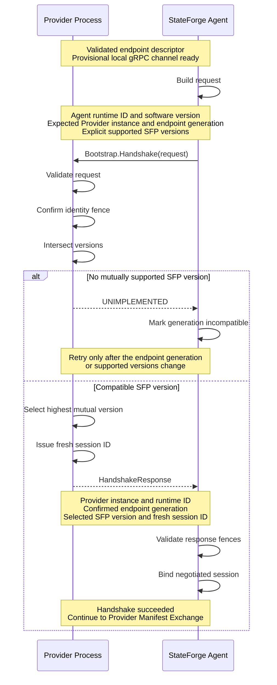

# Handshake and version negotiation

Bootstrap turns a provisional local gRPC channel into a fenced SFP session.
The Agent confirms that it reached the endpoint discovered on disk, both peers
select one SFP wire version, and the Provider issues the runtime and session
identifiers required by subsequent procedures.

## Procedure

SFP exposes the unary method
`/stateforge.sfp.bootstrap.v1.BootstrapService/Handshake`. It runs on the local
channel established from a validated endpoint descriptor.

1. The Agent creates a fresh runtime identity for its current process and
   copies the expected Provider instance and endpoint generation from the
   descriptor.
2. The Agent offers every SFP `major.minor` wire version it supports.
3. The Provider validates the request and confirms that the expected instance
   and generation identify the endpoint it is serving.
4. The Provider selects the highest version supported by both peers and creates
   a fresh session identifier.
5. The Agent validates the response against its request and descriptor, then
   binds the channel to the Provider instance, endpoint generation, Provider
   runtime, selected version, and session.

Only after all five steps succeed may the Agent continue to Provider Manifest
Exchange. A successful handshake does not by itself establish a valid manifest,
Provider availability, capability support, or authorization to run operations.

## Request and response

| Message | Field | Meaning |
| --- | --- | --- |
| Request | `agent_runtime.runtime_id` | Canonical lowercase UUIDv4 for the current Agent process. It is not a durable Control Plane Agent identity. |
| Request | `agent_runtime.software_version` | Nonempty version of the running Agent software. |
| Request | `expected_provider_instance_id` | Canonical lowercase UUIDv4 copied from the validated endpoint descriptor. It identifies the Provider installation. |
| Request | `expected_endpoint_generation` | Positive generation copied from the descriptor. It fences endpoint replacement. |
| Request | `supported_sfp_versions` | Nonempty, duplicate-free list of supported `major.minor` wire versions. Offer order conveys no preference. |
| Response | `provider_instance_id` | Confirmation of the requested Provider installation. |
| Response | `endpoint_generation` | Confirmation of the requested endpoint generation. |
| Response | `selected_sfp_version` | Highest version supported by both peers. It must be one the Agent offered. |
| Response | `provider_runtime_id` | Canonical lowercase UUIDv4 for the current Provider process. |
| Response | `session_id` | Opaque identifier issued for this successful handshake and copied unchanged into session-bound procedures. |

SFP wire versions contain only unsigned-integer `major` and `minor` components.
The major version is positive and the minor version may be zero. Patch versions
belong to software packages and are deliberately not part of wire negotiation.

## Identity and session fencing

The identifiers serve different purposes and must not be substituted for one
another:

- `provider_instance_id` remains stable for one Provider installation.
- `endpoint_generation` changes when that installation publishes a replacement
  endpoint.
- `provider_runtime_id` identifies the currently executing Provider process.
- `session_id` identifies the negotiated context created by one successful
  handshake.

Every successful handshake creates a session ID that the Provider installation
has not issued before, including after endpoint replacement or process restart.
The value is opaque: consumers preserve its exact case and contents and do not
parse, normalize, or assume it is a UUID. Unrelated Provider installations may
use the same value because session bindings also include the Provider instance.

The context-independent response validator can verify the shape and length of
a session ID, but only the Provider runtime can enforce freshness against IDs it
previously issued. Likewise, only the Agent can confirm that the response
identity, generation, and selected version match the descriptor and request
used for that call.

## Contract ownership and limits

The protobuf source defines the service and message shape. The versioned
`stateforge_protocol.sfp.bootstrap.v1.contract` module owns the canonical
service identity and byte limits, while the adjacent `validation` module owns
context-independent request and response validation.

| Resource | Limit |
| --- | ---: |
| Serialized request | 64 KiB |
| Serialized response | 8 KiB |
| Session ID | 255 Unicode code points |

The request and response limits apply to serialized protobuf bytes at the RPC
boundary. Procedure-specific checks remain required even when the shared gRPC
channel accepts a larger message for another SFP procedure.

The canonical validators require:

- canonical lowercase UUIDv4 Agent runtime, Provider instance, and Provider
  runtime identities;
- an allocated endpoint generation;
- a nonempty Agent software version;
- at least one unique valid SFP wire version; and
- a nonempty session ID within the code-point limit.

Generated protobuf bindings do not run these validators automatically.

## Outcomes and recovery

| Outcome | gRPC status or local result | Required behavior |
| --- | --- | --- |
| Malformed request or invalid field semantics | `INVALID_ARGUMENT` | Correct the request. Do not treat default or malformed values as wildcards. |
| Serialized request or response exceeds its procedure limit | `RESOURCE_EXHAUSTED` | Reject the message before accepting the session. |
| Requested Provider instance or endpoint generation does not identify the serving endpoint | `FAILED_PRECONDITION` | Revalidate discovery and connect to the current endpoint before trying again. |
| No mutually supported SFP wire version | `UNIMPLEMENTED` | Mark that endpoint generation protocol-incompatible. Do not retry it indefinitely without a change. |
| Provider endpoint is stopping before it can create a session | `UNAVAILABLE` | Treat the attempt as transient and follow bounded reconnect policy. |
| Provider constructs an invalid response | `INTERNAL` | Reject the session; the Provider has violated its own contract. |
| Response identity or generation differs from the descriptor, or the selected version was not offered | Local protocol failure | Reject the response and do not bind the channel. |

Transport loss, Provider restart, endpoint-generation change, or channel
replacement requires a new handshake and a fresh session. Late messages from a
superseded session remain stale even if the Provider instance is unchanged.
