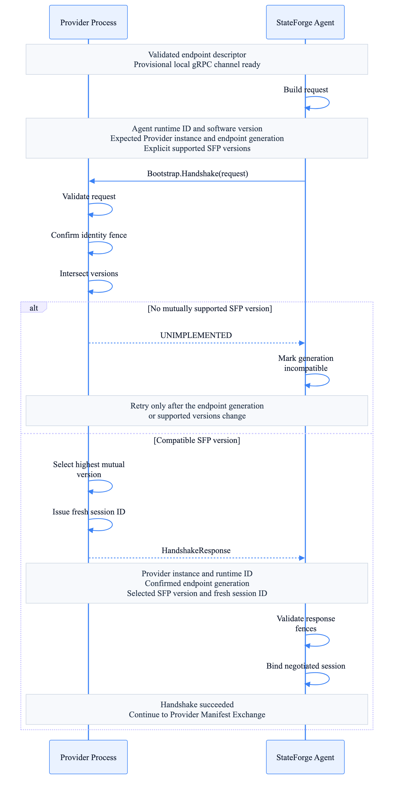

# Handshake and version negotiation

The bootstrap service establishes the identity and negotiated wire version of
an SFP session before operational RPCs are allowed on the channel.

_Select the diagram to open the full-resolution version._

The request binds the provisional channel to the discovered Provider instance
and endpoint generation. The response confirms that identity, chooses exactly
one protocol version, and supplies runtime and session identifiers.

## Wire contract

SFP exposes the unary method
`/stateforge.sfp.bootstrap.v1.BootstrapService/Handshake`. The protobuf source
defines its message shape; the versioned
`stateforge_protocol.sfp.bootstrap.v1.contract` module is the authoritative
consumer API for limits and canonical service/method identifiers.

| Resource | Limit |
| --- | --- |
| Serialized request | 64 KiB |
| Serialized response | 8 KiB |
| Session ID | 255 Unicode code points |

The request and response limits apply to serialized protobuf bytes at the RPC
boundary. The session ID is an opaque value issued by the Provider and copied
unchanged by consumers; its length is measured in Unicode code points rather
than encoded bytes. Procedure-specific checks remain required even when the
shared gRPC channel accepts a larger message for another SFP procedure.

If no wire version overlaps, the Provider returns gRPC `UNIMPLEMENTED`. The
Agent classifies the endpoint generation as incompatible rather than retrying
an unchanged generation indefinitely.
