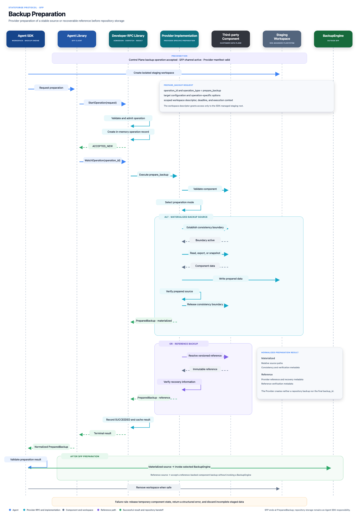

# Backup preparation

The Agent SDK creates and owns the staging workspace. Through the Agent
Library, the Provider prepares either materialized data in that workspace or a
recoverable Provider reference. The selected Backup Engine stores materialized
data after preparation succeeds.

_Select the diagram to open the full-resolution version._
