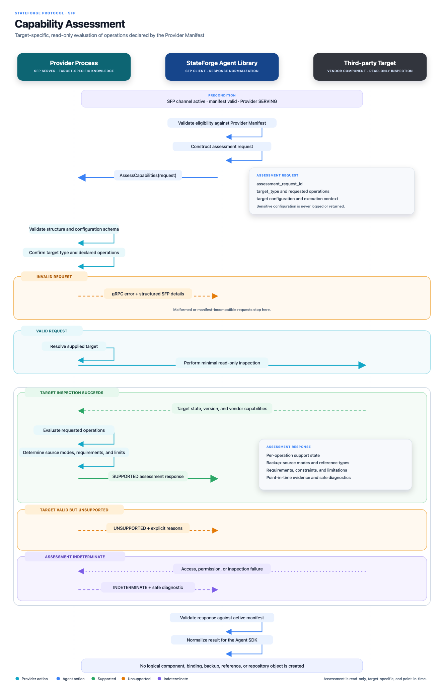

# Capability assessment

Capability assessment evaluates a concrete target and requested operation set
without executing those operations. The Provider validates configuration,
examines the third-party target, and returns normalized support, limits,
requirements, and blockers.

_Select the diagram to open the full-resolution version._
