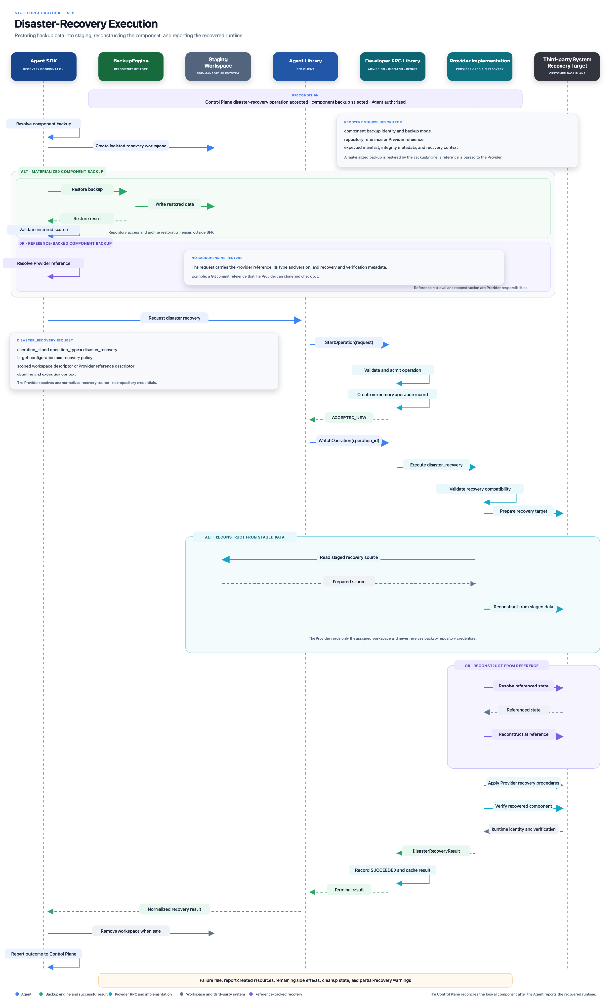

# Disaster-recovery execution

The Agent SDK resolves the component backup. A Backup Engine restores
materialized data into an SDK-managed workspace, while a reference-backed
backup is supplied directly as normalized recovery input. The Provider then
reconstructs and verifies the third-party target.

_Select the diagram to open the full-resolution version._
