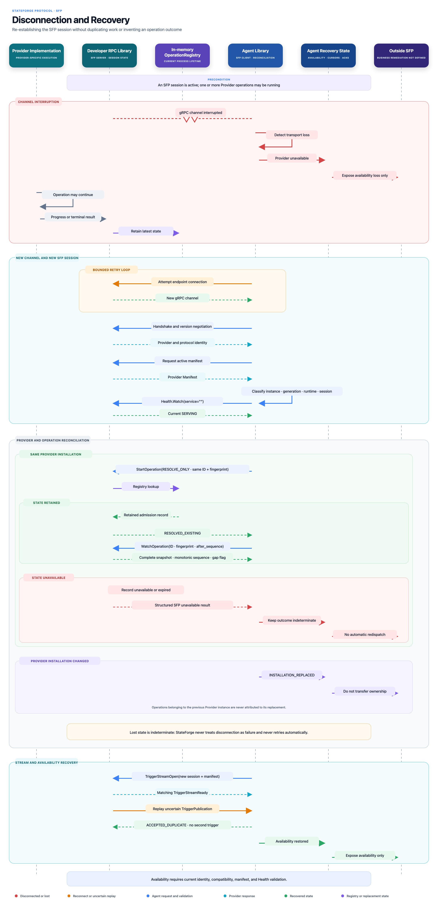

# Disconnection and recovery

SFP recovery re-establishes a trusted session and reconciles retained protocol
state. It never assumes that a lost RPC rolled back Provider work. A transport
failure can make the outcome unknown, but it cannot turn an admitted operation
into `FAILED`, cancel it, or authorize a second execution.

_Select the diagram to open the full-resolution version._

## Identity model

Recovery compares independently validated Bootstrap results. The four identity
fields have different lifetimes:

| Field | Meaning during recovery |
| --- | --- |
| `provider_instance_id` | Stable Provider installation identity. A different value is a replacement installation, not recovery of the previous Provider. |
| `endpoint_generation` | Monotonic endpoint publication for one installation. A greater value fences every call and stream bound to the earlier endpoint. |
| `provider_runtime_id` | Current Provider process identity. It distinguishes a live-process endpoint replacement from a process restart. |
| `session_id` | Opaque negotiated session identity. Every new Handshake produces a value not previously used by that Provider installation. Session tokens may coincide across unrelated installations because the installation identity remains part of every binding. |

The canonical transition classes are:

| Previous to current identity | Classification | Prior state may be reconciled? |
| --- | --- | --- |
| Same instance, generation, and runtime; new session | Same-process reconnect | Yes, from the still-live process. |
| Same instance and runtime; greater generation | Endpoint replaced | Yes, but uncertain admission crosses a generation boundary. |
| Same instance; greater generation and different runtime | Process restarted | Only when state was verifiably persisted and recovered. |
| Different instance | Installation replaced | No. The replacement cannot claim the previous installation's operations. |

A generation moving backward, one generation identifying two runtime IDs, or a
session ID reused within the same Provider installation is not a recovery
transition. Treat it as stale or invalid identity and do not reconcile through
it.

## Availability gate

Transport reconnection alone never makes the Provider available. Before new
operation admission or reliance on Provider-originated triggers, the Agent:

1. rediscovers or revalidates the endpoint descriptor;
2. opens a new channel and completes Bootstrap Handshake;
3. validates the current instance, generation, runtime, version, and new
   session identity;
4. obtains and accepts the current Provider Manifest for that session;
5. opens a new standard Health `Watch(service="")` and observes `SERVING`; and
6. revalidates every additional admission prerequisite, including any
   capability evidence invalidated with the earlier availability generation.

An unchanged manifest revision permits reuse of a previously validated
declaration, but never permits skipping the current response envelope, session,
generation, or Health checks. Health events from the old channel are stale even
when their payload says `SERVING`.

The Agent owns bounded retry timing and jitter. Retries must have finite
deadlines and bounded backoff. SFP defines which calls are safe to repeat; it
does not prescribe one runtime scheduler.

## Session and stream fencing

Every request after reconnect uses the new session binding. Responses must echo
the current Provider instance, endpoint generation, and session where their
procedure defines those fields. A response or stream event from the old
session is discarded and cannot update availability, acknowledgement state,
operation state, or a saved cursor.

Closing a channel has no business meaning. In particular, it does not:

- cancel admitted Provider work;
- reject or roll back a trigger already accepted by the Agent;
- prove that an admission or cancellation request was not committed; or
- make a replacement installation the owner of earlier work.

## Uncertain operation admission

Operation identity and the canonical invocation fingerprint survive session
replacement. Session binding and `admission_mode` are excluded from that
fingerprint.

When the reply to `StartOperation` is lost:

| Boundary | Required retry |
| --- | --- |
| Same live endpoint generation | The unchanged request may use `ADMIT_OR_RESOLVE`. The atomic registry either admits it once or resolves the retained matching record. |
| Endpoint generation, process, or retention boundary crossed | Use `RESOLVE_ONLY`. This mode must never create or dispatch absent work. |
| Provider installation changed | Do not send the old operation to the replacement as recovery. It is not the owner of that operation identity. |

A retained matching record returns `RESOLVED_EXISTING`, including when a later
generation verifiably recovered persisted state. Its
`admitted_endpoint_generation` remains the generation that originally admitted
the operation.

If no retained record can be proven, return
`OPERATION_RECORD_UNAVAILABLE`. If a retained tombstone proves expiry, return
`OPERATION_RECORD_EXPIRED`. Both outcomes are indeterminate. Neither is a
business failure and neither permits automatic redispatch with a new operation
ID. Remediation belongs above SFP.

## Operation observation and cancellation

After a new session is established, the Agent attaches
`WatchOperation` using:

- the current session binding;
- the original operation ID;
- the original request fingerprint; and
- the last snapshot sequence it validated.

The Provider immediately replays a complete current snapshot. Sequence numbers
never reset because of channel loss, session replacement, endpoint replacement,
or valid persisted recovery.

| Watch condition | Required result |
| --- | --- |
| `after_sequence = 0` | Replay current state with `updates_skipped = false`. |
| Current sequence equals the cursor | Replay the same complete snapshot with `updates_skipped = false`. |
| Current sequence is one greater | Return it with `updates_skipped = false`. |
| Current sequence skips retained intermediate updates | Return the complete current snapshot with `updates_skipped = true`. |
| Cursor is greater than retained current sequence | Reject with `CURSOR_AHEAD`; never reset the cursor automatically. |
| Admission retained but lifecycle state unavailable | Reject with `OPERATION_STATE_UNAVAILABLE`; outcome remains indeterminate. |
| Record unavailable or expired | Return the matching lifecycle record-unavailable or record-expired reason. |

A broken Watch does not cancel execution. A terminal snapshot already validated
before transport failure remains terminal evidence. Replaying a terminal
snapshot must reproduce the identical committed admission record, sequence,
state, result, progress, effects, and timestamps.

`CancelOperation` is separately idempotent. When its reply is lost, the Agent
may repeat the same operation ID and fingerprint under the new current session.
The response reports the Provider's retained atomic decision; transport loss
alone never means that cancellation succeeded.

## Trigger stream recovery

The Agent opens a new `StreamTriggers` stream only after it has accepted the
current session and manifest. The first request is a new `TriggerStreamOpen`,
and no publication is valid before the matching `TriggerStreamReady`.

A live Provider retains every unacknowledged publication. If the channel closes
before its acknowledgement arrives, it replays the publication on the new
ready stream with the same:

- `publication_id`;
- trigger identifier;
- observation time; and
- canonical payload content.

The Agent's accepted-publication identity is scoped to the stable Provider
installation. Identical replay from that installation receives
`ACCEPTED_DUPLICATE` and creates no second logical trigger. Reusing the same
publication ID with different canonical content is an idempotency conflict.

A replacement installation does not inherit acknowledgement state. Its
publication namespace is distinct even if a UUID happens to be equal; it may
be accepted as new only through its own validated stream. It cannot use that
identity to claim delivery by the previous installation.

The baseline Provider registry is in memory. A process restart may therefore
lose unacknowledged publications. Persistence is optional; when supplied, it
must preserve immutable publication identity and content. SFP does not require
a Provider to reconstruct events it can no longer prove.

## State retention and outcomes

Stable Provider identity does not imply stable operation or trigger storage.
The default Provider runtime may retain admission records, snapshots, terminal
results, cursors, and unacknowledged publications only for the current process
lifetime. A Provider may deliberately add persistence, but recovery claims are
valid only when the complete relevant state is restored without rewriting its
identity or ordering.

| Recovered evidence | Protocol outcome |
| --- | --- |
| Complete retained operation state | Resume Watch or resolve admission using the original identity and sequence. |
| Complete persisted state after restart | Same as retained state; original admission generation remains observable. |
| Proven expiry tombstone | Explicit expired-record result; business outcome remains indeterminate. |
| Admission exists but lifecycle evidence is missing | Explicit state-unavailable result; business outcome remains indeterminate. |
| No record or trustworthy tombstone | Explicit record-unavailable result; business outcome remains indeterminate. |
| Different Provider installation | Replacement; no attribution of previous operations to the new instance. |

Unknown remains visible. SFP never converts missing evidence into `FAILED`,
`CANCELLED`, success, rollback, or permission to retry business work.

## Compatibility and ownership

Recovery composes the existing versioned procedures. It defines no separate
reconciliation RPC and no second recovery state store:

- Endpoint Discovery and Bootstrap establish current identity.
- Manifest establishes current declarations and revision.
- standard gRPC Health establishes current process readiness.
- Trigger Publication owns publication replay and acknowledgements.
- Operation Admission owns idempotent admission and resolve-only lookup.
- Operation Lifecycle owns snapshot replay, cursors, terminal evidence, and
  cancellation decisions.

Protocol owns the context-independent identities, classifications, message
semantics, validation, and conformance vectors. Agent owns connection retry,
availability, saved cursors, cache policy, and orchestration. Provider owns its
state retention, optional persistence, and serving behavior.

This procedure does not define SF-AOP reporting, Control Plane remediation,
automatic operation re-execution, mandatory Provider persistence, or business
policy for resolving an indeterminate outcome.
