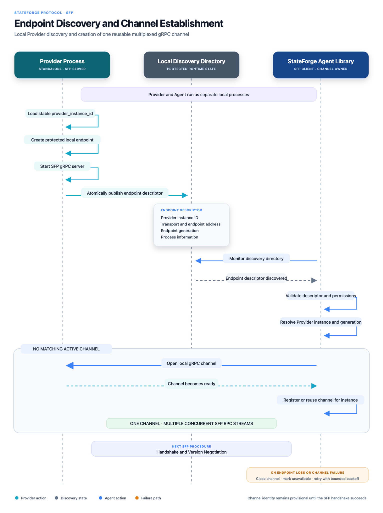

# Endpoint discovery and channel establishment

This procedure establishes the provisional local gRPC channel used by all
later SFP procedures. The Provider owns its stable instance identity, starts
its server, and atomically publishes a generation-specific endpoint. The Agent
Library monitors the discovery directory, validates the descriptor and local
filesystem boundary, then establishes or reuses the matching channel.

_Select the diagram to open the full-resolution version._
