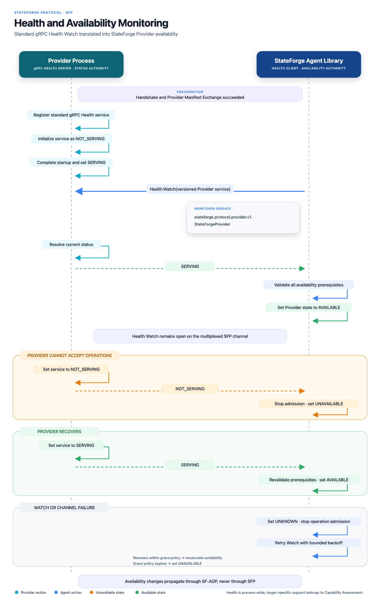

# Provider health and operational eligibility

The Provider exposes the standard `grpc.health.v1.Health` service on the
existing Agent-established SFP channel. The Provider reports its process-wide
health through the standard empty service name. The Agent combines that signal
with its own current transport, session, generation, and accepted manifest
before it allows new operation admission.

[](../assets/diagrams/health-and-availability-monitoring.png)

_Select the diagram to open the full-resolution version._

## Standard wire contract

SFP does not define a StateForge health protobuf. Its wire contract comes
directly from the canonical
[`grpc/health/v1/health.proto`](https://github.com/grpc/grpc-proto/blob/master/grpc/health/v1/health.proto)
definition, including the `grpc.health.v1.Health` service,
`HealthCheckRequest`, `HealthCheckResponse`, `Check`, and `Watch`. Python
consumers obtain those official generated bindings from
`grpcio-health-checking` as `grpc_health.v1.health_pb2` and
`grpc_health.v1.health_pb2_grpc`; StateForge does not generate or vendor a
second copy. StateForge's authoritative limits and service-name constants are
published by `stateforge_protocol.sfp.health_contract`:

| Resource | Limit |
| --- | --- |
| Serialized request | 4 KiB |
| Serialized response | 64 bytes |

The limits apply to each serialized `Check` or `Watch` message at the RPC
boundary, including unknown protobuf fields. Health shares the same local
HTTP/2 channel, endpoint trust, derived transport ceilings, and process
lifetime as the negotiated SFP services. It does not create a second
connection or reverse RPC surface. Its smaller per-procedure limits remain
mandatory even though another service requires a larger shared-channel
ceiling.

The Agent watches `Health.Watch(service="")`. In standard gRPC Health, the
empty service name represents the whole server; in SFP it represents the
whole Provider process. It is the authoritative health stream used as an input
to Agent-derived operational eligibility.

Providers may additionally register the protobuf full names of their hosted
SFP services for operator diagnostics. For SFP 1.0, those names are:

| Service key | Procedure |
| --- | --- |
| `stateforge.sfp.bootstrap.v1.BootstrapService` | Handshake and version negotiation |
| `stateforge.sfp.manifest.v1.ManifestService` | Provider manifest exchange |
| `stateforge.sfp.capability_assessment.v1.CapabilityAssessmentService` | Capability assessment |
| `stateforge.sfp.operation_admission.v1.OperationAdmissionService` | Operation admission |
| `stateforge.sfp.operation_lifecycle.v1.OperationLifecycleService` | Progress, results, and cancellation |
| `stateforge.sfp.trigger_publication.v1.TriggerPublicationService` | Trigger publication and acknowledgement |

These are actual protobuf service identities. Implementations must not invent
an umbrella name such as `StateForgeProvider`, omit the version, use a package
prefix, or interpret wildcards. A future SFP service may expose diagnostic
health under its own protobuf full name when that service becomes part of the
hosted contract.

A StateForge Provider starts the empty key as `NOT_SERVING` and reports
`SERVING` only after the Provider process has completed startup and can handle
its SFP contract. It returns to `NOT_SERVING` before the process stops accepting
new work or begins teardown. Named service states can explain a local problem,
but they neither override nor replace the Provider-wide state.

The standard lookup behavior is preserved:

| Request | Required result |
| --- | --- |
| `Check` for a registered name or `""` | Return that key's current `SERVING` or `NOT_SERVING` status. Callers set a finite deadline. `Check` remains diagnostic. |
| `Check` for an unknown name, including a wildcard-like name | Fail with gRPC `NOT_FOUND`. |
| `Watch` for a registered name or `""` | Immediately send the current status, then send every ordered status change. |
| `Watch` for an unknown name | Immediately send `SERVICE_UNKNOWN`, keep the stream open, and publish a later status if the name becomes registered. |

`SERVICE_UNKNOWN` is valid only as a `Watch` response. `UNKNOWN`,
`NOT_SERVING`, and `SERVICE_UNKNOWN` all fail closed for Agent eligibility.

## Provider lifecycle

The health registry exists before the endpoint becomes discoverable. The empty
Provider-wide key starts as `NOT_SERVING`; any named diagnostic keys also start
as `NOT_SERVING`. The proto3 default `UNKNOWN` is not a startup-ready state.

The Provider moves its Provider-wide status to `SERVING` only after it is ready
to accept correctly formed SFP requests. In particular:

1. startup validation succeeds, including construction of a valid effective
   manifest;
2. the hosted service implementations and their bounded runtime resources are
   ready;
3. the Provider publishes `SERVING` for the empty Provider-wide key; and
4. any named diagnostic states reflect their individual service readiness.

The standard API can expose per-service diagnostics, but StateForge health is
process-wide. Whenever the Provider cannot safely accept new SFP work,
including during degraded operation or maintenance, it publishes
`NOT_SERVING` for the empty key. Recovery changes that key back to `SERVING`
only after the Provider is operational again. Named statuses may remain more
specific for diagnosis; the Agent does not combine them into a second health
authority.

Shutdown reverses readiness before resource teardown. The Provider first sets
the empty Provider-wide key to `NOT_SERVING`, stops accepting new work, and
gives active Watch streams a bounded opportunity to observe the transition.
It may also update named diagnostic keys. It then closes Watch streams, stops
the gRPC server, releases Provider resources, and withdraws the endpoint.
The shutdown bound is a runtime configuration, not a new wire field. A slow or
failed observer cannot hold Provider shutdown open indefinitely.

Health transitions describe RPC-serving readiness. They do not create,
rewrite, or delete business state.

## Check and Watch

`Check` is a finite, point-in-time diagnostic. It is useful for operator tools,
startup diagnosis, and confirming a suspected state, but a successful Check
never promotes a Provider to operationally eligible. An Agent must not poll
Check as a substitute for Watch.

`Watch` is the authoritative ongoing health observation. After the Agent has a
current handshake and accepted manifest, it opens one
`Health.Watch(service="")` on that same channel. The first response is the
current Provider-wide state, not merely a change notification. Later responses
on that stream are processed in delivery order. Named `Check` or `Watch`
requests may support diagnostics, but they do not determine Agent eligibility.

Providers must bound the number of concurrent Watch observers and all
per-observer buffering. The Provider must not drop or reorder state changes to
keep a slow observer alive. When an observer cannot keep up within the
implementation's finite delivery bound, terminate that stream with a
sanitized resource or availability error. Capacity exhaustion uses
`RESOURCE_EXHAUSTED`. The state publisher and Provider shutdown must never wait
without a bound for an observer.

When a Watch ends for any reason, including an `OK` termination, the Agent
immediately treats the watched state as unknown and blocks new admission. The
standard retry behavior applies:

- `UNIMPLEMENTED` means Watch is unsupported. Do not retry it on the same
  endpoint generation and do not fall back to Check for eligibility.
- Any other terminal status is retried with capped exponential backoff while
  the channel and negotiated session remain current.
- Transport replacement or an invalid session requires normal discovery and
  handshake recovery before opening a new Watch.
- `SERVICE_UNKNOWN` does not terminate the stream. It remains ineligible while
  waiting for that same stream to report a known state.

Retry attempts and local observer limits are bounded runtime policy. They are
not encoded into the standard Health messages.

## Agent-derived operational eligibility

Provider health is one input; the Agent owns the final decision. New operation
admission is eligible only when all of these facts are simultaneously true:

```text
current transport
AND current successful handshake, session, and endpoint generation
AND compatible accepted manifest for that current session
AND current Provider-wide Watch for service=""
AND latest accepted Watch status is SERVING
```

Provider-wide `SERVING` alone is insufficient. A Provider can truthfully report
that it is serving while the Agent rejects its manifest; that Provider remains
ineligible. Likewise, a valid manifest does not override `NOT_SERVING` or a
lost Watch. A successful `Check` and named service statuses are diagnostic and
cannot promote eligibility.

Provider-wide `SERVING` means only that the Provider process is running and
ready to handle its SFP contract. It is not:

- a capability assessment for a particular operation or target;
- authorization or a policy decision;
- proof that runtime requirements are satisfied;
- proof that every manifest-declared operation will succeed;
- reservation of Provider capacity; or
- Control Plane availability.

Capability Assessment supplies point-in-time operation evidence. Operation
Admission revalidates the current request and prerequisites. Neither fact is
collapsed into the health status.

## Session and generation fencing

Standard Health responses intentionally contain no StateForge session,
generation, or manifest fields. The Agent therefore binds each Watch locally
to the channel identity, Provider instance ID, endpoint generation, negotiated
session ID, and accepted manifest revision that were current when it opened
the stream.

Before applying every response, the Agent compares that local binding with its
current Provider state. A response from a replaced channel, session,
generation, installation, or rejected/superseded manifest is discarded even
when it says `SERVING`. Cancelling an old Watch is not sufficient fencing: a
callback already queued by the transport may still arrive.

A reconnect starts ineligible. The Agent repeats handshake and manifest
acceptance, opens a newly bound Watch, and waits for its initial `SERVING`
response. An old stream can never restore eligibility for a new session or
generation.

## Effect on admitted work

Loss of health affects only new admission. It does not imply that already
admitted Provider work stopped, failed, or was cancelled. The Agent and
Provider preserve the operation's existing admission record, lifecycle state,
progress, and immutable terminal result. They do not replace a result, create a
failure, request cancellation, or redispatch work because health changed or a
Watch ended.

Existing operation observation or cooperative cancellation may continue when
their own current-session contracts permit it. If transport loss makes that
impossible, the outcome remains unresolved until lifecycle/recovery procedures
provide evidence. Health is not business-operation truth.

## Diagnostics and privacy

`HealthCheckResponse` carries only the standard status enum. Implementations
must not encode diagnostic text, Provider configuration, credentials, customer
data, target identities, or vendor-specific probe results into service names,
metadata, or status substitutions.

Local logs may record the fixed service key, accepted status, sanitized gRPC
code, retry attempt, and current non-secret correlation identities. Any remote
or exception description is untrusted: sanitize it and limit retained or
displayed text to 1,024 Unicode code points. Diagnostic text is never a
machine-readable discriminator and must not be used to restore eligibility.

This procedure does not require or define vendor polling. A Provider may use
implementation-specific evidence to decide its readiness, but that mechanism
and its raw details remain inside the Provider.

## Responsibilities

### Provider

- Host the standard Health service on the existing SFP server.
- Register the empty Provider-wide key and any named diagnostic keys.
- Start fail-closed, publish ordered transitions, and withdraw admission
  readiness before shutdown or teardown.
- Bound observers, buffering, delivery stalls, and shutdown.
- Keep health responses and failures sanitized.

### Agent

- Watch the empty Provider-wide service key on the current SFP channel.
- Treat the initial response and every ordered update as health input, while
  deriving eligibility from all current prerequisites.
- Fail closed on unknown state, stream loss, invalid manifest, or stale
  session/generation evidence.
- Fence late events and retry Watch with bounded backoff where the standard
  permits it.
- Preserve already admitted operation truth across health changes.

## Contract boundary

This package defines StateForge's use of standard gRPC Health, the empty
Provider-wide key, diagnostic service names, conformance vectors, and
cross-runtime behavior. It adds no custom
health protobuf, Provider implementation, Agent coordinator, second channel,
business-operation cancellation, Control Plane report, SF-AOP message, or
vendor-specific probe contract.

The portable vectors in `tests/fixtures/health` cover named, empty, unknown,
and wildcard lookups; startup, degradation, recovery, and shutdown; Check and
Watch; stream loss and backpressure; stale-session fencing; invalid manifest
despite `SERVING`; admitted work across health loss; and diagnostic bounds.
