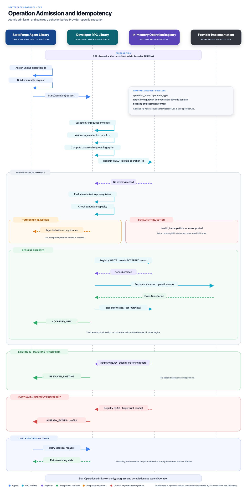

# Operation admission and idempotency

Operation admission turns one immutable, manifest-declared invocation into at
most one Provider dispatch. The Agent assigns the operation identity before
contact. The Provider validates the request, records a successful admission
atomically, and only then calls Provider-specific behavior.

_Select the diagram to open the full-resolution version._

## Wire contract

SFP exposes the unary method
`/stateforge.sfp.operation_admission.v1.OperationAdmissionService/StartOperation`
on the existing local channel. The authoritative source is
`proto/stateforge_protocol/sfp/operation_admission/v1/operation_admission.proto`.

This service admits any operation declared by the accepted P1 manifest. It
does not define a closed operation list, shell-command API, scheduler, policy
engine, or backup-specific transport method. Backup and disaster recovery are
later opt-in profiles over the same generic operation model.

`StartOperation` owns admission only. P5 defines progress, terminal outcomes,
results, observation, and cancellation. Resolving an operation whose lifecycle
is already terminal returns the same retained admission record and never
dispatches again; the P5 lifecycle surface returns the retained terminal
outcome and result.

## Request model

`StartOperationRequest` deliberately separates the immutable semantic
invocation from fields needed to validate the current call.

| Field | Meaning |
| --- | --- |
| `session_binding` | Current Provider installation, endpoint generation, and negotiated session expected for this call. These fields fence the transport call and are excluded from the invocation fingerprint. |
| `invocation` | Complete immutable operation attempt. Reusing its `operation_id` with different semantic content is an idempotency conflict. |
| `admission_mode` | Whether an absent record may be created or may only be resolved. This recovery control is excluded from the fingerprint. |

### Session binding

`session_binding` contains values obtained from the current handshake:

| Field | Rule |
| --- | --- |
| `expected_provider_instance_id` | Canonical lowercase UUIDv4 copied from Handshake. |
| `expected_endpoint_generation` | Positive generation copied from Handshake, never a process ID. |
| `expected_session_id` | Opaque active `HandshakeResponse.session_id`, 1–255 Unicode code points. |

The Provider validates all three values against one active negotiated session.
Installation identity and generation alone are not session authority. A
reconnect to the same live Provider generation may produce a new session ID;
the Agent updates `session_binding` without changing `invocation` or its
fingerprint.

### Immutable invocation

| Field | Ownership and validation |
| --- | --- |
| `operation_id` | Agent-assigned canonical lowercase UUIDv4 allocated before first contact. A new authorized attempt gets a new ID. A terminal ID is never repurposed. |
| `operation_identifier` | Exact P1 manifest key in `namespace/name@major` form. It remains an extensible string, not an enum. |
| `target` | One manifest-declared `target_kind` plus a required JSON object containing normalized target configuration. The configuration is validated against the accepted Provider-level P1 `configuration_schema`. It is not a StateForge project or component assignment. |
| `payload` | Required JSON object validated against the selected operation's P1 `input_schema` before admission. JSON Schema defaults are annotations and are not silently inserted. |
| `execution_deadline` | Absolute Agent-selected deadline for the business attempt. It is distinct from the gRPC call deadline and is immutable. |
| `contract.manifest_revision` | Exact accepted P1 manifest revision. It pins the operation declaration and its input/result schemas. |
| `contract.required_implementation_roles` | Zero or more distinct profile claims from the selected operation's P1 `implements` list that this invocation relies on. This may be a subset of all declared claims. Empty means this invocation requires no profile claim. These are not Control Plane contract identifiers or permissions. |
| `execution_context` | Required bounded JSON object containing already-approved, non-secret execution metadata. SFP transports context; it does not make the policy or authorization decision. |

The Agent and Provider must treat `target`, `payload`, and `execution_context`
as exact JSON values. Reordering object members is not a semantic change;
changing a value, adding or removing a member, or relying on an unmaterialized
schema default is a semantic change. `required_implementation_roles` is a set:
order is not semantic, duplicates are invalid.

A role names a versioned semantic/compliance profile, not a particular Control
Plane contract. An operation can claim multiple profiles in its P1 manifest;
the Agent validates any recognized profile it relies on, and admission checks
that each role requested here appears in that operation's declaration. This
membership check is not authorization or proof that the Provider's behavior
complies with the profile. A future Control Plane contract may require a
profile, but its contract identity is not sent as a role through SFP.

Configuration or payload fields declared `writeOnly` may contain secrets. The
Provider must not copy them into responses, error details, diagnostics,
fixtures, or logs. The request fingerprint is a correlation mechanism, not
authentication, and must not be exposed outside the trusted local SFP boundary
as a substitute for the request.

## Canonical request fingerprint

The Provider computes one fingerprint before looking up `operation_id`:

1. Parse and structurally validate `StartOperationRequest`.
2. Project only `OperationInvocation` to ProtoJSON using lowerCamelCase field
   names and emitting all non-presence defaults.
3. Sort `contract.requiredImplementationRoles` lexicographically by Unicode
   code point. Do not sort any other array.
4. Canonicalize the projected JSON with RFC 8785 (JCS).
5. Compute SHA-256 over the canonical UTF-8 bytes.
6. Encode the fingerprint as `sha256:` plus 64 lowercase hexadecimal digits.

The fingerprint includes `operation_id`, operation identifier, target,
payload, execution deadline, pinned manifest/profile context, and execution
context. It excludes `session_binding` and `admission_mode`. A same-generation
reconnect or switch to resolve-only therefore preserves the fingerprint, while
changing any immutable operation field produces an idempotency conflict under
the same operation ID.

The checked-in vector at
`tests/fixtures/operation_admission/fingerprint-vector.json` is normative for
schema 1. Implementations must produce the same canonical bytes and digest.
Deterministic protobuf serialization is not the fingerprint format.

## Admission modes

The zero/`UNSPECIFIED` mode is invalid.

| Mode | Behavior when no retained record exists |
| --- | --- |
| `ADMIT_OR_RESOLVE` | The request may create a new record after all admission checks pass. Use for the first submission and unchanged retries while the original Provider generation remains authoritative. |
| `RESOLVE_ONLY` | The request must never create or dispatch work. If no record can be proven, return an explicit unavailable or expired-record rejection. Use after an uncertain submission crosses a Provider generation or retention boundary. |

This distinction prevents an empty in-memory registry after process restart
from turning an uncertain old attempt into a second execution. The Agent must
remember whether a request might have reached the Provider. An explicit
pre-admission rejection proves no accepted record was created; a missing reply
does not.

## Validation and atomic admission order

Implementations perform these checks in order so retries and deadlines cannot
silently redispatch work:

1. Enforce the serialized request limit before decoding.
2. Validate message presence, identifier syntax, JSON bounds, and
   `admission_mode`.
3. Validate the active handshake session, Provider identity, and generation.
4. Match `contract.manifest_revision` to the Agent-accepted active manifest.
   Confirm the operation and target are declared, every required role is
   present, and target configuration and payload satisfy the accepted schemas.
5. Compute the canonical invocation fingerprint.
6. Look up `operation_id` before testing a new-admission deadline or capacity:
   - same fingerprint: return `RESOLVED_EXISTING` with the retained record;
   - different fingerprint: reject with `IDEMPOTENCY_CONFLICT`;
   - expired tombstone: reject with `OPERATION_RECORD_EXPIRED`.
7. If no record exists and the mode is `RESOLVE_ONLY`, reject with
   `OPERATION_RECORD_UNAVAILABLE`.
8. For a potential new admission, verify that `execution_deadline` is still in
   the future and evaluate current readiness, prerequisites, and capacity.
9. Atomically insert the admission record keyed by `operation_id`. Concurrent
   submissions must converge on one inserted record; the loser repeats the
   fingerprint comparison and resolves that record.
10. Dispatch Provider-specific behavior exactly once after the record is
    durable for the runtime's documented retention level.

An elapsed execution deadline does not erase or supersede an existing retained
record. A matching retry resolves that record even when the original deadline
has since passed. The lifecycle contract determines what the operation did,
not a new admission attempt.

Capability assessment is point-in-time evidence, not authorization. Admission
revalidates the current session, manifest, declaration, roles, schemas,
readiness, and any current prerequisites instead of trusting an old P2 result.

## Successful responses

Successful responses have exactly two dispositions. Zero/`UNSPECIFIED` is
invalid.

| Disposition | Meaning |
| --- | --- |
| `ACCEPTED_NEW` | One admission record was created atomically and the operation was dispatched once. |
| `RESOLVED_EXISTING` | A retained record with the same operation ID and fingerprint was returned. No second dispatch occurred. |

Every response echoes the current Provider installation, generation, session,
and pinned manifest revision. The Agent validates these fields against its
current call before accepting the response.

`OperationAdmissionRecord` contains the operation ID, canonical fingerprint,
original admission time, advertised record-expiry time, and generation that
first admitted it. Those fields do not change while the record is retained.
An implementation that verifiably persists and recovers a record may resolve it
from a later endpoint generation; `admitted_endpoint_generation` still reports
the original generation.

`record_expires_at` is an observable policy boundary, not a promise that an
in-memory Provider survives process failure. The Provider must not silently
shorten the advertised retention while the generation remains live. A process
restart may lose records unless the Provider documents stronger persistence.

## Rejections and structured errors

Rejections use a non-OK gRPC status plus
`OperationAdmissionErrorDetail`. They never use a third admission disposition
and never create an accepted record. Error details contain only operation ID
when valid, the bounded reason enum, retryability, optional non-negative retry
delay, and sanitized explanation.

| Condition | gRPC status | Structured reason | Retry guidance |
| --- | --- | --- | --- |
| Malformed fields, invalid identifiers, invalid bounds, or schema-invalid target/payload | `INVALID_ARGUMENT` | `INVALID_OPERATION_REQUEST` | Correct the request. Reusing the same ID is permitted only because the Provider explicitly rejected before admission. |
| Operation absent from the accepted manifest | `UNIMPLEMENTED` | `OPERATION_NOT_DECLARED` | Refresh declarations or choose declared work; do not reinterpret the identifier. |
| Target, schema, or required profile role is incompatible | `FAILED_PRECONDITION` | `OPERATION_INCOMPATIBLE` | Obtain a compatible target/contract and use a new operation ID if semantic content changes. |
| Session, generation, manifest, health, or current prerequisite is stale | `FAILED_PRECONDITION` | `OPERATION_PRECONDITION_FAILED` | Re-establish prerequisites. Reuse the ID only with identical invocation content. |
| Admission capacity temporarily exhausted | `RESOURCE_EXHAUSTED` | `PROVIDER_CAPACITY_EXHAUSTED` | Retry the identical request with bounded backoff; honor `retry_after` when present. |
| Whole Provider service temporarily unavailable | `UNAVAILABLE` | `PROVIDER_UNAVAILABLE` | Reconnect and revalidate before a bounded retry. |
| Same operation ID with a different fingerprint | `ALREADY_EXISTS` | `IDEMPOTENCY_CONFLICT` | Never retry changed content under this ID. |
| Execution deadline elapsed before new admission | `DEADLINE_EXCEEDED` | `OPERATION_DEADLINE_EXPIRED` | Do not mutate the expired invocation. A genuinely new authorized attempt needs a new ID and deadline. |
| Resolve-only request has no verifiably retained record | `FAILED_PRECONDITION` | `OPERATION_RECORD_UNAVAILABLE` | Outcome is unresolved. Do not automatically dispatch or manufacture failure/success. |
| A retained tombstone proves the record expired | `FAILED_PRECONDITION` | `OPERATION_RECORD_EXPIRED` | Outcome is unresolved. Escalate to a later decision-maker; expiry is not retry authorization. |

`retry_after` may appear only when `retryable` is true. Retryable means the
same immutable request may be attempted according to the table; it does not
authorize changing fields, creating a new operation ID after uncertainty, or
assuming the underlying vendor action is idempotent.

An unexpected boundary failure before a valid decision uses sanitized
`INTERNAL`. Transport loss has no structured admission conclusion because the
Agent did not receive proof of acceptance or rejection.

## Deadlines and retry safety

The Agent supplies two deadlines:

- `execution_deadline` is immutable semantic content. It bounds whether a new
  operation may be admitted and is included in the fingerprint.
- The gRPC call deadline bounds one transport attempt. It is not part of the
  fingerprint and does not prove that admission or execution stopped.

If the call deadline or transport fails before a response, retry the exact
invocation with the same operation ID. On the same live generation,
`ADMIT_OR_RESOLVE` is safe because atomic insertion ensures the retry either
creates the one record or resolves it. After generation replacement or when
retention is uncertain, use `RESOLVE_ONLY`. An unavailable/expired result stays
unresolved until a higher authority decides whether a genuinely new attempt is
safe.

SFP admission idempotency prevents duplicate dispatch for one retained
operation identity. It does not prove that the Provider's underlying business
action is idempotent, transactionally reversible, or safe to repeat after
state loss.

## Structural limits

The package ships
`stateforge_protocol/sfp/operation_admission/v1/operation_admission.schema.json`.
It validates complete ProtoJSON projections using lowerCamelCase names and
`MessageToDict(message, always_print_fields_with_no_presence=True)`. Proto3
defaults are not wildcards: missing nested messages, empty identifiers,
generation zero, and `UNSPECIFIED` enums are invalid.

| Limit | Maximum |
| --- | ---: |
| Serialized request | 8 MiB |
| Serialized response | 1 MiB |
| Serialized structured error detail | 4 KiB |
| Target, payload, or execution-context aggregate nesting | 64 containers |
| Entries per JSON object or array | 256 |
| JSON property name | 128 Unicode code points |
| JSON string value | 65,536 Unicode code points |
| Required implementation roles | 16 unique entries |
| Versioned identifier or role identifier | 255 Unicode code points |
| Session ID | 255 Unicode code points |
| Sanitized error explanation | 1,024 Unicode code points |

Consumers enforce serialized byte and aggregate nesting limits separately;
JSON Schema cannot express them portably. Configure transport receive limits
before decoding and walk nested `Struct` values iteratively before expensive
manifest-schema validation. A structurally valid multibyte string can still
exceed the wire byte limit.

The static schema cannot prove active-session membership, declaration lookup,
schema conformance against a dynamic manifest, timestamp ordering, fingerprint
correctness, atomic registry behavior, response correlation, or retention.
Those are required semantic checks covered by the procedure and conformance
fixtures.

## Retention and state loss

The baseline Provider registry may be in memory. Optional stronger persistence
is Provider-controlled; stable installation identity does not imply retained
operation records. Providers document their retention policy and expose each
record's current expiry boundary.

While a record is retained, every matching retry resolves it, whether the
operation is active or terminal. Providers may retain an expiry tombstone so a
late resolve-only request receives `OPERATION_RECORD_EXPIRED` instead of an
ambiguous absence. If a process or storage failure destroys both the record and
its tombstone, the Provider returns `OPERATION_RECORD_UNAVAILABLE` to a
resolve-only request. It must not invent a lifecycle outcome or dispatch new
work.

## Compatibility and delivery boundary

This procedure preserves bootstrap v1 and P1 manifest schema 1. It adds no P1
execution field and leaves versioned operation identifiers, schemas, and
explicit `implements` roles unchanged. New incompatible admission semantics
require a new package version; fields and enum values must not be reused.

This repository supplies the protocol source, generated bindings, structural
schema, golden fingerprint vector, error matrix, and conformance scenarios. It
does not implement an operation registry, Provider scheduler, Agent dispatcher,
vendor action, arbitrary command runner, SF-AOP transport, Control Plane API,
or policy engine.
