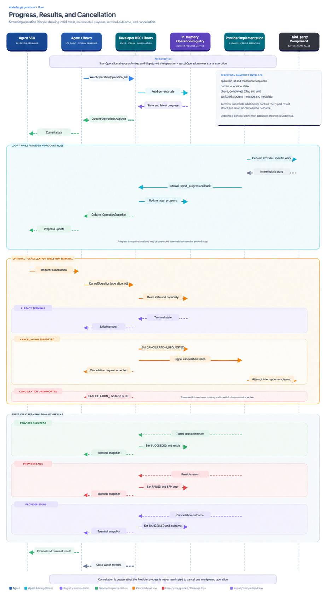

# Progress, results, and cancellation

Operation Lifecycle defines observation and cooperative cancellation of an
operation already admitted through
[Operation Admission](operation-admission.md). It adds the versioned
`stateforge.sfp.operation_lifecycle.v1.OperationLifecycleService` on the same
negotiated local SFP channel:

- `WatchOperation`: unary request, server-streaming snapshots.
- `CancelOperation`: unary request and response.

Neither RPC admits, restarts, or dispatches an operation. An unknown operation
ID never creates work. This contract contains no scheduler, operation registry,
Provider callback implementation, or Agent runtime.

The source `.proto`, packaged `operation_lifecycle.schema.json`, and this
procedure page define the current contract. The original
[SFP lifecycle specification](https://docs.google.com/document/d/1AEGKq15po5g_UYrv4qx1LzmNj1dKqA9J0eIIzTZVrlE/edit)
provides historical procedure context. Provider Manifest Exchange and
Operation Admission define the referenced declarations and records. Generic
target and source-mode fields are not part of the current contracts.

## Request and response correlation

Both requests reuse Operation Admission's `OperationSessionBinding`
unchanged. All three binding fields must match a known active negotiated
session. Session IDs are opaque
1–255-code-point strings, never inferred from installation or generation.
Each request supplies the existing `operation_id` and its exact
`expected_request_fingerprint` from the admitted request. Empty/default
identifiers are invalid. A lost admission reply is resolved through Operation
Admission; Watch and Cancel cannot substitute for admission or authorize
another attempt.

Watch additionally supplies `after_sequence`. Zero explicitly means a new
attachment. A positive value is the last validated sequence from this exact
operation record. Updating session binding after re-handshake does not change
the operation ID, fingerprint, or cursor.

Every reply echoes the current instance, generation, and session. Every
snapshot repeats the immutable Operation Admission record, versioned operation
identifier, and the manifest revision pinned by the original invocation.
The latter is **not necessarily the current manifest revision** after recovery.
Consumers validate results against the original accepted operation's result
schema and relied-on profiles. Providers retaining an operation must retain
that validation context; losing it is state loss, not permission to substitute
a newer schema or dispatch again.

Before accepting any message, the Agent checks its current session against
both the request and response, matches the operation ID and fingerprint, and
compares the immutable admission record and declaration pin with its Operation
Admission context. A recovered record may have an older
`admitted_endpoint_generation`
than the current envelope. A changed Provider installation is not recovery.
An invalid/mismatched response is a local protocol failure, not a business
outcome. Do not advance its cursor or issue another StartOperation.

## States, transitions, and presence

`OPERATION_STATE_UNSPECIFIED` is invalid. The shortened names below denote the
wire enum values with the `OPERATION_STATE_` prefix.

| Current state | Permitted next states | Meaning |
| --- | --- | --- |
| Initial admission | ACCEPTED | Record exists atomically before author work. Sequence is 1. |
| ACCEPTED | RUNNING, CANCELLATION_REQUESTED, FAILED | Execution starts, cancellation is requested, or execution cannot start. |
| RUNNING | CANCELLATION_REQUESTED, SUCCEEDED, FAILED | Work is active until a request or terminal commit. |
| CANCELLATION_REQUESTED | SUCCEEDED, FAILED, CANCELLED | Cancellation is pending; normal completion may still win. |
| SUCCEEDED, FAILED, CANCELLED | None | Terminal snapshot is immutable. |

RUNNING and CANCELLATION_REQUESTED may commit progress without changing state.
Replaying a snapshot or repeating Cancel is not a transition and allocates no
sequence. ACCEPTED has no progress updates. A Watch can skip intermediate
states through coalescing; the underlying committed transitions must still be
legal. For example, an observer may see ACCEPTED followed by SUCCEEDED only
with a sequence gap accounting for the intervening RUNNING transition.

| Snapshot state | Outcome presence | Progress presence |
| --- | --- | --- |
| ACCEPTED | All outcome arms absent; sequence 1, `updated_at = admitted_at` | Absent |
| RUNNING, CANCELLATION_REQUESTED | All outcome arms absent | Optional last progress |
| SUCCEEDED | Only `success`, containing required `result` object | Optional frozen last progress |
| FAILED | Only `failure`, containing code, explanation, and effects | Optional frozen last progress |
| CANCELLED | Only `cancellation`, containing effects | Optional frozen last progress |

Non-ACCEPTED states have sequence at least 2; SUCCEEDED and CANCELLED need at
least 3 because they require an intervening state. `oneof outcome` prevents
multiple protobuf arms; the JSON schema additionally binds each arm to its
state. An absent result differs from a present empty object. Even `{}` must
satisfy the pinned result schema.

## Snapshot sequences and replay

The Provider assigns a positive uint64 sequence to every committed state or
normalized progress change for each operation. ACCEPTED starts at 1, each
change increments exactly once, and each sequence denotes exactly one complete
snapshot. Sequences do not reset on reconnect, session change, or verifiable
persistent recovery. They are not global ordering across operations.

`updated_at` records commit time, not delivery time. Sequence establishes
order even if the wall clock moves backwards. A progress message records its
own commit sequence and timestamp, plus a sanitized message and/or an optional
finite percentage in [0, 100]. Absent percentage means unknown; zero means
zero. Percentages may reset between phases; 100 is not a terminal outcome.
Progress starts no earlier than sequence 3 (after entering RUNNING or
CANCELLATION_REQUESTED), and cannot exceed the enclosing snapshot sequence. If equal,
its timestamp equals the snapshot timestamp. In a terminal snapshot progress
must have an earlier sequence, because terminal commit is a separate change.
A state transition retains the latest progress unchanged.

At attachment, atomically capture current state and subscribe to subsequent
changes without a race window. Emit the captured **complete current snapshot
immediately**, even if the cursor already equals it. Do not wait for another
progress callback or replace this initial replay while delivering it. Only
subsequent pending snapshots may be coalesced. When already terminal, emit that
snapshot and close OK.
This is a state-snapshot stream, not a historical event log: a cursor does not
request all earlier progress events.

| Cursor / delivery | Required behavior |
| --- | --- |
| Initial `after_sequence = 0` | Replay current snapshot; `updates_skipped = false`. No earlier history was requested. |
| Positive cursor equals current | Replay that identical snapshot; flag false. |
| Positive cursor below current | Replay current; flag true exactly when `current > cursor + 1`. |
| Cursor greater than current | Reject with `OUT_OF_RANGE` / `CURSOR_AHEAD`; never silently reset it. |
| Subsequent response | Sequence must strictly increase; flag true exactly when it exceeds the last delivered sequence by more than one. |

A gap explicitly means intermediate updates are unavailable. The snapshot
remains sufficient for current state and outcome; the Agent replaces its view
and advances its cursor after full validation. It must not invent missing
progress or infer that no side effects occurred. Equal-sequence replays must
have identical snapshot content, apart from envelope/session/gap fields.
A later Cancel response can contain an older valid snapshot than a concurrent
Watch has delivered; do not regress the cached sequence. Conflicting content
at the same sequence or any mutation after terminal is a protocol violation.

Never wrap uint64. At `2^64 - 3`, stop committing further progress to reserve
the remaining two sequence values for cancellation-request and terminal state.
Replays and repeated cancellation decisions never consume those values.

## Retention and backpressure

Retain the current state, latest progress, and immutable terminal snapshot
with the Operation Admission record. No full progress history is required. A
terminal result must never be discarded while its admission record is retained.
Admission identity, fingerprint, admission/expiry times, and admitted generation
stay byte-for-byte unchanged in their canonical ProtoJSON projection.

The Operation Admission `record_expires_at` boundary must not be shortened.
Active operations retain their records while they can still execute, even past
that boundary; Operation Admission's expiry is not an instruction to discard
live work. After terminal commit and expiry, the Provider may evict the record
according to its documented
bounded retention policy. This does not extend or rewrite the immutable
Operation Admission expiry field. Already-attached observers retain their
pending terminal snapshot
until delivery or bounded stream failure; a later reconnect may find expiry.
An implementation must bound admissions when retaining active records would
exceed capacity, rather than deleting live records to admit more work.

For each observer, retain at most one pending snapshot in addition to one
in-flight response. A newer snapshot may replace pending intermediate state
or progress. A terminal snapshot replaces pending nonterminal data and cannot
be replaced by later progress. Send exactly one terminal snapshot per stream,
then close with gRPC OK. Reattachment can replay that same terminal snapshot.

Allow at most 16 observers per operation and impose a finite Provider-wide
observer limit. Implementations may use lower documented limits. When a
response cannot make delivery progress for 30 seconds (or a shorter documented
local bound), terminate that observer with `RESOURCE_EXHAUSTED` /
`SLOW_OBSERVER`. Bounded backpressure must not block operation completion or
unrelated streams. Framework/transport buffers must also be bounded; an
application queue limit alone is insufficient. A slow observer may fail to
receive a result, but cannot cause the retained terminal result to be dropped.

## Terminal results and failures

Before atomically recording SUCCEEDED, validate the complete typed result
against the **pinned Provider Manifest result schema**, its JSON/resource
bounds, and any
relied-on profile requirements. Do not insert schema defaults or infer backup
variants from a name. Invalid author results become FAILED with code
`stateforge.operation.invalid_result`; never send the invalid payload, schema
validation values, raw exception, or traceback. A result too large for the
contract is also an invalid result. Keep a small valid failure fallback so
invalid result serialization cannot prevent terminal reporting.

Failure codes are stable dotted identifiers. Generic runtime codes are:

| Code | Meaning |
| --- | --- |
| `stateforge.operation.provider_error` | An author/vendor failure was normalized and sanitized. |
| `stateforge.operation.invalid_result` | Author output failed the pinned contract or result limits. |
| `stateforge.operation.execution_deadline_exceeded` | The immutable business deadline expired and execution has ended. |

Providers may use namespaced domain codes for known failures; clients must
preserve unknown codes as failures without guessing recovery actions. Failure
explanations are sanitized and bounded. `OperationEffects` requires explicit
remaining-side-effect and cleanup states plus a safe explanation of relevant
partial changes/resources. Use UNKNOWN when facts are unavailable. Never use
false/empty defaults to imply successful cleanup. This metadata is evidence,
not an instruction to delete a resource or a guarantee that retry is safe.

Failure/cleanup reports, progress, and results must exclude credentials and
unnecessary customer data. Runtime sanitization is mandatory; protobuf and
JSON Schema cannot prove that a string is safe. Cleanup may be incomplete or
unknown after execution has ended. External side effects may remain even when
local execution failed; report uncertainty rather than promising rollback.

The business deadline remains the original Operation Admission execution
deadline. On expiry,
prevent not-yet-started work or request cooperative interruption where
supported. Do not label still-running work terminal just because time passed.
Once execution has ended, record the appropriate terminal outcome atomically;
a deadline failure uses the code above. No forced process kill, new dispatch,
or automatic business retry is implied. If an external action's state cannot
be established, report uncertainty; cancellation completion needs positive
confirmation that the affected execution stopped.

## Cancellation and races

Cancel is independent of Watch. After structural/session/record/fingerprint
checks, decide against the current operation state atomically:

| Condition | Disposition | Snapshot and effect |
| --- | --- | --- |
| Already terminal | ALREADY_TERMINAL | Return the same immutable terminal snapshot; no signal. |
| Already CANCELLATION_REQUESTED | ALREADY_REQUESTED | Return current snapshot; do not signal or increment again. |
| ACCEPTED/RUNNING, interruption unsupported | UNSUPPORTED | State unchanged, no signal, operation continues. |
| ACCEPTED/RUNNING, cooperative interruption supported | REQUESTED | Commit CANCELLATION_REQUESTED and arrange cooperative interruption; retain the pending request until execution ends. |

All four dispositions are gRPC OK. Cancellation support is an operation/runtime
fact; Operation Lifecycle adds no execution or cancellation-capability fields
to the Provider Manifest.
A lost Cancel reply is safely retried with the same operation/fingerprint and
a current session. No separate cancellation identity is needed because its
only effect is a monotonic request on the existing operation record.

Cancellation is scoped to the identified operation. It must not terminate the
shared Provider process or channel, cancel unrelated operations, or close
unrelated streams. Cancelling a Watch only detaches that observer. An operation
which cannot be safely interrupted in isolation reports UNSUPPORTED; killing
the Provider is not a cancellation fallback.

CANCELLED is committed only after confirmation that execution stopped or was
prevented from starting, with its cleanup report. For queued cancellation,
ensure author work cannot subsequently begin before confirming cancellation.
A failed attempt to interrupt does not imply CANCELLED; the operation remains
CANCELLATION_REQUESTED until actual success, failure, or confirmed stop.

The first terminal commit wins. If success or failure wins before Cancel's
atomic decision, return ALREADY_TERMINAL. If Cancel commits its request first,
normal success/failure may still commit before interruption completes. Later
callbacks cannot overwrite any terminal snapshot, mutate its cleanup report,
or publish more progress. Losing terminal proposals are discarded and any
runtime cleanup obligations remain local. No terminal state is rewritten to
make a cancellation request appear successful.

## Wire failures, validation order, and recovery

Check byte limits before decoding, then message structure and bounds, current
session, retained record, fingerprint, and finally Watch cursor or cancellation
support. This ordering does not inspect or execute business payloads. When the
record has been evicted with a tombstone, report expiry; absent evidence cannot
distinguish never-admitted from lost state. If admission evidence exists but
lifecycle/schema context cannot be recovered, report state unavailable.

Use non-OK gRPC statuses with `OperationLifecycleErrorDetail` when decoding and
transport permit structured details. Pack it in a `google.protobuf.Any` with
type URL
`type.googleapis.com/stateforge.sfp.operation_lifecycle.v1.OperationLifecycleErrorDetail`
inside `google.rpc.Status.details`, carried by the standard
`grpc-status-details-bin` trailing metadata. Its numeric status code must match
the RPC status. Consumers ignore unknown detail types and handle absent details
as transport uncertainty, never as permission to dispatch. This specifies the
new service's error transport without changing Operation Admission messages.
Never put a
business FAILED outcome in this error channel.

| Condition | gRPC status | Lifecycle reason | Recovery |
| --- | --- | --- | --- |
| Malformed request/defaults/bounds | INVALID_ARGUMENT | INVALID_REQUEST | Correct structure; preserve operation identity/content. |
| Inactive or mismatched session/endpoint | FAILED_PRECONDITION | SESSION_PRECONDITION_FAILED | Rediscover/re-handshake before retry. |
| Unknown or lost admission record | FAILED_PRECONDITION | OPERATION_RECORD_UNAVAILABLE | Outcome indeterminate; never automatically redispatch. |
| Expiry proven by retained tombstone | FAILED_PRECONDITION | OPERATION_RECORD_EXPIRED | Outcome indeterminate; expiry does not authorize retrying business work. |
| Admission exists, lifecycle evidence unavailable | FAILED_PRECONDITION | OPERATION_STATE_UNAVAILABLE | Outcome indeterminate; do not fabricate a terminal state. |
| Fingerprint disagrees with retained record | FAILED_PRECONDITION | FINGERPRINT_MISMATCH | Reject mismatched context; no state change. |
| Cursor ahead of retained sequence | OUT_OF_RANGE | CURSOR_AHEAD | Verify saved identity/cursor and recovery integrity; never reset automatically. |
| Too many observers | RESOURCE_EXHAUSTED | OBSERVER_CAPACITY_EXHAUSTED | Bounded retry after capacity recovers. |
| Observer exceeds delivery bound | RESOURCE_EXHAUSTED | SLOW_OBSERVER | Reattach with last validated cursor. |
| Provider temporarily unavailable | UNAVAILABLE | PROVIDER_UNAVAILABLE | Reconnect/revalidate, then bounded retry. |
| Unexpected boundary failure | INTERNAL | Detail optional | Revalidate; no business conclusion. |
| Client call deadline or stream cancellation | DEADLINE_EXCEEDED / CANCELLED | Detail optional | Operation continues unless explicitly cancelled separately. |
| Transport/message byte limit | RESOURCE_EXHAUSTED | Detail optional | Respect message bounds; do not retry unchanged oversized content. |
| Service/package unsupported by peer | UNIMPLEMENTED | Detail optional | Mark this feature incompatible; never fall back to StartOperation. |

A Watch closes OK only after sending its terminal snapshot. End-of-stream OK
without terminal is a protocol violation. A broken stream, expired RPC, Agent
restart, or lost channel does not cancel business execution. A terminal
snapshot received and validated before a transport failure remains evidence;
a transport error cannot rewrite it. With no terminal evidence, reconnect
using a finite deadline, bounded backoff, new session binding, and last
validated cursor. Do not treat a transport status as rollback or success.

The baseline registry may be in memory. Recovery in a new Provider generation
requires verifiably retained admission, schema context, sequence, state, and
terminal result. Losing those is indeterminate even with the same stable
installation UUID. Providers may opt into persistence; Operation Lifecycle
does not mandate it.

## Structural limits and compatibility

| Item | Maximum |
| --- | ---: |
| Serialized Watch/Cancel request | 8 KiB |
| Serialized Watch/Cancel response | 8 MiB |
| Serialized complete snapshot | 7 MiB |
| Serialized structured error detail | 4 KiB |
| Progress/failure/effects explanation | 1,024 Unicode code points each |
| Result JSON nesting | 64 containers |
| Entries per result object/array | 256 |
| Result property name / string | 128 / 65,536 Unicode code points |
| Pending snapshots / observer | 1, plus 1 in flight |
| Observers / operation | 16 (lower finite local limits allowed) |
| Stalled delivery | 30 seconds (shorter local bounds allowed) |

Use complete lowerCamelCase ProtoJSON with all non-presence defaults emitted.
Optional `percentage` and outcome/message fields retain true presence. Unknown
properties, enum values, wrong outcome arms, and UNSPECIFIED values are invalid.
The packaged schema is self-contained for offline validation; its embedded
Operation Admission definitions are tested against the authoritative Operation
Admission schema. JSON Schema checks
structure, not serialized sizes, recursive depth, finite interoperable JSON,
uint64 upper bounds, valid calendar timestamps, sessions, transitions, cursor
comparisons, result-schema conformance, or semantic truth. Consumers must check
all of these. Protobuf parsing itself does not validate the contract.

The Operation Lifecycle package and its two methods are additive to the
existing services. Provider Manifest shape, schema version, profile semantics,
and revision vectors and Operation Admission invocation fingerprints and
admission records remain unchanged. Supporting an SFP
wire version alone does not mean an older peer implements this service; handle
UNIMPLEMENTED explicitly. Future incompatible lifecycle changes need a new
versioned package. Field numbers are scoped to these messages; none are
repurposed from an existing message.

Fixtures cover legal and illegal transitions, immediate/late Watch, coalesced
gaps, reconnect, terminal replay, invalid results, partial cleanup, cancellation
races, unsupported cancellation, unknown records, and stream termination.
They define consumer obligations without implementing a runtime task manager,
full event log, process-kill cancellation, or Control Plane response policy.

## Design rationale

Complete snapshots cost more bytes per update than deltas, but let a late or
slow observer recover without unlimited history or reconstructing missed events.
The gap flag exposes this loss explicitly. Keeping progress separate from its
enclosing snapshot sequence distinguishes an old retained progress report from
a new state transition.

One pending update per observer, the 16-observer ceiling, and the 30-second
stall bound are conservative finite limits for this contract. Lower local
limits remain possible; these limits do not prescribe storage or scheduling.
The result JSON limits reuse Operation Admission's bounded JSON model. The
smaller snapshot limit leaves room inside the response envelope and permits a
small failure fallback when author output is oversized.

The Operation Admission record expiry remains immutable. Retaining active
records past expiry avoids forgetting work that can still cause effects, at the
cost of admission capacity.
Persistence is optional; state loss remains explicit uncertainty.
