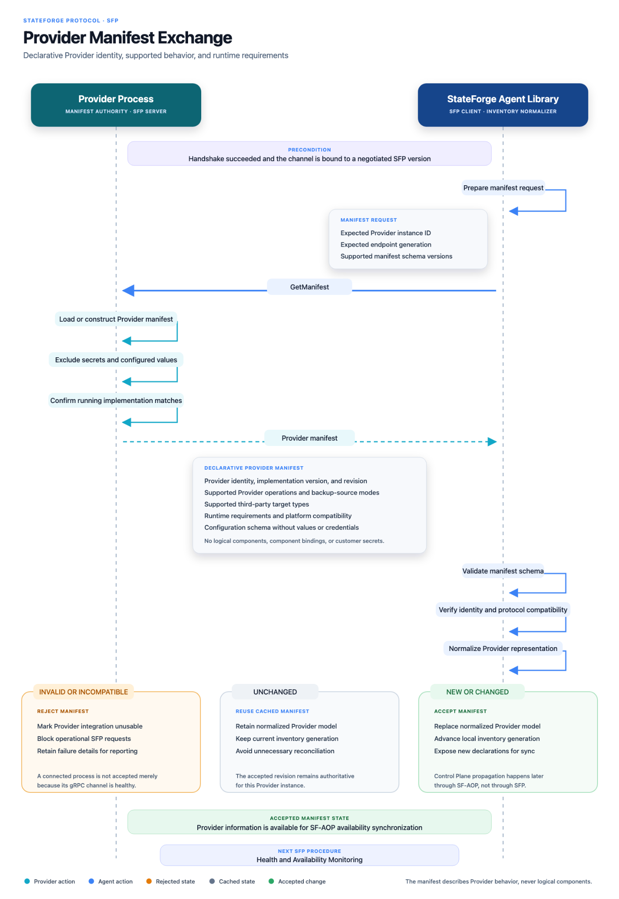

# Provider manifest exchange

After a successful handshake, the Agent retrieves the Provider's effective
manifest over the negotiated SFP service. The exchange confirms identity,
manifest schema compatibility, operations, contracts, triggers, target kinds,
runtime requirements, and configuration schema without transferring secrets.

_Select the diagram to open the full-resolution version._
