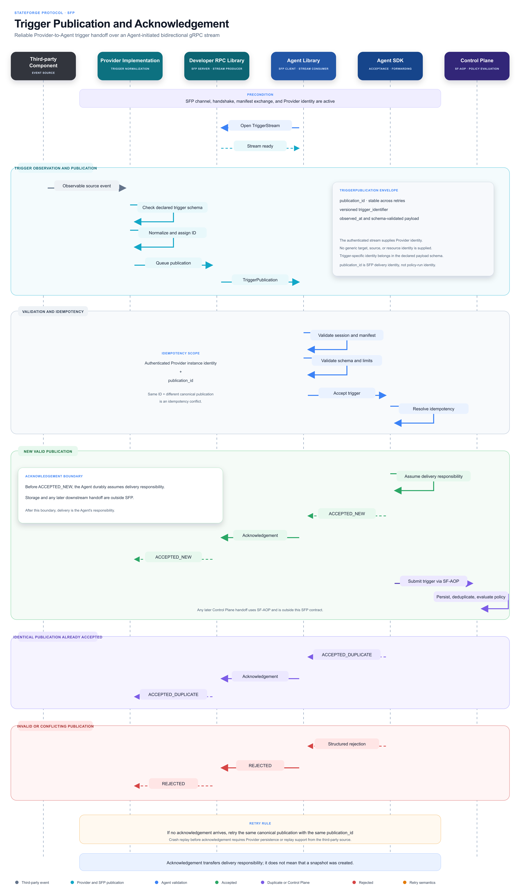

# Trigger publication and acknowledgement

The Agent opens a long-lived bidirectional SFP stream. The Provider publishes
normalized, manifest-declared trigger events on that stream, and the Agent
returns one terminal acknowledgement for every received publication. This
procedure transfers delivery responsibility to the Agent; policy evaluation
and any later Control Plane delivery are outside SFP.

_Select the diagram to open the full-resolution version._

## Trigger declarations and payload schemas

Every publishable trigger is declared in the accepted
`ProviderManifest.triggers` map. Its key is a versioned identifier such as
`stateforge.git/reference.changed@1`, and its `payload_schema` is a JSON Schema
Draft 2020-12 object schema.

The publication's `trigger_identifier` must exactly match one of those keys.
The identifier's `@major` component identifies the trigger contract major, and
the stream's bound `manifest_revision` selects the exact declaration and schema
snapshot. A publication therefore has no separate `schema_version` field:
implementers must not guess which schema applies or negotiate one independently
of the manifest.

The Provider validates and normalizes its payload before publishing. The Agent
independently validates the decoded payload against the exact schema from the
accepted manifest revision. Trigger-specific source or resource identity, when
the trigger needs it, is a typed field inside that schema-bound payload. SFP
does not define a generic source, target, resource, project, or component field.

## Stream establishment

The Agent calls `TriggerPublicationService.StreamTriggers` on the existing SFP
channel. The directions intentionally follow gRPC client/server ownership:

- Agent-to-Provider messages are `StreamTriggersRequest` values containing the
  initial `open` message and later acknowledgements.
- Provider-to-Agent messages are `StreamTriggersResponse` values containing the
  initial `ready` message and later publications.

The first Agent message must be `TriggerStreamOpen`; the first Provider message
must be `TriggerStreamReady`. The binding fences the stream to the authenticated
Provider installation, endpoint generation, handshake session, and exact
accepted manifest revision. Empty values are invalid rather than wildcards.
The Provider echoes all four binding values in `ready`; any mismatch terminates
the stream with `FAILED_PRECONDITION`.

The Agent also supplies a receive window from 1 through 1024. The Provider
selects an equal or smaller positive `maximum_in_flight_publications`. Once that
many publications await acknowledgement, the Provider stops sending and lets
gRPC backpressure propagate to its internal publication queue.

## Trigger publication fields

| Field | Meaning |
| --- | --- |
| `publication_id` | Provider-generated lowercase UUIDv4 that identifies one logical publication and remains unchanged across retries. |
| `trigger_identifier` | Exact versioned key from the accepted `ProviderManifest.triggers` map; this selects the declared payload schema. |
| `observed_at` | UTC time at which the Provider observed the source event. It is not a trusted ordering authority across Providers or sessions. |
| `payload` | Trigger-specific normalized object validated against the selected declaration's JSON Schema. |

The authenticated stream supplies Provider identity. The Provider cannot
override that identity in the publication envelope. A generic
`source_identity` is deliberately absent; any identity required by a particular
trigger belongs in that trigger's payload schema.

## Validation and canonical equality

The Agent processes each publication in this order:

1. Validate the protobuf message, required values, timestamps, and protocol
   limits.
2. Resolve the idempotency key from the authenticated Provider instance identity
   and `publication_id`.
3. If that key was already accepted, compare the stored canonical publication.
   Return `ACCEPTED_DUPLICATE` for identical content or reject an altered reuse
   as `IDEMPOTENCY_CONFLICT`.
4. For a new identity, require the exact `trigger_identifier` in the stream's
   accepted manifest revision and validate `payload` against its schema.
5. Atomically record the accepted publication and assume delivery
   responsibility before returning `ACCEPTED_NEW`.

Canonical publication content is the RFC 8785 canonical JSON object formed from
the decoded ProtoJSON fields `triggerIdentifier`, `observedAt`, and `payload`.
It excludes `publicationId`, Provider/session identity, endpoint generation,
manifest revision, transport framing, and acknowledgement data. Equal content
therefore remains a duplicate after reconnect or Agent restart; changing any
canonical field while reusing the identity is a conflict.

## Acknowledgements and rejections

| Disposition | Meaning |
| --- | --- |
| `ACCEPTED_NEW` | A new valid publication was durably accepted, and the Agent assumed delivery responsibility before acknowledging it. |
| `ACCEPTED_DUPLICATE` | The same Provider installation and publication identity were already accepted with identical canonical content. No second trigger is created. |
| `REJECTED` | The publication was not accepted. A structured rejection supplies the stable reason and retry guidance. |

Acknowledgements carry `publication_id`, so the Agent may acknowledge different
publications out of transmission order. A rejected acknowledgement contains
exactly one of these stable reasons:

| Rejection reason | Retry guidance |
| --- | --- |
| `INVALID_PUBLICATION` | Correct the malformed or out-of-bounds publication; an unchanged retry is not useful. |
| `TRIGGER_NOT_DECLARED` | Refresh/re-negotiate the manifest or correct the identifier; an unchanged retry on this stream is not useful. |
| `PAYLOAD_SCHEMA_VIOLATION` | Correct the payload; an unchanged retry is not useful. |
| `IDEMPOTENCY_CONFLICT` | Allocate a new publication identity only for a genuinely different logical event; the conflicting reuse is not retryable. |
| `AGENT_CAPACITY_EXHAUSTED` | Retry the same canonical publication later, optionally after the bounded `retry_after` delay. |
| `DELIVERY_RESPONSIBILITY_UNAVAILABLE` | Retry unchanged after the Agent can durably assume responsibility. |

`retry_after` is present only when `retryable` is true and the Agent has bounded
guidance. Human-readable explanations are sanitized diagnostics, never
machine-readable discriminators.

## Delivery responsibility, retry, and replay

`ACCEPTED_NEW` is the responsibility boundary. Before sending it, the Agent
must durably ensure that it owns subsequent delivery. How the Agent persists or
hands off the trigger is an implementation decision outside this SFP procedure.
Acknowledgement does not mean that a backup, snapshot, policy run, or business
action has completed.

If no acknowledgement arrives, the Provider retries the same canonical content
with the same `publication_id`. Durable Provider persistence is optional, but a
Provider that promises crash replay must persist its unacknowledged publication
or be able to reconstruct it from the third-party source. Delivery
deduplication does not provide exactly-once business execution.

Ordering is defined only for messages as observed on one stream. Publications
may be processed and acknowledged independently, and ordering across Providers,
sessions, or trigger identifiers is undefined. Consumers must use
trigger-specific payload fields if domain ordering matters.

## Limits and stream failures

The following limits are part of this contract:

- each Agent-to-Provider stream message: at most 64 KiB serialized;
- each Provider-to-Agent stream message: at most 2 MiB serialized;
- canonical payload JSON: at most 1 MiB, nesting depth 64, at most 256 members
  per object or items per array, and property names at most 128 UTF-8 bytes;
- versioned trigger identifier: at most 255 UTF-8 bytes;
- opaque session identifier: at most 255 UTF-8 bytes;
- sanitized rejection explanation: at most 1024 UTF-8 bytes;
- `retry_after`: positive and no greater than 24 hours.

Invalid stream framing or malformed bounds use `INVALID_ARGUMENT`; inactive or
mismatched bindings use `FAILED_PRECONDITION`; reuse of an active session for a
second trigger stream uses `ALREADY_EXISTS`; stream-level capacity exhaustion
uses `RESOURCE_EXHAUSTED`; and loss of the bound session uses `UNAVAILABLE`.
Individual validly framed publication failures use `REJECTED` without ending an
otherwise healthy stream.

## Responsibilities and privacy

The Provider implementation observes third-party events and produces the
trigger-specific normalized payload. The Developer RPC Library verifies the
declaration, schema, bounds, and queue before serializing it. The Agent Library
validates session and manifest fencing, schema, idempotency, and flow control.
The Agent SDK owns the durable delivery responsibility established by
`ACCEPTED_NEW`.

Trigger declarations and publications must not contain credentials or secrets.
Payload schemas should include only data required by the declared trigger.
Rejections must not echo raw payloads, stack traces, credentials, or unnecessary
customer data.
