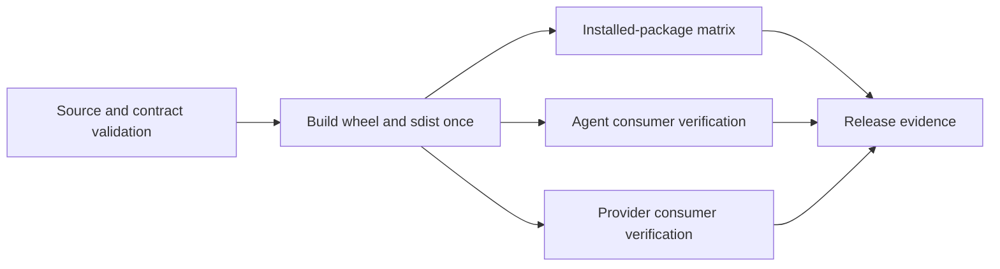

# CI/CD and artifact verification

StateForge Protocol automation builds one immutable Python distribution and
uses those exact bytes for installed-package and consumer verification. Pull
requests, integration pushes, and release-candidate runs share the same
repository-local actions and reusable workflows.

## Pipeline



| Layer | Location | Responsibility |
| --- | --- | --- |
| Contract validation | `.github/actions/contracts/validate` | Buf lint and format, deterministic generation, compatibility, fixtures, and the complete contract suite |
| Package build | `.github/actions/python/build` | Build one wheel and one source distribution and record hashes and source provenance |
| Installed verification | `.github/actions/python/test-installed` | Verify and install the downloaded artifact outside the checkout |
| Consumer verification | `.github/workflows/protocol-consumer-test.yml` | Run independent Agent and Provider suites against the exact built Protocol wheel |
| Ownership audit | `scripts/ci/audit_consumer.py` | Reject private validation imports and copied normative Protocol identities or limits |
| Evidence collection | `.github/actions/evidence/collect` | Bound logs and record a small allow-listed runner summary |
| Reusable workflows | `.github/workflows/protocol-*.yml` | Compose source, build, installed, and consumer verification jobs |
| Entry workflows | `protocol-ci.yml`, `protocol-release-candidate.yml` | Select event-specific artifact names, retention, concurrency, and compatibility baselines |

## Exact-artifact handoff

`protocol-build.yml` is the only build owner. It uploads one immutable artifact
containing the wheel, source distribution, `SHA256SUMS`, and a readable
`PROVENANCE` record. Installed and consumer jobs download that artifact, verify
its hashes, and install the recorded wheel. They never rebuild it.

The installed-package matrix verifies distribution metadata, `py.typed`, all
generated protobuf and gRPC modules, public contract modules, validation
schemas, and packaged conformance fixtures without a repository `PYTHONPATH`.
It runs against every supported Python and runner combination.

Agent and Provider verification first resolve each requested consumer ref to
one immutable commit. Both consumers install the exact Protocol wheel, run
their complete configured quality suites, and retain the wheel digest and
resolved consumer identity as evidence.

## Portable build action

Another repository may invoke the package action directly. The consumer owns
revision selection and checks out Protocol below its workspace. The action
always resolves and builds the checkout containing the action:

```yaml
- uses: actions/checkout@<immutable-sha>
  with:
    repository: stateforge-org/stateforge-protocol
    ref: <protocol-ref-or-commit>
    path: .stateforge-ci/protocol
    persist-credentials: false

- uses: ./.stateforge-ci/protocol/.github/actions/python/build
  with:
    output-directory: dist/protocol
    evidence-directory: evidence/protocol-build
```

Both destination paths are normalized within the caller workspace before the
source build begins. `PROVENANCE` records the exact commit and ref from the
Protocol checkout, never the consuming repository.

## Reusable workflow interfaces

- `protocol-build-and-verify.yml` accepts `artifact-name`,
  `breaking-against`, and `retention-days`; it returns `artifact-name`,
  `version`, and `wheel-sha256`.
- `protocol-build.yml` accepts artifact and evidence names plus retention; it
  returns the exact build identity.
- `protocol-installed-test.yml` accepts the artifact name produced by the
  build workflow plus an evidence prefix and retention.
- `protocol-consumer-test.yml` accepts the exact artifact name, Agent and
  Provider refs, an evidence prefix, and retention.
- `protocol-source-verify.yml` accepts the Buf comparison source plus an
  evidence name and retention.

Pull requests and integration pushes retain artifacts for seven days. Manual
release-candidate runs default to 30 days. Source, build, installed, and
consumer jobs upload bounded evidence even when an earlier check fails.

## Workflow security

Workflows use read-only repository permissions, pin external actions to full
commit SHAs, disable persisted checkout credentials, set job timeouts, and key
Python caches from `pyproject.toml`. Actionlint validates workflow syntax.
Zizmor blocks medium- or high-severity findings without receiving a GitHub
token.

Evidence uploads contain bounded logs and a small allow-listed runner summary.
They never dump the process environment or arbitrary workspace contents.

## Local parity

After installing the `dev` and `docs` dependency groups, run:

```bash
GOBIN="$(pwd)/.cache/actionlint" \
  go install github.com/rhysd/actionlint/cmd/actionlint@v1.7.12
./.cache/actionlint/actionlint
zizmor --offline --persona auditor --min-severity medium .
buf lint
buf format --diff --exit-code
python scripts/check_generated.py
buf breaking --against '.git#branch=origin/mvp/implementation'
python -m ruff format --check .
python -m ruff check .
python -m mypy src
python -m pytest
python -m build
python -m mkdocs build --strict
```

The installed-package verifier, consumer verifier, and ownership auditor are
CI tools for validating exact artifacts and independent repositories. Their
source behavior is covered by the repository test suite; the cross-repository
consumer workflow is the release evidence for real consumer compatibility.
