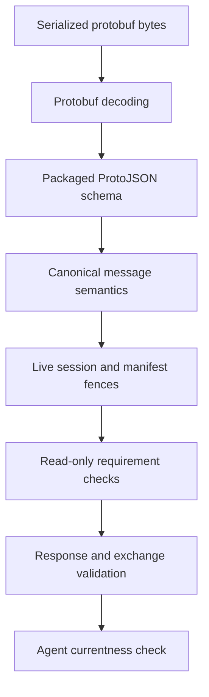

# Capability assessment

Capability Assessment asks a Provider whether its **current runtime** can
support a set of manifest-declared operations. It evaluates dynamic facts such
as filesystem access, permissions, installed tooling, and vendor state without
executing the operations or modifying the inspected environment.

The Agent calls this procedure only through a current, available Provider
session. Each response is a point-in-time evidence snapshot: useful for
planning, but never authorization or a promise that later admission will
succeed.

## Capability assessment at a glance

The Agent asks about manifest-declared operations. The Provider evaluates their
declared requirement checks against the current target and returns a bounded,
point-in-time evidence snapshot.

```stateforge-entity-flow
source: capability-assessment-overview.yaml
```

## Interactive walkthrough

```stateforge-procedure
source: capability-assessment.yaml
scenario: success
```

??? info "Capability assessment sequence"

    ```mermaid
    sequenceDiagram
        participant Agent as StateForge Agent
        participant Service as Capability Service
        participant Checks as Requirement Checks
        participant Runtime as Runtime Context

        Note over Agent,Service: Current session, accepted manifest, Provider SERVING
        Agent->>Service: AssessCapabilities(request)
        Service->>Service: Validate request and live fences
        Service->>Checks: Run distinct declared checks
        Checks->>Runtime: Read-only inspection
        Runtime-->>Checks: Point-in-time evidence
        Checks-->>Service: Typed outcomes
        Service->>Service: Normalize ordered findings
        Service-->>Agent: AssessCapabilitiesResponse
        Agent->>Agent: Validate exchange and currentness

        alt Requirement unsatisfied
            Agent->>Agent: Retain SUPPORTED_WITH_REQUIREMENTS
        else Runtime incompatible
            Agent->>Agent: Retain UNSUPPORTED
        else Evidence inconclusive
            Agent->>Agent: Retain INDETERMINATE
        else All requirements satisfied
            Agent->>Agent: Retain SUPPORTED
        end
    ```

## Who implements Capability Assessment

The [StateForge Provider Python](https://github.com/stateforge-org/stateforge-provider-python)
framework hosts the service and turns Provider-authored requirement checks into
canonical findings. A Provider author declares **what must be checked** and
returns a typed outcome; the framework owns discovery, manifest publication,
deduplication, execution, normalization, and gRPC error handling.

The StateForge Agent selects operations from its accepted manifest, supplies
the active session fences, validates the complete exchange, and retains only
evidence whose session, manifest, availability generation, operation set, and
execution context remain current.

Use `stateforge-protocol` directly when implementing another Agent or Provider
runtime, or when building conformance tooling.

## Declaring runtime requirements in a Provider

Static requirement metadata is published in the Provider manifest. The check
itself evaluates the runtime only when Capability Assessment is requested.

```python
import os
from pathlib import Path

from stateforge_provider import (
    Provider,
    ProviderModel,
    RequirementCheckResult,
    operation,
    requirement_check,
)


class WriteRequest(ProviderModel):
    content: str


class WriteResult(ProviderModel):
    bytes_written: int


class ExampleProvider(Provider):
    @requirement_check(
        "example.runtime.var_write",
        "The Provider can write to /var/lib/example",
    )
    async def can_write_state(self) -> RequirementCheckResult:
        directory = Path("/var/lib/example")
        if directory.is_dir() and os.access(directory, os.W_OK):
            return RequirementCheckResult.satisfied()
        return RequirementCheckResult.unsatisfied(
            "The state directory is not writable"
        )

    @operation(
        "example.runtime/state.write@1",
        requires=("example.runtime.var_write",),
    )
    async def write_state(self, request: WriteRequest) -> WriteResult: ...
```

The operation names the check by its stable identifier. The framework runs a
shared check at most once per assessment even when several requested
operations require it.

| Author result | Normalized operation finding |
| --- | --- |
| Every check is `satisfied()` | `SUPPORTED` |
| Any check is `unsatisfied()` and none is stronger | `SUPPORTED_WITH_REQUIREMENTS` |
| Any check is `incompatible()` | `UNSUPPORTED` |
| Any check is `unknown()` and none is incompatible | `INDETERMINATE` |

When multiple checks differ, StateForge Provider Python applies this
precedence: **incompatible → unknown → unsatisfied → satisfied**. Explanations
must be bounded, sanitized, and safe to return to the Agent.

## Using the Python wire contract

Install the generated Protocol package:

```console
python -m pip install stateforge-protocol
```

### Contract sources

| Source | Responsibility |
| --- | --- |
| [`capability_assessment.proto`](https://github.com/stateforge-org/stateforge-protocol/blob/mvp/implementation/proto/stateforge_protocol/sfp/capability_assessment/v1/capability_assessment.proto) | Owns messages, enums, field numbers, the service, and `AssessCapabilities`. |
| [`capability_assessment.schema.json`](https://github.com/stateforge-org/stateforge-protocol/blob/mvp/implementation/src/stateforge_protocol/sfp/capability_assessment/v1/capability_assessment.schema.json) | Validates the complete ProtoJSON request and response shapes, field bounds, and finding-state invariants. |
| [`contract.py`](https://github.com/stateforge-org/stateforge-protocol/blob/mvp/implementation/src/stateforge_protocol/sfp/capability_assessment/v1/contract.py) | Exposes the canonical service identity, message limits, assessment bounds, and reusable reason codes. |
| [`validation.py`](https://github.com/stateforge-org/stateforge-protocol/blob/mvp/implementation/src/stateforge_protocol/sfp/capability_assessment/v1/validation.py) | Validates requests, responses, request/response correlation, uniqueness, and complete ordered finding coverage. |
| Generated `capability_assessment_pb2` and `capability_assessment_pb2_grpc` | Supply Python messages, enums, client stubs, server interfaces, and registration helpers. |

Generated protobuf classes enforce wire types. They do **not** enforce the
complete StateForge semantic contract. Independent implementations must call
the public Protocol validators before trusting decoded messages.

### Python API surface

| Purpose | Python API |
| --- | --- |
| Request and response messages | `capability_assessment_pb2.AssessCapabilitiesRequest` and `AssessCapabilitiesResponse` |
| Support and requirement states | `capability_assessment_pb2.SupportState` and `RequirementState` |
| Asynchronous client | `capability_assessment_pb2_grpc.CapabilityAssessmentServiceStub` |
| Server interface and registration | `CapabilityAssessmentServiceServicer` and `add_CapabilityAssessmentServiceServicer_to_server` |
| Stable limits and reason codes | `stateforge_protocol.sfp.capability_assessment.v1.contract` |
| Canonical validation | `stateforge_protocol.sfp.capability_assessment.v1.validation` |

```python
from uuid import uuid4

from google.protobuf import struct_pb2
from stateforge_protocol.sfp.capability_assessment.v1 import (
    capability_assessment_pb2,
    capability_assessment_pb2_grpc,
    validation,
)

request = capability_assessment_pb2.AssessCapabilitiesRequest(
    assessment_request_id=str(uuid4()),
    expected_provider_instance_id=provider_instance_id,
    expected_endpoint_generation=endpoint_generation,
    expected_session_id=session_id,
    expected_manifest_revision=manifest_revision,
    execution_context=struct_pb2.Struct(),
    operation_identifiers=("example.runtime/state.write@1",),
)
validation.validate_assess_capabilities_request(request)

stub = capability_assessment_pb2_grpc.CapabilityAssessmentServiceStub(channel)
response = await stub.AssessCapabilities(request, timeout=5.0)
validation.validate_assessment_exchange(request, response)
```

The caller still owns transport byte limits, a finite deadline, and checks
that depend on the live session, accepted manifest, availability, or local
policy.

## Wire contract

Capability Assessment is one unary RPC on the active SFP channel:

```text
/stateforge.sfp.capability_assessment.v1.CapabilityAssessmentService/AssessCapabilities
```

The Agent calls it after Bootstrap, manifest acceptance, and Provider Health
have established a current available session.

### Request

| Field | Meaning |
| --- | --- |
| `assessment_request_id` | Agent-minted canonical UUIDv4 for this exact semantic request. An unchanged retry may reuse it; changed content requires a new identity. |
| `expected_provider_instance_id` | Provider installation identity copied from the active session. |
| `expected_endpoint_generation` | Positive endpoint generation copied from the active session. |
| `expected_session_id` | Exact negotiated session fence. Instance and generation alone do not identify one handshake session. |
| `expected_manifest_revision` | Revision of the manifest the Agent accepted and used to select operations. |
| `execution_context` | Bounded, non-secret situational metadata. It is not Provider configuration or an operation invocation payload. |
| `operation_identifiers` | Nonempty ordered collection of unique `namespace/name@major` identifiers declared by the accepted manifest. |

Operation-specific resource input belongs to the operation's declared
`input_schema` and its later invocation. Capability Assessment does not carry
a generic target configuration and does not pre-validate a future operation
payload.

### Response envelope

=== "Field reference"

    | Field | Meaning |
    | --- | --- |
    | `assessment_request_id` | Echo of the request identity. |
    | `provider_instance_id`, `endpoint_generation`, `session_id` | Echoed session fences that must match the request. |
    | `manifest_revision` | Exact declaration revision used for the assessment. |
    | `assessment_id` | New Provider-minted UUIDv4 for this produced snapshot; never derived from the request identity. |
    | `assessment_timestamp` | Provider-clock capture time. It is evidence metadata, not trusted cross-Provider ordering. |
    | `findings` | Exactly one finding per requested operation, in request order. Consumers still correlate by identifier. |

=== "Example ProtoJSON"

    ``` { .json .annotate title="AssessCapabilitiesResponse" }
    {
      "assessmentRequestId": "3fa85f64-5717-4562-b3fc-2c963f66afa6 (1)",
      "providerInstanceId": "550e8400-e29b-41d4-a716-446655440000",
      "endpointGeneration": "4",
      "sessionId": "session-3d19b6d2-4b7b-4f4a-9c9a-2f3f4f0c9a1b (2)",
      "manifestRevision": "sha256:dd58cd0518f631e370a095e6ba0c97476b028c8c65fac1f4b8da28d130c94cb7",
      "assessmentId": "6ba7b810-9dad-41d1-80b4-00c04fd430c8 (3)",
      "assessmentTimestamp": "2026-09-16T07:30:00Z",
      "findings": [
        {
          "operationIdentifier": "stateforge.git/reference.resolve@1",
          "supportState": "SUPPORT_STATE_SUPPORTED (4)",
          "requirementFindings": [],
          "reasons": [],
          "constraints": []
        },
        {
          "operationIdentifier": "stateforge.git/branch.list@1",
          "supportState": "SUPPORT_STATE_SUPPORTED_WITH_REQUIREMENTS (5)",
          "requirementFindings": [
            {
              "requirementId": "stateforge.capability_assessment.v1.tooling_version",
              "state": "REQUIREMENT_STATE_UNKNOWN",
              "description": "Vendor tooling version could not be determined.",
              "versionConstraint": ">=2.30"
            }
          ],
          "reasons": [],
          "constraints": [
            {
              "constraintId": "stateforge.capability_assessment.v1.read_only_window",
              "value": "",
              "explanation": "Only usable during the nightly maintenance window."
            }
          ]
        }
      ]
    }
    ```

    1.  Echoes the request identity so the Agent can correlate the exchange.
    2.  Completes the echoed session fence together with the Provider instance
        and endpoint generation.
    3.  Identifies this new point-in-time evidence snapshot.
    4.  Reports that current evidence satisfies every declared requirement.
    5.  Keeps unmet or unknown requirements and active constraints attached to
        the affected operation.

### Finding states

| State | Meaning |
| --- | --- |
| `SUPPORTED` | Current evidence supports the operation and contains no unmet or unknown requirement. |
| `SUPPORTED_WITH_REQUIREMENTS` | Support depends on at least one unmet or unknown requirement, or an explicit constraint. |
| `UNSUPPORTED` | Current evidence proves the operation is not supported. |
| `INDETERMINATE` | Available evidence cannot establish support or non-support. |

All four are successful domain results. A request for several operations may
return a different state for each operation.

### Finding details

| Detail | Machine-readable identity | Human-readable context | Required rule |
| --- | --- | --- | --- |
| Requirement | `requirement_id` | `description` plus optional `version_constraint` | State is `SATISFIED`, `UNSATISFIED`, or `UNKNOWN`. |
| Reason | `reason_code` | `explanation` | Required for `UNSUPPORTED` and `INDETERMINATE`. |
| Constraint | `constraint_id` plus `value` | `explanation` | May justify `SUPPORTED_WITH_REQUIREMENTS`. |

Identifiers are extensible dotted names, not closed enums. Explanations are
diagnostic text and must never be used as machine-readable discriminators.

### Reason-code vocabulary

Providers should reuse these canonical codes when they fit. Provider-specific
codes use the Provider's own `provider_identity` namespace.

| Reason code | Meaning |
| --- | --- |
| `stateforge.capability_assessment.v1.access_denied` | Evidence could not be read because access was denied. |
| `stateforge.capability_assessment.v1.permission_uncertain` | Required permissions could not be established. |
| `stateforge.capability_assessment.v1.unsupported_vendor_state` | The current vendor-side state does not support the operation. |
| `stateforge.capability_assessment.v1.insufficient_evidence` | Inspection could not gather enough evidence to decide. |
| `stateforge.capability_assessment.v1.requirement_unmet` | A declared runtime prerequisite is not met. |

## Structural and semantic validation

Validation is layered. Passing an earlier layer never skips the layers after
it.



| Owner | Validates |
| --- | --- |
| Protobuf runtime | Wire types and decodability. |
| Packaged schema | Required ProtoJSON fields, identifier shapes, enum values, collection bounds, and finding-state invariants. |
| `validation.py` | Canonical UUIDs and generations, execution-context depth, uniqueness, request/response correlation, and exact ordered finding coverage. |
| Provider runtime | Active session, current manifest revision, declared operations, Provider readiness, author hook execution, and response byte limit. |
| Agent runtime | Accepted manifest membership, finite deadline, retries, current availability generation, exact-scope caching, and post-call currentness. |

The schema validates lowerCamelCase ProtoJSON produced with
`always_print_fields_with_no_presence=True`. Empty proto3 defaults are not
wildcards. A missing identity, generation zero, an `UNSPECIFIED` enum, an
empty operation set, or a missing findings collection is invalid.

### Finding invariants

| Finding | Required relationship |
| --- | --- |
| `SUPPORTED` | No requirement may be `UNSATISFIED` or `UNKNOWN`. |
| `SUPPORTED_WITH_REQUIREMENTS` | At least one requirement is `UNSATISFIED` or `UNKNOWN`, or at least one constraint exists. |
| `UNSUPPORTED` | At least one machine-readable reason exists. |
| `INDETERMINATE` | At least one machine-readable reason exists. |
| Every response | Finding identifiers are unique and cover every requested operation exactly once, in request order. |

Requirement IDs, reason codes, and constraint IDs are each unique within one
operation finding.

### Resource limits

| Resource | Maximum |
| --- | ---: |
| Serialized request | 8 MiB |
| Serialized response | 16 MiB |
| `execution_context` nesting depth | 64 containers |
| Entries in each execution-context object or array | 32 |
| Execution-context property name | 128 characters |
| Execution-context string value | 2,048 characters |
| Requested operations | 64 unique identifiers |
| Requirement findings per operation | 64 |
| Reasons per operation | 16 |
| Constraints per operation | 32 |
| Explanation | 1,024 characters |
| Requirement description | 2,048 characters |
| Version constraint | 255 characters |
| Constraint value | 512 characters |

Serialized byte limits remain independent of field limits. A structurally
valid message containing multibyte text can still exceed its wire limit.

## Evidence lifetime and reuse

The Agent may reuse an assessment only when every part of its scope still
matches:

| Scope part | Required match |
| --- | --- |
| Provider | Same `provider_instance_id`. |
| Endpoint | Same `endpoint_generation`. |
| Session | Same `session_id`. |
| Declaration | Same `manifest_revision`. |
| Availability | Same `availability_generation`; any Health transition invalidates the snapshot. |
| Operations | Same identifiers in the same order. |
| Runtime context | Same deterministic `execution_context` hash. |

!!! important "Reuse rule"

    A change to any row invalidates the cached evidence. The Agent must run a new
    assessment.

Cache reuse avoids repeating the same inspection. It does not authorize later
operation admission. The Provider keeps no persistent idempotency ledger for this
read-only RPC: reusing `assessment_request_id` correlates an unchanged retry, but
the Provider may mint a new `assessment_id` and report newer evidence on every
call.

## Failures, deadlines, and retries

| Outcome | Required behavior |
| --- | --- |
| Malformed fields, duplicate operations, invalid identifiers, or excessive context nesting | `INVALID_ARGUMENT`; correct the request before retrying. |
| Inactive session, mismatched identity or generation, stale manifest revision, or undeclared operation | `FAILED_PRECONDITION`; reconnect or refresh the manifest before building a new request. |
| Request or response exceeds its serialized limit | `RESOURCE_EXHAUSTED`. |
| Provider is not ready before or after inspection | `UNAVAILABLE`; retry only while the captured lease remains current. |
| Deadline expires or caller cancels | `DEADLINE_EXCEEDED` or `CANCELLED`; stop inspection where possible and return no partial result. |
| Requirement-check hook fails or the Provider cannot construct a valid response | Sanitized `INTERNAL`; log implementation details only inside the Provider. |
| Access denial, unmet permissions, incompatibility, or inconclusive inspection for one operation | A normalized finding, not an RPC failure. |

The Agent supplies a finite deadline. Automatic retries are bounded and apply
only to temporary `UNAVAILABLE` failures. Before every attempt and before
accepting a response, the Agent confirms the session and availability
generation are still current.

## What an assessment proves

| It does | It does not |
| --- | --- |
| Report current Provider evidence for requested declared operations. | Authorize or admit an operation. |
| Distinguish supported, conditionally supported, unsupported, and unknown. | Reserve Provider capacity or create a lease. |
| Describe requirements, reasons, and constraints with stable identifiers. | Validate a future operation payload. |
| Allow fresh reassessment after the runtime changes. | Guarantee the same result at later admission or execution time. |

Operation Admission must independently validate the current request and its
current prerequisites. Capability Assessment remains read-only evidence.
