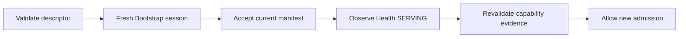

# Disconnection and recovery

Recovery establishes a fresh trusted session, then resumes from state the
Provider can still prove. A lost RPC can make an operation outcome unknown; it
cannot roll work back, mark it failed, or authorize a second execution.

## Recovery at a glance

The channel is only the transport. Admitted work and retained protocol state
have their own lifetimes.

```stateforge-entity-flow
source: disconnection-recovery-overview.yaml
```

## Interactive walkthrough

Choose a scenario to inspect reconnect identity, replacement, missing state,
lost replies, cursor recovery, trigger replay, and stale-session fencing.

```stateforge-procedure
source: disconnection-recovery.yaml
scenario: same-process-reconnect
```

??? abstract "Recovery sequence"

    ```mermaid
    sequenceDiagram
        participant Provider as Provider Runtime
        participant State as Retained State
        participant Agent as StateForge Agent

        Provider--xAgent: Active channel closes
        Agent->>Agent: Set UNKNOWN and stop new admission
        Note over Provider,State: Existing work and retained state do not change

        Agent->>Provider: Reconnect and run Handshake
        Provider-->>Agent: Current identity and fresh session
        Agent->>Agent: Classify identity transition
        Agent->>Provider: GetManifest and start Health Watch
        Provider-->>Agent: Accepted manifest and SERVING

        alt Continuity may be proven
            Agent->>Provider: Resolve admission and resume Watch
            State-->>Agent: Retained current evidence
            Provider-->>Agent: Identical pending trigger replay
        else Prior state cannot be proven
            Provider-->>Agent: Explicit unavailable or expired reason
            Agent->>Agent: Preserve indeterminate outcome
        end
    ```

## Who implements recovery

The Agent owns reconnect deadlines, bounded backoff, endpoint rediscovery,
fresh qualification, saved cursors, and the decision to stop admission while
availability is unknown.

The Provider owns its retained operation records, lifecycle snapshots,
terminal results, and unacknowledged trigger publications. Persistence across
a process restart is optional, but any state claimed after restart must retain
its original identity and ordering.

The Protocol package classifies validated identity transitions. The actual
state reconciliation remains in Operation Admission, Operation Lifecycle, and
Trigger Publication; recovery defines no additional RPC.

## Using the Python contract

### Contract sources

| Source | Responsibility |
| --- | --- |
| [`recovery.py`](https://github.com/stateforge-org/stateforge-protocol/blob/mvp/implementation/src/stateforge_protocol/sfp/recovery.py) | Defines the identity snapshot, transition classes, and context-independent classifier. |
| [Endpoint Discovery contract](https://github.com/stateforge-org/stateforge-protocol/blob/mvp/implementation/src/stateforge_protocol/sfp/endpoint_discovery/v1/contract.py) | Owns endpoint-generation validity. |
| [Bootstrap contract](https://github.com/stateforge-org/stateforge-protocol/blob/mvp/implementation/src/stateforge_protocol/sfp/bootstrap/v1/contract.py) | Owns session-identifier limits and fresh-session semantics. |
| [Operation Admission validation](https://github.com/stateforge-org/stateforge-protocol/blob/mvp/implementation/src/stateforge_protocol/sfp/operation_admission/v1/validation.py) | Validates safe resolution of uncertain admission. |
| [Operation Lifecycle validation](https://github.com/stateforge-org/stateforge-protocol/blob/mvp/implementation/src/stateforge_protocol/sfp/operation_lifecycle/v1/validation.py) | Validates resumed cursors, snapshot continuity, cancellation decisions, and terminal replay. |
| [Trigger Publication validation](https://github.com/stateforge-org/stateforge-protocol/blob/mvp/implementation/src/stateforge_protocol/sfp/trigger_publication/v1/validation.py) | Validates stream rebinding and immutable publication replay. |

There is no `disconnection_recovery.proto`, service, `contract.py`, or
`validation.py`. Recovery composes the procedures above; `recovery.py` only
classifies facts from two sessions that have already passed their owning
contracts.

### Classify a reconnect

```python
from uuid import UUID

from stateforge_protocol.sfp.recovery import (
    EndpointSessionIdentity,
    RecoveryKind,
    classify_recovery,
)

previous = EndpointSessionIdentity(
    provider_instance_id=UUID("11111111-1111-4111-8111-111111111111"),
    endpoint_generation=42,
    provider_runtime_id=UUID("33333333-3333-4333-8333-333333333333"),
    session_id="session-42",
)
current = EndpointSessionIdentity(
    provider_instance_id=previous.provider_instance_id,
    endpoint_generation=43,
    provider_runtime_id=previous.provider_runtime_id,
    session_id="session-43",
)

transition = classify_recovery(previous, current)
assert transition is RecoveryKind.ENDPOINT_REPLACED
assert transition.may_reconcile_previous_state
assert transition.requires_resolve_only
```

`classify_recovery` does not open a channel or prove that a record exists. It
classifies continuity after both endpoint/session identities have already been
validated.

## Rebuild trust in order

Transport reconnection alone never makes a Provider available.



| Gate | What becomes current |
| --- | --- |
| Endpoint | Provider instance, endpoint generation, socket, and runtime candidate |
| Bootstrap | Negotiated version and a fresh session identity |
| Manifest | Declarations accepted for that session and generation |
| Health | Process-wide readiness observed on a new Watch |
| Capability evidence | Runtime-dependent operation support invalidated by the prior availability generation |

An unchanged manifest revision may avoid revalidating the declaration body,
but it never bypasses the current response envelope, session, generation, or
Health gates.

## Classify identity continuity

The four identity fields answer different questions:

| Field | Question answered |
| --- | --- |
| `provider_instance_id` | Is this the same Provider installation? |
| `endpoint_generation` | Is this the same published endpoint generation? |
| `provider_runtime_id` | Is this the same running Provider process? |
| `session_id` | Is this message bound to the newly negotiated session? |

| Valid transition | Identity change | Prior state may be reconciled? | Uncertain admission mode |
| --- | --- | --- | --- |
| `SAME_PROCESS_RECONNECT` | New session only | Yes | `ADMIT_OR_RESOLVE` remains safe on the same live generation |
| `ENDPOINT_REPLACED` | Greater generation, same runtime | Yes, when retained | `RESOLVE_ONLY` |
| `PROCESS_RESTARTED` | Greater generation and new runtime | Only from trustworthy restored state | `RESOLVE_ONLY` |
| `INSTALLATION_REPLACED` | Different Provider instance | No | Do not send the old operation as recovery |

!!! danger "Not a recovery transition"

    Reusing the previous session, moving generation backward, or changing the
    runtime without changing generation raises `RecoveryContractError`.
    Reconciliation must stop.

## Fence the old channel

After the fresh Handshake, every request uses the new session binding. A late
response or stream event from the old session is discarded.

| A stale message must not change | Example |
| --- | --- |
| Availability | An old Health `SERVING` event cannot restore availability. |
| Trigger state | An old acknowledgement cannot release a pending publication. |
| Operation state | An old Watch snapshot cannot advance the saved cursor. |
| Cancellation state | A late response cannot prove that interruption stopped execution. |

Closing a channel does not cancel work, roll back a trigger, or prove whether
an admission or cancellation request committed.

## Resolve uncertain admission

The original operation ID and canonical invocation fingerprint survive session
replacement. The session binding and `admission_mode` do not contribute to the
fingerprint.

| Recovery boundary | Required action | May create absent work? |
| --- | --- | --- |
| Same live generation | Retry the unchanged invocation with `ADMIT_OR_RESOLVE`. | Yes, through the same atomic registry. |
| Generation or process boundary | Send the unchanged invocation with `RESOLVE_ONLY`. | No. |
| Different Provider installation | Do not treat the replacement as owner of the old operation. | No. |

| Evidence found | Result |
| --- | --- |
| Matching retained record | `RESOLVED_EXISTING`; preserve the original admission generation. |
| Proven expiry tombstone | `OPERATION_RECORD_EXPIRED`; outcome remains indeterminate. |
| No trustworthy record | `OPERATION_RECORD_UNAVAILABLE`; outcome remains indeterminate. |

Neither unavailable outcome permits automatic redispatch with a new operation
ID.

## Resume operation observation

The Agent opens `WatchOperation` under the current session with the original
operation ID, original fingerprint, and its last fully validated sequence.

| Cursor compared with retained current sequence | Provider response |
| --- | --- |
| Zero | Replay current state; `updates_skipped = false`. |
| Equal | Replay the identical current snapshot; flag false. |
| One behind | Deliver the next current snapshot; flag false. |
| More than one behind | Deliver the complete current snapshot; flag true. |
| Ahead | Reject with `CURSOR_AHEAD`; never reset the cursor silently. |
| Admission retained but lifecycle state missing | Reject with `OPERATION_STATE_UNAVAILABLE`. |

Sequence never resets after channel loss, endpoint replacement, or valid
persisted recovery. A previously validated terminal snapshot remains terminal
evidence, and terminal replay must be identical apart from the current response
envelope's session and generation fences.

## Recover cancellation

`CancelOperation` is independently idempotent. If its reply is lost, repeat the
same operation ID and fingerprint under the current session. The Provider
returns its retained atomic decision; it does not arrange a second interruption
signal for an already-requested cancellation.

Transport loss alone never proves `CANCELLED`. Only a validated terminal
snapshot can do that.

## Recover trigger publication

After the current session and manifest are accepted, the Provider opens a new
`StreamTriggers` stream. No publication is valid before `TriggerStreamReady`.

| Replay condition | Result |
| --- | --- |
| Same installation, publication ID, and canonical content | `ACCEPTED_DUPLICATE`; no second logical trigger. |
| Same installation and publication ID, different content | Idempotency conflict; no trigger created. |
| Replacement installation, equal publication UUID | Separate namespace; may be accepted as new through that installation's valid stream. |

A live Provider retains an unacknowledged publication and replays it unchanged.
If a process restart loses an in-memory queue, the Provider does not fabricate
events it can no longer prove.

## Retained evidence decides the outcome

| Recovered evidence | Protocol outcome |
| --- | --- |
| Complete operation state | Resolve admission or resume Watch with original identity and sequence. |
| Complete state restored after restart | Same, while preserving the original admission generation. |
| Proven expiry tombstone | Explicit expired-record reason; indeterminate business outcome. |
| Admission record without lifecycle state | Explicit state-unavailable reason; indeterminate business outcome. |
| No record or trustworthy tombstone | Explicit record-unavailable reason; indeterminate business outcome. |
| Different Provider installation | No attribution of the previous installation's work. |

Unknown remains visible. Missing evidence never becomes `FAILED`, `CANCELLED`,
success, rollback, or permission to repeat business work.

## Responsibility boundary

Recovery composes Endpoint Discovery, Bootstrap, Manifest, standard gRPC
Health, Capability Assessment, Operation Admission, Operation Lifecycle, and
Trigger Publication. Each procedure continues to own its messages, validation,
limits, and errors.

The Agent owns connection policy and orchestration. The Provider owns retention
and optional persistence. Higher layers decide how to remediate an indeterminate
business outcome; SFP does not automatically re-execute it.
