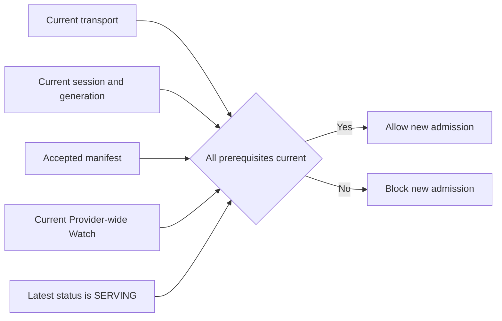

# Health and availability monitoring

Health tells the Agent whether a Provider process can accept new SFP work.
The Provider publishes one process-wide status through the standard gRPC
Health service. The Agent watches that status and combines it with its current
session, endpoint generation, and accepted manifest before allowing new
operation admission.

The authoritative observation is `Health.Watch(service="")` on the existing
SFP channel. `SERVING` can make an otherwise valid Provider eligible;
`NOT_SERVING`, an unknown state, or a lost Watch always fails closed.

## Health at a glance

Provider-wide Health is one input to availability. The Agent admits new work
only while the current Watch reports `SERVING` and every other session
prerequisite remains valid.

```stateforge-entity-flow
source: health-overview.yaml
```

## Interactive walkthrough

```stateforge-procedure
source: health.yaml
scenario: success
```

??? info "Health and availability sequence"

    ```mermaid
    sequenceDiagram
        participant Provider as Provider Process
        participant Health as gRPC Health Service
        participant Agent as StateForge Agent

        Provider->>Health: Register Provider-wide status
        Provider->>Health: Set NOT_SERVING
        Note over Provider,Agent: Bootstrap and manifest acceptance succeed
        Provider->>Health: Startup complete and set SERVING
        Agent->>Health: Watch Provider-wide status
        Health-->>Agent: SERVING (current status)
        Agent->>Agent: Validate Watch binding and prerequisites
        Agent->>Agent: Mark Provider AVAILABLE

        alt Provider cannot accept new work
            Provider->>Health: Set NOT_SERVING
            Health-->>Agent: NOT_SERVING
            Agent->>Agent: Block new admission
        else Provider recovers
            Provider->>Health: Set SERVING
            Health-->>Agent: SERVING
            Agent->>Agent: Revalidate and mark AVAILABLE
        else Watch or channel ends
            Agent->>Agent: Mark health UNKNOWN
            Agent->>Agent: Block new admission
            Agent->>Health: Retry Watch with bounded backoff
        end
    ```

## Who implements Health

[StateForge Provider Python](https://github.com/stateforge-org/stateforge-provider-python)
hosts the standard Health service, starts fail-closed, and translates the
Provider author's typed health result into `SERVING` or `NOT_SERVING`.
Provider authors override `Provider.health()` only when readiness depends on
their own resources and call `Provider.refresh_health()` when that evidence
changes.

The StateForge Agent opens the Provider-wide Watch after Bootstrap and
manifest acceptance. It validates every response, fences events to the exact
session that opened the stream, derives availability, and retries eligible
Watch failures with bounded backoff.

Use `stateforge-protocol` directly when implementing another Agent or Provider
runtime, or when building conformance tooling. The package supplies canonical
service names, message bounds, and status names; the standard gRPC package
supplies the messages and service bindings.

## Using the Python contract

Install the Protocol package and the official gRPC Health bindings:

```console
python -m pip install stateforge-protocol grpcio-health-checking
```

### Contract sources

| Source | Responsibility |
| --- | --- |
| [`grpc/health/v1/health.proto`](https://github.com/grpc/grpc-proto/blob/master/grpc/health/v1/health.proto) | Owns `grpc.health.v1.Health`, `Check`, `Watch`, request and response messages, and the serving-status enum. |
| [`health_contract.py`](https://github.com/stateforge-org/stateforge-protocol/blob/mvp/implementation/src/stateforge_protocol/sfp/health_contract.py) | Owns StateForge's Provider-wide service key, diagnostic SFP service names, message limits, and diagnostic-text bound. |
| [`shared_endpoint.py`](https://github.com/stateforge-org/stateforge-protocol/blob/mvp/implementation/src/stateforge_protocol/sfp/shared_endpoint.py) | Includes standard Health in the services and aggregate transport ceilings of the shared SFP endpoint. |

Health has no StateForge protobuf and no separate `validation.py`. The wire
schema and enum belong to the standard gRPC package. StateForge adds the
cross-runtime constants in `health_contract.py`; live Watch binding, retry,
readiness, and admission decisions require runtime state and therefore remain
with the Agent or Provider.

### Python API surface

| Purpose | Python API |
| --- | --- |
| Request and response messages | `grpc_health.v1.health_pb2.HealthCheckRequest` and `HealthCheckResponse` |
| Asynchronous client stub | `health_pb2_grpc.HealthStub` constructed with a `grpc.aio.Channel` |
| Server interface and registration | `health_pb2_grpc.HealthServicer` and `add_HealthServicer_to_server` |
| StateForge names and limits | `stateforge_protocol.sfp.health_contract` |
| Aggregate endpoint limits | `stateforge_protocol.sfp.shared_endpoint` |

```python
from grpc_health.v1 import health_pb2, health_pb2_grpc
from stateforge_protocol.sfp import health_contract

request = health_pb2.HealthCheckRequest(
    service=health_contract.AUTHORITATIVE_WATCH_SERVICE
)
stub = health_pb2_grpc.HealthStub(channel)

async for response in stub.Watch(request):
    status = response.status
```

`AUTHORITATIVE_WATCH_SERVICE` is the empty string. The caller must still
enforce the serialized limits from `health_contract`, apply a deadline where
the RPC is finite, and bind streamed responses to its current local session.

## Standard Health wire contract

SFP uses the standard methods on the same local channel as every other
Provider procedure:

```text
/grpc.health.v1.Health/Check
/grpc.health.v1.Health/Watch
```

| Resource | Limit |
| --- | --- |
| Serialized request | 4 KiB |
| Serialized response | 64 bytes |

These limits apply to every serialized `Check` request and every `Check` or
`Watch` response, including unknown protobuf fields. The larger shared-channel
ceiling does not replace the narrower Health limits.

### The empty service name means the Provider process

```text
Health.Watch(service="")
                     └── overall Provider process health
```

The empty key is the only Health signal that contributes to Provider
availability. A Provider registers it before becoming discoverable, initializes
it as `NOT_SERVING`, and changes it to `SERVING` only when the process is ready
to accept correctly formed SFP requests.

Implementations may also register hosted SFP service names for diagnostics:

| Diagnostic service key | Procedure |
| --- | --- |
| `stateforge.sfp.bootstrap.v1.BootstrapService` | Handshake and version negotiation |
| `stateforge.sfp.manifest.v1.ManifestService` | Provider manifest exchange |
| `stateforge.sfp.capability_assessment.v1.CapabilityAssessmentService` | Capability assessment |
| `stateforge.sfp.operation_admission.v1.OperationAdmissionService` | Operation admission |
| `stateforge.sfp.operation_lifecycle.v1.OperationLifecycleService` | Progress, results, and cancellation |
| `stateforge.sfp.trigger_publication.v1.TriggerPublicationService` | Trigger publication and acknowledgement |

These are exact protobuf service identities. Named statuses help operators
locate a problem, but they never override the empty Provider-wide key and
never make the Provider eligible.

### Check and Watch have different jobs

=== "Method reference"

    | Request | Result | Effect on Agent availability |
    | --- | --- | --- |
    | `Check` for `""` or a registered name | Return the current status. The caller uses a finite deadline. | Diagnostic only. A successful Check cannot make a Provider available. |
    | `Check` for an unknown or wildcard-like name | gRPC `NOT_FOUND`. | None. |
    | `Watch` for `""` or a registered name | Send the current status immediately, then every ordered change. | Only the current Watch for `""` can contribute to availability. |
    | `Watch` for an unknown name | Send `SERVICE_UNKNOWN`, keep the stream open, and publish a later status if the name is registered. | Fails closed while unknown. |

=== "Example ProtoJSON"

    ``` { .json .annotate title="HealthCheckRequest" }
    {
      "service": " (1)"
    }
    ```

    1.  The empty service name selects overall Provider process health.

    ``` { .json .annotate title="HealthCheckResponse · current state" }
    {
      "status": "SERVING (1)"
    }
    ```

    1.  The current Watch for the empty service may contribute this evidence
        to the Agent's availability decision.

    ``` { .json .annotate title="HealthCheckResponse · later update" }
    {
      "status": "NOT_SERVING (1)"
    }
    ```

    1.  A later streamed update immediately fails closed for new admission.

`SERVICE_UNKNOWN` is valid only as a Watch response. The status enum has four
wire values:

| Status | Meaning in StateForge |
| --- | --- |
| `SERVING` | The Provider process reports that it can accept new SFP work. |
| `NOT_SERVING` | The Provider process cannot currently accept new SFP work. |
| `UNKNOWN` | No usable readiness evidence is available. |
| `SERVICE_UNKNOWN` | The watched service name is not registered yet. |

Every state except `SERVING` fails closed.

## From Provider readiness to Agent availability

The Provider owns its process health. The Agent owns the final availability
decision.



`SERVING` is necessary, but never sufficient by itself. A stale session, a
replaced endpoint generation, a rejected manifest, or a lost Watch keeps the
Provider unavailable even when the last received status was `SERVING`.

Provider-wide health answers one question: _can this process accept new SFP
work?_ It does not decide whether a particular operation is supported for a
target. Capability Assessment supplies that point-in-time evidence, while
Operation Admission revalidates the request and current prerequisites.

## Provider lifecycle

| Phase | Provider-wide status | Admission effect |
| --- | --- | --- |
| Registry created | `NOT_SERVING` | Blocked. |
| Startup and declaration validation complete | `SERVING` | Eligible only after every Agent-owned prerequisite also passes. |
| Degraded operation or maintenance | `NOT_SERVING` | New admission stops. |
| Recovery complete | `SERVING` | The Agent revalidates prerequisites before restoring availability. |
| Shutdown begins | `NOT_SERVING` before teardown | New admission stops before Watch streams and transport are closed. |

StateForge Provider Python maps author-facing `DEGRADED`, `MAINTENANCE`, and
`NOT_SERVING` to the standard wire status `NOT_SERVING`. Raw probe details and
hook exceptions remain local to the Provider process.

Providers bound the number of Watch observers, queue capacity, delivery time,
and shutdown wait. They preserve ordered changes for an observer; if a slow
observer cannot keep up within those bounds, they terminate that Watch with
`RESOURCE_EXHAUSTED` instead of dropping or reordering health transitions.

## Session fencing and Watch recovery

Standard Health responses carry no StateForge session, endpoint generation,
Provider identity, or manifest revision. The Agent therefore binds each Watch
locally to the exact channel and accepted session that opened it.

Before applying a response, the Agent checks that this binding is still
current. A queued `SERVING` event from a replaced channel or session is
discarded. Reconnecting starts unavailable: the Agent repeats Bootstrap and
manifest acceptance, opens a new Watch, and waits for that stream's initial
status.

| Watch outcome | Agent behavior |
| --- | --- |
| Ordered status response | Apply it only when the Watch binding is current. |
| `SERVICE_UNKNOWN` | Keep the stream open and remain unavailable. |
| Stream ends with `OK` or another retryable status | Immediately become unavailable and retry with capped exponential backoff while the session remains current. |
| `RESOURCE_EXHAUSTED` | Become unavailable and retry; the Provider may have rejected capacity or a slow observer. |
| `UNIMPLEMENTED` | Mark Watch unsupported, remain unavailable, and do not retry on the unchanged endpoint generation. |
| Channel, session, or endpoint replacement | Stop using the old Watch and recover through discovery and Bootstrap. |

The retry schedule is bounded Agent policy, not a field in the Health
protocol.

## Health loss does not rewrite admitted work

When health becomes unavailable, the Agent blocks **new** operation admission.
It does not infer an outcome for work that was already admitted.

| Health loss does | Health loss does not |
| --- | --- |
| Block new admission. | Mark an operation failed or cancelled. |
| Invalidate capability evidence tied to the prior availability generation. | Replace progress or an immutable terminal result. |
| Trigger Watch recovery while the session remains current. | Redispatch work or request cancellation automatically. |

Existing observation or cooperative cancellation may continue when their own
current-session contracts permit it. If transport loss prevents observation,
the operation remains unresolved until lifecycle or recovery procedures supply
new evidence.

## Diagnostics and privacy

`HealthCheckResponse` carries only the standard status enum. Do not encode
configuration, credentials, customer data, target identities, vendor probe
results, or free-form diagnostics into service names or substitute statuses.

Local logs may retain the fixed service key, accepted status, sanitized gRPC
code, retry attempt, and non-secret correlation identities. Untrusted remote
or exception descriptions are limited to 1,024 Unicode code points and remain
human-readable diagnostics; they never restore availability.
