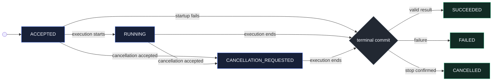

# Progress, results, and cancellation

Operation Lifecycle observes and cooperatively cancels work already admitted
through [Operation Admission](operation-admission.md). It streams complete
current-state snapshots, retains one immutable terminal outcome, and keeps
observer failures separate from business execution.

Neither lifecycle RPC creates, restarts, or redispatches an operation. An
unknown operation identity remains unknown.

## Operation lifecycle at a glance

This example follows a database-maintenance operation from its first retained
snapshot to a validated terminal result.

```stateforge-entity-flow
source: operation-lifecycle-overview.yaml
```

## Interactive walkthrough

Choose a scenario to examine successful execution, late attachment, reconnect
gaps, failure, cancellation races, transport loss, and bounded backpressure.

```stateforge-procedure
source: operation-lifecycle.yaml
scenario: success
```

??? info "Operation lifecycle sequence"

    ```mermaid
    sequenceDiagram
        participant Agent as StateForge Agent
        participant Service as Lifecycle Service
        participant Record as Operation Record
        participant Runtime as Provider Implementation

        Agent->>Service: WatchOperation(operation ID, fingerprint, cursor)
        Service->>Record: Capture current snapshot + subscribe
        Record-->>Service: Current complete snapshot
        Service-->>Agent: Snapshot replay

        Runtime->>Record: Commit RUNNING
        Record-->>Agent: RUNNING snapshot
        Runtime->>Record: Commit normalized progress
        Record-->>Agent: RUNNING + progress

        alt Execution succeeds
            Runtime->>Service: Candidate result
            Service->>Service: Validate pinned result schema
            Service->>Record: Commit SUCCEEDED
            Record-->>Agent: SUCCEEDED + result
        else Execution fails
            Runtime->>Service: Normalized failure
            Service->>Record: Commit FAILED + effects
            Record-->>Agent: FAILED + effects
        else Agent requests cancellation
            Agent->>Service: CancelOperation
            Service->>Record: Commit CANCELLATION_REQUESTED
            Service-->>Agent: REQUESTED + current snapshot
            Service->>Runtime: Cooperative interruption
            alt Stop confirmed
                Runtime->>Record: Commit CANCELLED + effects
                Record-->>Agent: CANCELLED + effects
            else Completion wins
                Runtime->>Record: Commit SUCCEEDED or FAILED
                Record-->>Agent: Actual terminal outcome
            end
        end

        Service-->>Agent: Close Watch with gRPC OK
    ```

## Who implements Operation Lifecycle

The StateForge Agent opens `WatchOperation`, validates each snapshot against
the current session and original admission context, advances its cursor only
after validation, and calls `CancelOperation` when a higher layer requests
cooperative cancellation.

The Provider runtime owns the lifecycle service, operation record, sequence,
observer limits, atomic cancellation decision, result validation, and terminal
retention. A Provider integration reports progress and returns a result or
normalized failure; it does not frame Watch responses or decide retry
correlation.

The `stateforge-protocol` package supplies the messages, service identity,
limits, structural schema, state-transition validators, exchange validators,
and terminal-replay checks. It does not execute operations, retain runtime
state, or force cancellation.

## Using the Python contract

Install the generated contracts and gRPC runtime:

```console
python -m pip install stateforge-protocol grpcio
```

### Contract sources

| Source | Responsibility |
| --- | --- |
| [`operation_lifecycle.proto`](https://github.com/stateforge-org/stateforge-protocol/blob/mvp/implementation/proto/stateforge_protocol/sfp/operation_lifecycle/v1/operation_lifecycle.proto) | Defines Watch, cancellation, snapshots, progress, terminal outcomes, effects, and structured errors. |
| [`contract.py`](https://github.com/stateforge-org/stateforge-protocol/blob/mvp/implementation/src/stateforge_protocol/sfp/operation_lifecycle/v1/contract.py) | Owns the canonical service identity and every lifecycle message, result, observer, and diagnostic limit. |
| [`validation.py`](https://github.com/stateforge-org/stateforge-protocol/blob/mvp/implementation/src/stateforge_protocol/sfp/operation_lifecycle/v1/validation.py) | Validates requests, responses, snapshots, exchanges, adjacent transitions, cancellation decisions, and terminal replay. |
| [`operation_lifecycle.schema.json`](https://github.com/stateforge-org/stateforge-protocol/blob/mvp/implementation/src/stateforge_protocol/sfp/operation_lifecycle/v1/operation_lifecycle.schema.json) | Defines complete lowerCamelCase ProtoJSON structures and state-dependent presence rules. |

### Python API surface

| Purpose | Python API |
| --- | --- |
| Messages and enums | `operation_lifecycle_pb2` |
| Asynchronous client stub | `operation_lifecycle_pb2_grpc.OperationLifecycleServiceStub` |
| Server interface | `operation_lifecycle_pb2_grpc.OperationLifecycleServiceServicer` |
| Server registration | `operation_lifecycle_pb2_grpc.add_OperationLifecycleServiceServicer_to_server` |
| Service identity and limits | `stateforge_protocol.sfp.operation_lifecycle.v1.contract` |
| Context-independent validation | `stateforge_protocol.sfp.operation_lifecycle.v1.validation` |

Import the public contract through its versioned package:

```python
from stateforge_protocol.sfp.operation_lifecycle.v1 import (
    operation_lifecycle_pb2,
    operation_lifecycle_pb2_grpc,
    validation,
)

validation.validate_watch_operation_request(request)
stub = operation_lifecycle_pb2_grpc.OperationLifecycleServiceStub(channel)

previous_sequence = None
async for response in stub.WatchOperation(request, timeout=30.0):
    validation.validate_watch_exchange(
        request,
        response,
        previous_sequence=previous_sequence,
    )
    previous_sequence = response.snapshot.sequence
```

Generated protobuf classes enforce wire types, not the complete StateForge
contract. Both peers must enforce `contract.py` byte limits and apply the live
session, retained-record, pinned-schema, persistence, and cancellation checks
owned by their runtime.

## Wire contract

Operation Lifecycle exposes two methods on the active SFP channel:

| Method | Shape | Purpose |
| --- | --- | --- |
| `/stateforge.sfp.operation_lifecycle.v1.OperationLifecycleService/WatchOperation` | Unary request, server stream | Immediately replay current state, then deliver newer snapshots until a terminal outcome or stream failure. |
| `/stateforge.sfp.operation_lifecycle.v1.OperationLifecycleService/CancelOperation` | Unary request and response | Make one idempotent, cooperative cancellation decision against current operation state. |

Cancelling a Watch call only detaches that observer. Cancelling the business
operation requires `CancelOperation`.

## Identifying the admitted operation

Both requests carry the current session binding, the existing operation ID,
and the exact request fingerprint returned by Operation Admission. Watch also
carries the last validated sequence.

=== "Field reference"

    | Field | Meaning |
    | --- | --- |
    | `session_binding` | Current Provider installation, endpoint generation, and negotiated session. It may change after reconnection. |
    | `operation_id` | Immutable Agent-assigned identity of the admitted operation. |
    | `expected_request_fingerprint` | Exact fingerprint of the admitted invocation. It prevents an operation ID from being paired with different content. |
    | `after_sequence` | Watch cursor. Zero means first attachment; a positive value is the last fully validated snapshot sequence. |

=== "Watch request"

    ``` { .json .annotate title="WatchOperationRequest" }
    {
      "sessionBinding": {
        "expectedProviderInstanceId": "11111111-1111-4111-8111-111111111111 (1)",
        "expectedEndpointGeneration": "42",
        "expectedSessionId": "session-admission-42"
      },
      "operationId": "22222222-2222-4222-8222-222222222222 (2)",
      "expectedRequestFingerprint": "sha256:9d52f77a7f678fda81dcee97df7b3bc5e4877ee570285f6aa5741b83d4c731df (3)",
      "afterSequence": "0 (4)"
    }
    ```

    1.  Selects one active Provider session.
    2.  Selects the retained operation record.
    3.  Proves which immutable invocation the Agent expects.
    4.  Requests an initial current-state replay.

=== "Cancel request"

    ``` { .json .annotate title="CancelOperationRequest" }
    {
      "sessionBinding": {
        "expectedProviderInstanceId": "11111111-1111-4111-8111-111111111111",
        "expectedEndpointGeneration": "42",
        "expectedSessionId": "session-admission-42"
      },
      "operationId": "22222222-2222-4222-8222-222222222222",
      "expectedRequestFingerprint": "sha256:9d52f77a7f678fda81dcee97df7b3bc5e4877ee570285f6aa5741b83d4c731df"
    }
    ```

A new session binding never changes the operation identity, fingerprint,
snapshot sequence, or declaration revision. A changed Provider installation
is not recovery.

## Snapshot state machine

Every Watch response contains a complete `OperationSnapshot`. Sequence starts
at one and advances once for each committed state or progress change.



Progress does not add another state. A progress commit keeps `RUNNING` or
`CANCELLATION_REQUESTED` and advances the snapshot sequence.

| State | Outcome | Progress |
| --- | --- | --- |
| `ACCEPTED` | Absent | Absent |
| `RUNNING` | Absent | Optional latest progress |
| `CANCELLATION_REQUESTED` | Absent | Optional latest progress |
| `SUCCEEDED` | Required validated `success.result` | Optional frozen latest progress |
| `FAILED` | Required `failure` with code, explanation, and effects | Optional frozen latest progress |
| `CANCELLED` | Required `cancellation.effects` | Optional frozen latest progress |

Terminal snapshots never change. Replaying a snapshot or repeating a
cancellation request consumes no sequence.

## Watching current state

At attachment, the Provider atomically captures current state and subscribes
the observer before sending the first response. This closes the gap between
reading state and listening for changes.

| Cursor and delivery | Required behavior |
| --- | --- |
| `after_sequence = 0` | Replay current state with `updates_skipped = false`; no history was requested. |
| Positive cursor equals current | Replay the identical current snapshot with the flag false. |
| Positive cursor below current | Replay current state; set the flag exactly when more than one sequence was skipped. |
| Cursor greater than current | Reject with `OUT_OF_RANGE` / `CURSOR_AHEAD`. |
| Later response | Sequence strictly increases; the flag reflects a gap from the last delivered sequence. |

`WatchOperation` is a current-state stream, not an event log. A gap means
intermediate updates are unavailable, but the complete snapshot still defines
current state and any terminal outcome.

=== "Response fields"

    | Field | Meaning |
    | --- | --- |
    | `provider_instance_id`, `endpoint_generation`, `session_id` | Current response fences validated against the active call. |
    | `snapshot.admission_record` | Immutable record returned by Operation Admission. |
    | `snapshot.operation_identifier` | Exact operation declaration selected by the original invocation. |
    | `snapshot.manifest_revision` | Original pinned manifest revision, not necessarily the Provider's current revision. |
    | `snapshot.sequence` | Per-operation committed ordering. It never resets on reconnect. |
    | `snapshot.updated_at` | Commit time. Sequence, not wall-clock time, determines order. |
    | `updates_skipped` | Whether this delivery crossed unavailable intermediate sequences after a positive cursor. |

=== "Terminal response"

    ``` { .json .annotate title="WatchOperationResponse · terminal" }
    {
      "providerInstanceId": "11111111-1111-4111-8111-111111111111",
      "endpointGeneration": "42",
      "sessionId": "session-admission-42",
      "snapshot": {
        "admissionRecord": {
          "operationId": "22222222-2222-4222-8222-222222222222",
          "requestFingerprint": "sha256:9d52f77a7f678fda81dcee97df7b3bc5e4877ee570285f6aa5741b83d4c731df",
          "admittedAt": "2026-09-19T12:00:00Z",
          "recordExpiresAt": "2026-09-20T12:00:00Z",
          "admittedEndpointGeneration": "42"
        },
        "operationIdentifier": "example.database/maintenance.compact@1",
        "manifestRevision": "sha256:aaaaaaaaaaaaaaaaaaaaaaaaaaaaaaaaaaaaaaaaaaaaaaaaaaaaaaaaaaaaaaaa (1)",
        "sequence": "5",
        "state": "OPERATION_STATE_SUCCEEDED",
        "updatedAt": "2026-09-19T12:00:04Z",
        "success": {
          "result": {
            "reclaimedBytes": 4096
          }
        },
        "progress": {
          "sequence": "4",
          "updatedAt": "2026-09-19T12:00:03Z",
          "message": "Finishing maintenance.",
          "percentage": 100
        }
      },
      "updatesSkipped": true (2)
    }
    ```

    1.  Pins result validation to the original manifest declaration.
    2.  Reports that this response crossed unavailable intermediate sequences.

Once a valid terminal snapshot is delivered, the Provider closes that Watch
stream with gRPC `OK`. End-of-stream `OK` without terminal evidence is a
protocol violation.

### Progress

| Rule | Meaning |
| --- | --- |
| Complete snapshot | Progress is retained inside the operation snapshot, never sent as an uncorrelated delta. |
| Optional percentage | Absence means unknown; zero means zero; 100 does not mean `SUCCEEDED`. |
| Phase changes | Percentage need not remain monotonic across different operation phases. |
| Terminal snapshot | May retain earlier progress, but terminal commit uses a newer sequence. |
| Safe diagnostics | Messages are bounded and sanitized; they are not machine-readable state. |

## Results, failures, and effects

Before committing `SUCCEEDED`, the Provider validates the complete result
against the accepted operation's pinned `result_schema`. Invalid or oversized
author output becomes a sanitized `FAILED` snapshot with code
`stateforge.operation.invalid_result`; invalid data is never returned.

| Terminal state | Required evidence |
| --- | --- |
| `SUCCEEDED` | A present result object satisfying the pinned schema. Even `{}` must be valid for that schema. |
| `FAILED` | Stable dotted code, sanitized explanation, and explicit side-effect and cleanup states. |
| `CANCELLED` | Positive confirmation that execution stopped, plus explicit side-effect and cleanup states. |

Effects distinguish what remains from what was cleaned up:

| Field | Values |
| --- | --- |
| `side_effects` | `NONE`, `PRESENT`, or `UNKNOWN` |
| `cleanup` | `NOT_REQUIRED`, `COMPLETED`, `INCOMPLETE`, or `UNKNOWN` |
| `explanation` | Bounded safe context about relevant resources or uncertainty |

Failure and cancellation never imply rollback. When facts are unavailable,
the Provider reports `UNKNOWN` rather than using an empty/default value to
suggest successful cleanup.

## Cooperative cancellation

`CancelOperation` makes one atomic decision against current operation state.
All four dispositions are successful gRPC responses.

| Current condition | Disposition | State change and signal |
| --- | --- | --- |
| Already terminal | `ALREADY_TERMINAL` | Return the immutable terminal snapshot; no signal. |
| Cancellation already requested | `ALREADY_REQUESTED` | Return current state; no new sequence or signal. |
| Interruption unsupported | `UNSUPPORTED` | Keep current state; no signal. |
| Active and interruption supported | `REQUESTED` | Commit `CANCELLATION_REQUESTED`, then arrange one cooperative signal. |

=== "Disposition reference"

    `REQUESTED` means the Provider accepted a cancellation request. It does
    **not** mean execution stopped. `CANCELLED` is committed only after positive
    confirmation that execution stopped or was prevented from starting.

=== "Requested response"

    ``` { .json .annotate title="CancelOperationResponse · requested" }
    {
      "providerInstanceId": "11111111-1111-4111-8111-111111111111",
      "endpointGeneration": "42",
      "sessionId": "session-admission-42",
      "disposition": "CANCELLATION_DISPOSITION_REQUESTED (1)",
      "snapshot": {
        "admissionRecord": {
          "operationId": "22222222-2222-4222-8222-222222222222",
          "requestFingerprint": "sha256:9d52f77a7f678fda81dcee97df7b3bc5e4877ee570285f6aa5741b83d4c731df",
          "admittedAt": "2026-09-19T12:00:00Z",
          "recordExpiresAt": "2026-09-20T12:00:00Z",
          "admittedEndpointGeneration": "42"
        },
        "operationIdentifier": "example.database/maintenance.compact@1",
        "manifestRevision": "sha256:aaaaaaaaaaaaaaaaaaaaaaaaaaaaaaaaaaaaaaaaaaaaaaaaaaaaaaaaaaaaaaaa",
        "sequence": "5",
        "state": "OPERATION_STATE_CANCELLATION_REQUESTED (2)",
        "updatedAt": "2026-09-19T12:00:04Z",
        "progress": {
          "sequence": "4",
          "updatedAt": "2026-09-19T12:00:03Z",
          "message": "Finishing maintenance.",
          "percentage": 100
        }
      }
    }
    ```

    1.  Confirms the atomic cancellation decision.
    2.  Shows that cancellation is pending, not terminal.

Cancellation is operation-scoped. It never kills the shared Provider process,
closes unrelated streams, or cancels unrelated operations. The first terminal
commit wins: success or failure may still beat cooperative interruption after
the request is accepted.

## Retention and backpressure

The Provider retains current state, latest progress, and an immutable terminal
snapshot with the admission record. Full progress history is not required.

For each observer, the Provider permits one response in flight and one pending
snapshot. A newer snapshot may replace pending intermediate state; a terminal
snapshot cannot be replaced. This lets operation execution continue even when
an observer is slow.

| Boundary | Required behavior |
| --- | --- |
| Observer count | At most 16 per operation; lower finite local limits are allowed. |
| Stalled delivery | After at most 30 seconds, terminate that observer with `RESOURCE_EXHAUSTED` / `SLOW_OBSERVER`. |
| Active operation | Retain its record while it can still create effects, even beyond the advertised admission expiry. |
| Terminal operation | Retain the terminal result while its admission record remains retained. |

A failed observer never deletes the terminal result or cancels execution.

## Transport failures and recovery

Non-OK gRPC status describes the lifecycle call or stream, not the business
outcome. A broken Watch, client deadline, or channel loss does not cancel the
operation.

| Condition | gRPC status | Structured reason | Recovery |
| --- | --- | --- | --- |
| Invalid shape or bounds | `INVALID_ARGUMENT` | `INVALID_REQUEST` | Correct the request without changing operation identity. |
| Stale session or endpoint | `FAILED_PRECONDITION` | `SESSION_PRECONDITION_FAILED` | Rediscover and re-handshake. |
| Record unavailable | `FAILED_PRECONDITION` | `OPERATION_RECORD_UNAVAILABLE` | Preserve an indeterminate outcome; never redispatch automatically. |
| Record expiry proven | `FAILED_PRECONDITION` | `OPERATION_RECORD_EXPIRED` | Expiry does not authorize new business work. |
| Lifecycle state unavailable | `FAILED_PRECONDITION` | `OPERATION_STATE_UNAVAILABLE` | Do not fabricate a terminal state. |
| Fingerprint mismatch | `FAILED_PRECONDITION` | `FINGERPRINT_MISMATCH` | Reject the mismatched context. |
| Cursor ahead | `OUT_OF_RANGE` | `CURSOR_AHEAD` | Verify retained cursor and recovery integrity. |
| Observer capacity exhausted | `RESOURCE_EXHAUSTED` | `OBSERVER_CAPACITY_EXHAUSTED` | Retry after capacity recovers. |
| Observer stalled | `RESOURCE_EXHAUSTED` | `SLOW_OBSERVER` | Reattach with the last validated cursor. |
| Provider unavailable | `UNAVAILABLE` | `PROVIDER_UNAVAILABLE` | Reconnect, revalidate, then retry with bounded backoff. |

??? example "Example structured lifecycle error"

    ``` { .json .annotate title="OperationLifecycleErrorDetail" }
    {
      "operationId": "22222222-2222-4222-8222-222222222222 (1)",
      "reason": "LIFECYCLE_ERROR_REASON_CURSOR_AHEAD (2)",
      "explanation": "The requested cursor is newer than the retained snapshot. (3)"
    }
    ```

    1.  Correlates the failed lifecycle request.
    2.  Supplies the stable machine-readable reason paired with `OUT_OF_RANGE`.
    3.  Adds bounded, sanitized context only.

Structured details travel in `google.rpc.Status.details` as a
`google.protobuf.Any`. Business `FAILED` outcomes remain inside operation
snapshots and never use this error channel.

After a stream failure, the Agent reconnects with a finite deadline, bounded
backoff, current session binding, and the last fully validated cursor. It never
uses `StartOperation` as a Watch fallback.

## Structural limits

| Limit | Maximum |
| --- | ---: |
| Serialized Watch or Cancel request | 8 KiB |
| Serialized Watch or Cancel response | 8 MiB |
| Serialized complete snapshot | 7 MiB |
| Serialized structured error detail | 4 KiB |
| Result JSON nesting | 64 containers |
| Entries per result object or array | 256 |
| Result property name | 128 Unicode code points |
| Result string | 65,536 Unicode code points |
| Progress, failure, or effects explanation | 1,024 Unicode code points |
| Pending snapshots per observer | 1, plus 1 response in flight |
| Observers per operation | 16 |
| Stalled delivery | 30 seconds |

Consumers enforce serialized byte size, recursive depth, finite JSON values,
timestamp validity, live-session membership, cursor relationships, pinned
result-schema conformance, and semantic truth in addition to the packaged JSON
Schema.

## Responsibility boundary

This repository owns the lifecycle wire contract, generated bindings,
structural schema, state transitions, error reasons, resource limits, and
conformance vectors. Provider runtimes own operation records, execution,
observer delivery, result validation, cancellation support, and terminal
retention. Agent runtimes own request construction, cursor persistence,
snapshot validation, and recovery after transport loss.
