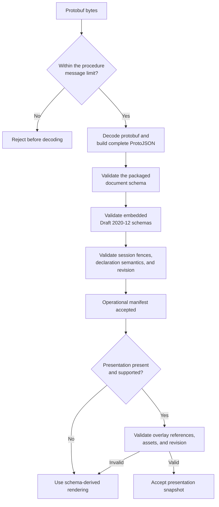

# Provider manifest exchange

After Bootstrap establishes a session, the Agent asks what the Provider
declares. The response is one complete, revisioned snapshot of the Provider's
operations, triggers, schemas, runtime requirements, and supported platforms.
It describes capability shape without transferring configured values, secrets,
or runtime evidence.

Manifest Exchange is a read-only, idempotent RPC. A successful gRPC response is
not enough: the Agent must validate the session envelope, declaration, embedded
schemas, and deterministic revision before the manifest becomes usable.

## Manifest exchange at a glance

One request captures the Provider's complete declaration as an immutable,
revisioned snapshot. The Agent accepts or rejects that snapshot as a whole.

```stateforge-entity-flow
source: provider-manifest-overview.yaml
```

## Interactive walkthrough

```stateforge-procedure
source: provider-manifest.yaml
scenario: success
```

??? info "Provider Manifest sequence"

    ```mermaid
    sequenceDiagram
        participant Agent as StateForge Agent
        participant Provider as Manifest Service
        participant Declaration as Provider Declaration
        participant Cache as Manifest Cache

        Note over Agent,Provider: Bootstrap session is active
        Agent->>Provider: GetManifestRequest<br/>instance + generation + session + schema offer
        Provider->>Provider: Validate request syntax and byte limit
        Provider->>Provider: Resolve exact active session

        alt No common manifest schema
            Provider-->>Agent: UNIMPLEMENTED
        else Session is stale or mismatched
            Provider-->>Agent: FAILED_PRECONDITION
        else Request and session are valid
            Provider->>Declaration: Capture one immutable snapshot
            Provider->>Declaration: Validate schemas and compute revision
            Declaration-->>Provider: Canonical declaration + revision
            Provider-->>Agent: Complete GetManifestResponse
            Agent->>Agent: Validate response fences before cache lookup
            alt Validated cache key exists
                Agent->>Cache: Reuse exact accepted declaration
                Cache-->>Agent: Canonical manifest bytes
            else New or changed revision
                Agent->>Declaration: Validate full manifest and revision
                Agent->>Cache: Store accepted canonical bytes
            end
            Note over Agent,Provider: Manifest accepted<br/>Continue to Health and Capability Assessment
        end
    ```

## Who implements Manifest Exchange

Provider authors using
[StateForge Provider Python](https://github.com/stateforge-org/stateforge-provider-python)
do not construct this protobuf response or calculate its revision manually.
The framework converts their typed declarations into a validated immutable
snapshot, binds each response to the requesting session, and registers the
Manifest service on the shared endpoint.

The StateForge Agent builds the request from its active Bootstrap session,
validates every response fence, and caches only accepted canonical declaration
bytes. Use `stateforge-protocol` directly when building another runtime, an
Agent implementation, or conformance tooling.

## Using the Python contract

Install the generated contracts and gRPC runtime:

```console
python -m pip install stateforge-protocol grpcio
```

### Contract sources

| Source | Responsibility |
| --- | --- |
| [`manifest.proto`](https://github.com/stateforge-org/stateforge-protocol/blob/mvp/implementation/proto/stateforge_protocol/sfp/manifest/v1/manifest.proto) | Owns messages, field numbers, and the unary `ManifestService.GetManifest` RPC. |
| [`contract.py`](https://github.com/stateforge-org/stateforge-protocol/blob/mvp/implementation/src/stateforge_protocol/sfp/manifest/v1/contract.py) | Owns the canonical service identity and the limits for declarations, presentation overlays, assets, schemas, and revisions. |
| [`validation.py`](https://github.com/stateforge-org/stateforge-protocol/blob/mvp/implementation/src/stateforge_protocol/sfp/manifest/v1/validation.py) | Owns complete exchange validation, independent manifest and presentation acceptance, embedded-schema inspection, canonical revisions, and cache keys. |
| [`manifest.schema.json`](https://github.com/stateforge-org/stateforge-protocol/blob/mvp/implementation/src/stateforge_protocol/sfp/manifest/v1/manifest.schema.json) | Defines the request and response ProtoJSON projections and manifest schema-1 structure. |

### Python API surface

| Purpose | Python API |
| --- | --- |
| Request, response, and declaration messages | `manifest_pb2` |
| Asynchronous client stub | `manifest_pb2_grpc.ManifestServiceStub` constructed with a `grpc.aio.Channel` |
| Server interface and registration | `manifest_pb2_grpc.ManifestServiceServicer` and `add_ManifestServiceServicer_to_server` |
| Service identity and resource limits | `stateforge_protocol.sfp.manifest.v1.contract` |
| Complete response validation | `validation.validate_manifest_response` |
| Operational and presentation snapshot validation | `validation.validate_manifest_exchange` |
| Declaration and embedded-schema validation | `validation.validate_manifest_document` and `validation.validate_schema` |
| Presentation overlay validation | `validation.validate_presentation_document` |
| Deterministic revisions | `validation.compute_manifest_revision` and `validation.compute_presentation_revision` |
| Cache-key validation | `validation.validate_manifest_key` and `validation.validate_presentation_key` |

Import the complete public surface from the versioned package:

```python
from stateforge_protocol.sfp.manifest.v1 import (
    contract,
    manifest_pb2,
    manifest_pb2_grpc,
    validation,
)
```

Generated protobuf classes enforce wire types, not the complete StateForge
contract. Receivers must enforce the byte limits from `contract.py` and call
the public validators explicitly. Provider and Agent runtimes still own live
session lookup, request/response correlation, retry policy, and cache storage.

## Wire contract

SFP 1.0 exposes the unary method
`/stateforge.sfp.manifest.v1.ManifestService/GetManifest` on the same local
gRPC channel as bootstrap. The authoritative source is
`proto/stateforge_protocol/sfp/manifest/v1/manifest.proto`. No new connection,
reverse RPC, operation admission, or persistent registry is involved.

The Agent may call this read-only, idempotent RPC only after a successful
handshake. The request identifies that exact session and offers the manifest
schema versions the Agent understands. The response returns one complete,
revisioned declaration snapshot.

=== "Field reference"

    | Message | Field | Meaning |
    | --- | --- | --- |
    | Request | `expected_provider_instance_id` | Provider installation copied from the active Bootstrap session. |
    | Request | `expected_endpoint_generation` | Endpoint generation copied from the active Bootstrap session. |
    | Request | `expected_session_id` | Exact session identifier issued by Bootstrap. |
    | Request | `supported_manifest_schema_versions` | One to 32 unique positive schema versions. Offer order carries no preference. |
    | Response | `provider_instance_id`, `endpoint_generation`, `session_id` | Echoed session fences that must match the request and remain current. |
    | Response | `manifest_schema_version` | Highest manifest schema version supported by both peers. |
    | Response | `manifest` | Complete Provider declaration for the selected schema. |
    | Response | `manifest_revision` | Deterministic SHA-256 revision of the accepted declaration snapshot. |
    | Response | `presentation` | Optional Provider, operation, trigger, field, group, and embedded-asset presentation overlay. |
    | Response | `presentation_revision` | Independent SHA-256 revision bound to this manifest; present exactly when `presentation` is present. |

=== "Example request"

    ``` { .json .annotate title="GetManifestRequest" }
    {
      "expectedProviderInstanceId": "7f7db7d8-68b4-4f71-9769-065b5c4f941c (1)",
      "expectedEndpointGeneration": "4",
      "supportedManifestSchemaVersions": [
        2,
        1
      ],
      "expectedSessionId": "manifest-session-A (2)"
    }
    ```

    1.  Begins the endpoint fence copied from the active Bootstrap session;
        `expectedEndpointGeneration` completes it.
    2.  Selects one exact negotiated session on that endpoint.

=== "Example response"

    ``` { .json .annotate title="GetManifestResponse" }
    {
      "providerInstanceId": "7f7db7d8-68b4-4f71-9769-065b5c4f941c (1)",
      "endpointGeneration": "4",
      "manifestSchemaVersion": 1,
      "manifest": {
        "providerIdentity": "stateforge.git (2)",
        "implementationVersion": "1.0.0",
        "displayName": "Git Provider",
        "operations": {
          "stateforge.git/reference.resolve@1": {
            "inputSchema": {
              "$schema": "https://json-schema.org/draft/2020-12/schema",
              "type": "object",
              "properties": {},
              "additionalProperties": false
            },
            "resultSchema": {
              "$schema": "https://json-schema.org/draft/2020-12/schema",
              "type": "object",
              "properties": {},
              "additionalProperties": false
            },
            "implements": []
          }
        },
        "runtimeRequirements": {
          "executable.git": {
            "description": "Git executable available to the Provider",
            "versionConstraint": ">=2.40"
          }
        },
        "platforms": [
          {
            "operatingSystem": "linux",
            "architecture": "x86_64"
          }
        ],
        "configurationSchema": {
          "$schema": "https://json-schema.org/draft/2020-12/schema",
          "type": "object",
          "properties": {
            "repository": {
              "type": "string"
            },
            "token": {
              "type": "string",
              "writeOnly": true
            }
          },
          "additionalProperties": false,
          "required": [
            "repository"
          ]
        },
        "triggers": {}
      },
      "manifestRevision": "sha256:6bfdf3aedc2d4e45d77d4787cc0e744a488208b2510d81788291f51d24a623e8 (3)",
      "sessionId": "manifest-session-A (4)"
    }
    ```

    1.  Echoes the Provider installation fence; `endpointGeneration` must
        match the request as well.
    2.  Begins the complete author declaration, including operations,
        requirements, supported platforms, configuration, and triggers.
    3.  Identifies this declaration snapshot independently of the active
        session.
    4.  Correlates the snapshot with the exact session that requested it.

Missing identities, generation zero, or an empty session identifier are
invalid; they never mean "any Provider or session". Offer order has no meaning,
and the Provider selects the highest schema version supported by both peers.
Software, SFP, and manifest schema versions are independent.

There is no empty success or implicit not-modified reply. The declaration,
identity, generation, and revision come from one consistent snapshot. The
`session_id` belongs to this call's validated session rather than the immutable
declaration, so concurrent sessions may receive the same revision with
different response fences.

### Session binding

`GetManifestRequest.expected_session_id` uses field **4** and
`GetManifestResponse.session_id` uses field **6**. Both are required opaque strings of
1–255 Unicode code points, matching capability assessment. Preserve exact case and contents;
do not trim, normalize, parse as UUID, or derive them from endpoint identity.
No mandatory session metadata header is introduced.

The Provider must resolve the requested identifier to a known, active session
established by successful SFP negotiation, for the requested Provider instance
and endpoint generation. It must validate that binding before selecting the
manifest schema or serving the snapshot. A successful handshake by some other
session on the endpoint is insufficient. Unknown, inactive, or mismatched
sessions fail with `FAILED_PRECONDITION`; malformed or missing identifiers
fail with `INVALID_ARGUMENT` before semantic lookup. If the Provider detects
invalidation before returning, it must fail rather than substitute another
session. How the runtime stores active sessions is outside this contract.

A new handshake can produce a different session without changing the instance
or generation. The Agent captures the negotiated session for each request and
accepts a response only if its `session_id` matches both that request and the
Agent's still-current session. A late reply for a superseded session is rejected
even if the manifest revision is cached and otherwise valid. Session identifiers
express negotiated context; they are not authentication credentials or
permission to execute operations. Existing channel trust requirements still
apply.

## Presentation snapshot

The operational manifest already contains everything a renderer needs to build
a correct default interface. Its JSON Schemas define fields, types, required
values, validation, and secret-bearing inputs. The optional `presentation`
snapshot improves that interface without changing any of those facts.

The presentation and its revision are present as a pair. The Agent validates
the operational manifest first and can use it even when presentation is
absent or rejected. A valid presentation is revised independently and bound
to the accepted `manifest_revision`.

The [Provider presentation guide](provider-presentation.md) explains what each
view means, where it appears in a future Control Plane, how schema-derived
defaults and presentation hints compose, and how embedded assets remain safe.
The wire fields, validation pipeline, and limits remain defined on this page.

## Declaration model

The public Provider framework constructs these declarations from Python
metadata, typed models, decorators, and explicit compliance claims. Provider
authors do not construct protobuf messages or calculate revisions themselves.

| Declaration | Schema-1 meaning |
| --- | --- |
| `provider_identity` | Author-declared dotted lowercase identity such as `stateforge.git`. |
| `implementation_version` | SemVer 2.0.0 of the running Provider implementation. |
| `display_name` | Nonempty human-readable name. |
| `operations` | Map from extensible operation identifier to Draft 2020-12 input schema, result schema, and explicit `implements` roles. |
| `runtime_requirements` | Map of dotted requirement identifiers to descriptions and version constraints. These are declarations, not installed-state observations or commands to execute. |
| `platforms` | Nonempty list of explicit operating-system/architecture pairs, such as `linux` / `x86_64`. No wildcard or implied Cartesian product. |
| `configuration_schema` | JSON Schema Draft 2020-12 object schema describing configuration shape. |
| `triggers` | Map from declared trigger identifier to a payload schema. No streaming or acknowledgement behavior is defined here. |

### Operation and trigger identifiers

Every operation and trigger uses the same three-part identifier:

```text
stateforge.git / reference.resolve @ 1
──────────────   ─────────────────   ─
namespace        name                major
```

_Spaces are shown only to make the parts visible. The actual identifier is
`stateforge.git/reference.resolve@1`._

| **1 · Namespace** | **2 · Name** | **3 · Major version** |
| --- | --- | --- |
| `stateforge.git` | `reference.resolve` | `1` |
| At least two dot-separated lowercase segments. | One or more dot-separated lowercase segments. Every segment starts with a letter and may also contain digits or underscores. | A positive integer with no leading zero. |

The complete identifier is case-sensitive and may contain at most 255
characters.

| Identifier | Result | Reason |
| --- | --- | --- |
| `stateforge.git/reference.resolve@1` | ✓ Valid | Two-part namespace, lowercase dotted name, and positive major version. |
| `com.example.backup/snapshot.create@2` | ✓ Valid | Additional namespace and name segments are allowed. |
| `git/reference.resolve@1` | ✕ Invalid | The namespace has only one segment. |
| `stateforge.git/Reference.Resolve@1` | ✕ Invalid | Name segments must be lowercase. |
| `stateforge.git/reference.resolve@01` | ✕ Invalid | The major version has a leading zero. |

!!! important "Identifiers are extension points"

    Preserve each valid identifier exactly as declared. Never coerce operation
    or trigger identifiers into a closed enum: new identifiers can appear
    without changing the SFP wire contract.

### Empty values have explicit meanings

| Empty value | Meaning |
| --- | --- |
| `operations: {}` | The Provider declares no operation support. |
| `triggers: {}` | The Provider declares no trigger support. |
| `runtime_requirements: {}` | The Provider declares no additional runtime prerequisites. |
| `version_constraint: ""` | The requirement has no declared version restriction. |

A nonempty version constraint is interpreted by the requirement that owns it,
not by `stateforge-protocol`.

!!! warning "Unknown does not mean satisfied"

    If the Agent does not recognize a runtime requirement, it has no evidence
    that the requirement is satisfied. Capability Assessment and Operation
    Admission own that later runtime decision.

### Profiles express interoperability

A **profile** is a separately named and versioned contract for a reusable
operation role. It can define common semantics, schemas, and behavior outside
the generic SFP operation model. This lets consumers recognize operations that
implement the same role even when their Provider-specific operation identifiers
are different.

A **profile claim** is the Provider's explicit assertion that one operation
conforms to that profile:

```text
stateforge.git/reference.resolve@1
    └── implements → example.vendor.profile.v1.read_only
```

| Concept | What it identifies |
| --- | --- |
| Operation identifier | The concrete operation exposed by this Provider. |
| Profile identifier | The reusable external contract. |
| Entry in `implements` | The operation's explicit claim that it conforms to that profile. |

| SFP does | SFP does not |
| --- | --- |
| Validate each claim's identifier shape. | Assign application-specific meaning to a claim. |
| Transport declared claims unchanged. | Infer a claim from an operation's name or schemas. |
| Treat `implements: []` as no claims. | Treat an empty list as implicit support. |

Another specification may define a profile's schemas and semantics. Manifest
Exchange only carries the explicit claim.

!!! note "Declaration, not runtime evidence"

    A profile claim describes what the operation implements. It does not prove
    that the operation can run in the current environment; Capability
    Assessment decides that later.

### Every operation has the same shape

```yaml
"stateforge.git/reference.resolve@1":
  input_schema:
    $schema: https://json-schema.org/draft/2020-12/schema
    type: object
  result_schema:
    $schema: https://json-schema.org/draft/2020-12/schema
    type: object
  implements: []
```

| Field | Meaning |
| --- | --- |
| `input_schema` | The operation's accepted input shape. |
| `result_schema` | The operation's terminal result shape. This is its only manifest-level result declaration. |
| `implements` | The operation's explicit profile claims; an empty list claims none. |

!!! important "Do not infer another contract"

    Construction and validation must not invent result modes or profile claims
    from operation names, roles, or schema payloads. Names inside embedded
    schemas remain ordinary schema data; they do not create manifest fields or
    claims.

## Structural and semantic validation

Manifest acceptance is a pipeline. Passing one layer never skips the layers
that follow it.



| Stage | Question answered |
| --- | --- |
| Message limits | Is the serialized request or response within its procedure bound? |
| Protobuf decoding | Do the fields have the declared wire types? |
| Packaged document schema | Is the complete request or response structurally valid? |
| Embedded-schema validation | Are operation, result, configuration, and trigger schemas safe Draft 2020-12 documents? |
| Semantic validation | Do identities, session fences, declaration rules, and the deterministic revision agree? |
| Presentation validation | Do optional views refer only to declared capabilities and schema fields, use compatible preferences, carry safe assets, and match their independent revision? |

!!! important "Decoding is not validation"

    A message can deserialize successfully and still violate the StateForge
    contract. Generated protobuf bindings do not call the public validators
    automatically.

### Build the ProtoJSON projection

The packaged
`stateforge_protocol/sfp/manifest/v1/manifest.schema.json` validates ProtoJSON,
not protobuf bytes.

| Message | Packaged definition |
| --- | --- |
| `GetManifestRequest` | `$defs.getManifestRequest` |
| `GetManifestResponse` | `$defs.getManifestResponse` |

Use lowerCamelCase field names and emit every scalar, repeated-field, and map
default that has no presence:

```python
projection = MessageToDict(
    message,
    always_print_fields_with_no_presence=True,
)
```

Present message fields remain present, and absent required messages are
invalid. Do not use a serializer's default field-omission behavior for either
validation or revision calculation.

### Validation ownership

| Layer | Owns |
| --- | --- |
| `manifest.proto` | Field names, numbers, wire types, messages, and service shape. |
| `manifest.schema.json` | Required fields, identifier syntax, uniqueness, counts, and nested structural constraints. |
| `validation.py` | Embedded-schema and presentation semantics, bounded canonicalization, independent revision calculation, and cache-key validation. |
| Provider and Agent runtimes | Live-session lookup, declaration construction, request correlation, cache storage, and admission decisions. |

The protocol package exposes validation functions; callers invoke them
explicitly. It does not run a server, negotiate schemas, construct author
declarations, or maintain Agent caches.

### Declaration rules

| Value | Required form |
| --- | --- |
| Provider instance identity | Canonical lowercase UUIDv4. |
| Endpoint generation | Positive decimal value within protobuf's `uint64` range. |
| Implementation version | SemVer 2.0.0. |
| Operation, trigger, requirement, and profile identifiers | Their respective canonical identifier syntax. |
| Manifest schema version | A known supported version. |
| Manifest revision | `sha256:` followed by 64 lowercase hexadecimal characters. |
| Presentation schema version | Version `1` when a presentation snapshot is included. |
| Presentation revision | `sha256:` followed by 64 lowercase hexadecimal characters and bound to the accepted manifest revision. |
| Repeated declarations | Unique where the contract defines set-like semantics. |

### Bounded validation

Implementations enforce these limits before accepting a snapshot:

| Limit | Maximum |
| --- | ---: |
| Serialized request | 8 KiB |
| Serialized response | 2 MiB |
| Canonical revision preimage | 1 MiB |
| Canonical presentation revision preimage | 2 MiB |
| JSON nodes processed during validation | 100,000 |
| Schema nodes processed per embedded document | 25,000 |
| Each operations, triggers, or requirements map | 1,024 entries |
| Platform pairs | 256 unique pairs |
| Profile claims per operation | 64 unique claims |
| Embedded JSON nesting | 64 containers |
| Presentation assets | 64 assets; 256 KiB each; 1 MiB total |
| Presentation dimensions | 8192 × 8192 pixels |

!!! warning "Reject expensive input early"

    Configure transport limits before decoding. Check nesting and canonical
    preimage size before expensive schema processing. Implementations may apply
    stricter local resource limits and report them safely.

### Embedded JSON Schema safety

Input, result, configuration, and trigger schemas are Draft 2020-12 documents
carried in `google.protobuf.Struct`.

| Area | Rule |
| --- | --- |
| Root | Explicitly declare `$schema` and `type: object`. Boolean subschemas are allowed below the root. |
| References | Use only local fragment references that resolve inside the same document. Never retrieve a remote schema. |
| Base URI | `$id` is prohibited, so nested content cannot change the reference base. |
| JSON values | Reject duplicate object keys, NaN, infinity, invalid Unicode, non-JSON values, and numbers outside RFC 8785's interoperable domain. |
| Content | Carry types, constraints, and safe static metadata—not configured values, credentials, customer data, or component bindings. |
| Secrets | Mark secret-bearing inputs with `writeOnly: true`. They cannot expose `default`, `examples`, `const`, or `enum` values, directly or through references and composed schemas. |

### What validation cannot prove

Structural validation catches direct and recursively nested write-only
violations. It cannot identify arbitrary secrets hidden in descriptions or
prove that a business-specific declaration is truthful.

!!! danger "Runtime checks remain mandatory"

    The Provider runtime and Agent must enforce the remaining semantic checks.
    Rejection diagnostics must never echo submitted values or whole schemas.

## Deterministic revision

For a validated `GetManifestResponse` named `response`, calculate the revision
through the public validator:

```python
from google.protobuf.json_format import MessageToDict
from stateforge_protocol.sfp.manifest.v1 import validation

manifest = MessageToDict(
    response.manifest,
    always_print_fields_with_no_presence=True,
)
revision = validation.compute_manifest_revision(
    manifest,
    response.manifest_schema_version,
    response.provider_instance_id,
)
```

`compute_manifest_revision` canonicalizes the object using
[RFC 8785 JSON Canonicalization Scheme](https://www.rfc-editor.org/rfc/rfc8785.html),
encode it as UTF-8, and set the revision to `sha256:` followed by the lowercase
SHA-256 digest. Include all schema-1 declaration fields, including display
metadata, explicit empty maps/lists/strings, embedded schemas, and compliance
claims. Exclude `manifest_revision`, `endpoint_generation`, and `session_id`.
Thus a new handshake or a restart with unchanged declarations and stable
installation identity can retain its revision, while a new installation or
changed declarations gets a new one. Session binding changes only the exchange
envelope: the checked-in canonical preimage bytes and golden digest stay the
same.

Changing an input or result schema changes the revision even if the role is
unchanged. Object/map key insertion order does not affect the revision. Array
order is preserved and contributes to the revision, including JSON Schema arrays. A
Provider should generate stable ordering for set-like declaration lists to
avoid unnecessary revision changes. RFC 8785 supplies string escaping, UTF-16
key ordering and IEEE 754 number formatting; do not apply extra Unicode
normalization, schema rewriting, or application defaults to the preimage.

Do not hash protobuf bytes, even with deterministic serialization enabled:
[protobuf serialization is not canonical](https://protobuf.dev/programming-guides/serialization-not-canonical/).
The checked-in `tests/fixtures/manifest/response.json` and
`revision-preimage.json` form a cross-language conformance vector. Its revision
is `sha256:6bfdf3aedc2d4e45d77d4787cc0e744a488208b2510d81788291f51d24a623e8`.

## Agent acceptance and caching

1. Verify successful handshake, expected identity and generation, and that the
   selected schema was offered and is understood.
2. Require a complete response, valid header, and bounded payload. Match the
   response `session_id` to the request's `expected_session_id` and the current
   negotiated session before considering any cached declaration.
3. Compare `(provider_instance_id, negotiated SFP version,
   manifest_schema_version, manifest_revision)` with a previously **validated**
   cache entry. On a match, reuse that exact cached declaration; do not merge
   fields from the new response or skip current session/generation checks.
4. For a new key, call the versioned semantic validator before acceptance. It
   validates the complete schema, embedded references, identity, claim shapes,
   limits, and canonical digest. Store only accepted snapshots. A revision is
   a change detector, not authentication. Profile-specific conformance still
   requires the validators and behavior tests defined by that profile.
5. Validate `presentation` independently. Cache it by Provider identity,
   accepted manifest revision, presentation schema version, and presentation
   revision. If it is absent, unsupported, or invalid, discard it and retain
   complete schema-derived rendering from the accepted manifest.
6. An invalid manifest leaves the integration unusable even if gRPC health is
   `SERVING`. Block operational requests. A valid changed manifest replaces the
   normalized declaration and triggers Agent-owned reconciliation.

This permits header comparison and reuse without re-validating and normalizing
an unchanged declaration. Protobuf decoding still occurs because the response
is complete. Cache the declaration separately from its per-call session header;
a matching cache entry never authorizes skipping current-session checks. The
protocol package does not implement the cache or inventory.

## Failures, deadlines and retries

| Outcome | Required behavior |
| --- | --- |
| Malformed request, duplicate/empty version offer, invalid identity/generation, or missing/empty/oversized session ID | Provider returns `INVALID_ARGUMENT`. |
| Serialized request or response exceeds its procedure limit | Receiver returns or records `RESOURCE_EXHAUSTED`; do not retry unchanged oversized content. |
| Session unknown/inactive, handshake missing, or instance/generation does not match the requested active session | Provider returns `FAILED_PRECONDITION`; Agent re-establishes a session (rediscovering if needed) before a new attempt. |
| No common manifest schema version | Provider returns `UNIMPLEMENTED`; Agent marks the endpoint incompatible instead of indefinitely retrying unchanged capabilities. |
| Provider cannot produce a valid snapshot | Fail startup before ready publication where possible; otherwise return `INTERNAL` with sanitized diagnostics, never partial success. |
| Presentation is absent, unsupported, invalid, or its revision does not match | Accept the operational manifest, discard the presentation snapshot, and render directly from the manifest schemas. |
| Transport lost or temporarily unavailable | `UNAVAILABLE`; bounded read retries with backoff are safe after validating/re-establishing the session. |
| Client deadline or cancellation | Standard `DEADLINE_EXCEEDED` / `CANCELLED`; no operation is started or cancelled by this read. |
| Success payload fails Agent validation or revision check | Local manifest rejection, independently of transport health; it is not a successful capability negotiation. |

Check request syntax before session binding, then schema compatibility, then
obtain a snapshot. Each unary call has an explicit finite deadline chosen by
the Agent. Cancellation stops response work; it has no Provider business side
effects. After re-handshake, build a new request using the new handshake's
session ID and confirmed identity/generation; do not retry the old session ID
or accept its outstanding responses. Bounded retries within a still-valid
session may reuse its identifier. Retries may observe a newer complete
revision. Diagnostic text is not a machine-readable error discriminator; this
contract uses standard gRPC statuses and introduces no separate error-detail
schema.

## Contract boundary

Manifest schema 1 is the only schema defined by this package. A request names
the expected Provider instance, endpoint generation, and negotiated session;
the response echoes that session and carries one complete declaration and its
revision. Unknown manifest schema versions are not interpreted as schema 1.

`ProviderManifest` describes Provider-wide identity, operations, runtime and
platform requirements, Provider configuration shape, and triggers. It contains
no generic target-kind declaration or configured resource. An operation's
`input_schema` defines any resource information that operation needs. The
manifest contains schemas, not configuration values or operation inputs.

`ProviderPresentation` is a separate optional snapshot in the same response.
It describes the Provider itself and overlays declared operations, triggers,
and schema fields. It cannot add or hide capabilities, redefine schemas, carry
runtime values, or affect operation and trigger protocol semantics.

The `manifest_revision` hashes the canonical declaration, schema version, and
Provider instance identity. `presentation_revision` separately hashes the
presentation snapshot while binding it to that accepted manifest revision.
Session ID and endpoint generation are not part of either preimage. Consumers
must validate each snapshot before caching it.

This package defines wire messages, validation schemas, and conformance
vectors, not Provider session storage or an Agent client. The portable
`tests/fixtures/manifest/request.json`, `response.json`,
`presentation-response.json`, and `session-binding.json` fixtures exercise the
schema, presentation overlay, and session binding.
