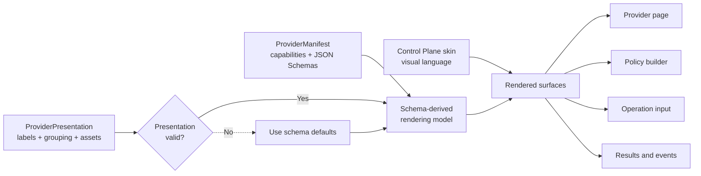
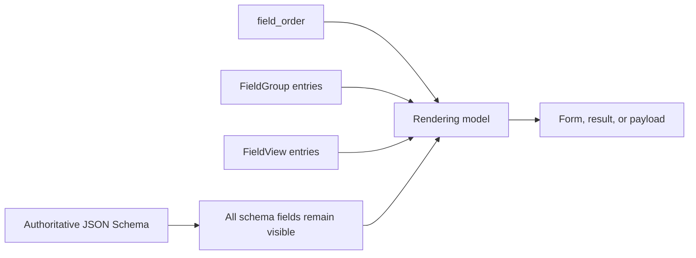

# Provider presentation

A Provider presentation is an optional visual overlay for an accepted
[Provider manifest](provider-manifest.md). It gives a Control Plane useful
labels, explanations, grouping, render preferences, and Provider-owned visuals
without replacing the operation and trigger schemas that define the real
contract.

When a presentation is absent or rejected, the same manifest still produces a
complete schema-derived interface. Presentation improves that interface; it is
never required to understand or execute a capability.

!!! note "Illustrative Control Plane surfaces"

    The previews on this page show how a Control Plane can apply the contract.
    The Protocol defines the meaning of each view. The Control Plane and its
    active skin decide exact layout, spacing, typography, and interaction.

## From declaration to interface

The inputs have separate responsibilities:

| Input | What it contributes |
| --- | --- |
| Operational manifest | Provider identity, capability identifiers, JSON Schemas, required fields, validation, and secret semantics |
| Provider presentation | Human-facing descriptions, grouping, field order, compatible widgets and displays, and embedded visuals |
| Control Plane skin | Colors, type, spacing, component styling, and the overall product experience |

The presentation does not contain a page template. It supplies structured
meaning that any conforming Control Plane can render in its own visual system.

## Views and their Control Plane surfaces

| View | Primary Control Plane surface | What it contributes |
| --- | --- | --- |
| `ProviderView` | Provider detail page and capability browser | Summary, description, icon, banner, and optional capability groups |
| `CapabilityGroup` | Sections within the Provider's capability browser | Label, description, icon, and a stable group ID referenced by operations and triggers |
| `OperationView` | Operation cards, policy steps, input forms, and result panels | Operation text and icon plus separate input and result schema views |
| `TriggerView` | Trigger cards, policy conditions, and event inspection | Trigger text and icon plus a payload schema view |
| `SchemaView` | A form, result, or payload layout | Field order, optional field groups, and field-level presentation hints |
| `FieldGroup` | A labeled section within one schema-derived surface | A visual grouping of JSON Pointer-addressed fields |
| `FieldView` | One field in a form, result, or payload | Label, help, placeholder, unit, input widget, or read-only display style |
| `PresentationAsset` | Provider, group, operation, or trigger visuals | Embedded PNG or sanitized SVG content addressed by its SHA-256 digest |

## Provider view

`ProviderView` describes the integration as a whole. The Control Plane combines
it with `ProviderManifest.display_name` and the manifest's declared operations
and triggers. It does not create a second Provider identity or a custom page.

  
ILLUSTRATIVE PROVIDER PAGE

  

    
GP

    

      <strong>Git Provider</strong>
      
Inspect and resolve Git references.

    

  

  

    Repository
    
Repository inspection and reference operations.

    

      
<small>OPERATION</small><strong>Resolve reference</strong>

      
<small>TRIGGER</small><strong>Reference changed</strong>

    

  

| Preview element | Contract source |
| --- | --- |
| `Git Provider` | `ProviderManifest.display_name` |
| Introductory copy | `ProviderView.summary` and `description` |
| Provider mark or banner | `icon_asset_digest` and `banner_asset_digest` |
| `Repository` section | One `CapabilityGroup` |
| Cards inside the section | Declared operations and triggers whose views reference the group's ID |

Groups are optional. An operation or trigger with an empty `group_id` remains
visible as an ungrouped capability. A group never owns or duplicates the
capabilities placed inside it.

## Operation view

One `OperationView` follows an operation across the places where a user works
with it:

1. its label, summary, description, and icon identify the operation in a
   capability browser or policy builder;
2. its `input` view refines the schema-derived form used to configure an
   invocation; and
3. its `result` view refines how a terminal result is read.

  
ONE OPERATION · THREE SURFACES

  

    <section>
      <small>POLICY STEP</small>
      <h3>Resolve reference</h3>
      
Resolve a Git reference to a commit.

    </section>
    <section>
      <small>INPUT</small>
      <label>Repository <input value="owner/repository" readonly></label>
      <label>Depth 5 commits</label>
      
Credentials

      <label>Access token <input value="••••••••" readonly></label>
    </section>
    <section>
      <small>RESULT</small>
      <dl>
        
<dt>Commit</dt><dd><code>a83f0c1</code></dd>

        
<dt>Changed</dt><dd>Yes</dd>

      </dl>
    </section>
  

The operation's authoritative `input_schema` still decides that `repository`
is required, `depth` is numeric, and `token` is `writeOnly`. Presentation can
choose a text control, bounded slider, and secret input only because those
choices agree with the schema. The result view can render a commit as code and
`changed` as a badge, but it cannot change either result value or type.

## Trigger view

`TriggerView` identifies a declared trigger wherever it can be selected and
controls how an observed payload is presented. It does not define trigger
delivery, acknowledgement, filtering, or policy semantics.

  
TRIGGER SELECTION AND EVENT

  

    <section>
      <small>POLICY CONDITION</small>
      <h3>Reference changed</h3>
      
A repository reference moved.

    </section>
    <section>
      <small>EVENT PAYLOAD</small>
      <dl>
        
<dt>Reference</dt><dd><code>refs/heads/main</code></dd>

        
<dt>Previous</dt><dd><code>7da91b4</code></dd>

      </dl>
    </section>
  

The trigger's `payload_schema` remains authoritative. The payload `SchemaView`
may order, label, group, and format its fields; it cannot add trigger inputs or
alter the event.

## Schema and field views

Every `SchemaView` is scoped to exactly one operation input, operation result,
or trigger payload schema. It uses JSON Pointer to address fields in that
schema.

| Presentation value | Rendering effect | Contract boundary |
| --- | --- | --- |
| `field_order` | Establishes the preferred order for listed fields | Omitted fields still render from the schema |
| `FieldGroup` | Places fields into a labeled visual section | A field belongs to at most one group |
| `label` and `help_text` | Replaces generated copy with author-provided wording | Does not change the field's JSON name or meaning |
| `placeholder` | Adds an input prompt | Valid only on operation input fields |
| `unit` | Adds a human-readable unit beside a value | Does not transform or scale the value |
| `widget` | Suggests a compatible input control | Must agree with type, `enum`, format, bounds, and `writeOnly` semantics |
| `display` | Suggests a compatible read-only renderer | Must agree with the result or payload field type |

There is no presentation field for hiding a schema field, changing
requiredness, supplying defaults, or redefining validation.

## Assets and skins

Presentation assets give a Provider ownership of its visual identity without
giving it executable access to the Control Plane. The snapshot can embed
bounded PNG and sanitized SVG assets. Every asset is content-addressed and
every reference must resolve.

The asset supplies the visual content. The active Control Plane skin decides
how it is framed: size, spacing, background, border, and placement remain part
of the host experience. Presentation contains no HTML, CSS, JavaScript, remote
URL, or filesystem path.

## Acceptance and fallback

The Agent accepts the operational manifest before considering presentation.
It then evaluates the optional snapshot as a separate unit:

| Presentation state | Rendering behavior |
| --- | --- |
| Absent | Build every surface from the manifest's JSON Schemas. |
| Supported and valid | Apply the complete presentation overlay to the schema-derived model. |
| Unsupported schema version | Ignore the presentation and use schema-derived rendering. |
| Invalid reference, preference, asset, or revision | Ignore the presentation and use schema-derived rendering. |

An invalid field hint does not make an operation invalid. The complete
presentation snapshot is discarded, and the operational manifest remains
available.

`manifest_revision` never includes presentation. The separate
`presentation_revision` is bound to the accepted manifest revision, so an
overlay cannot be reused with a different capability declaration.

## How presentation reaches the Control Plane

Within SFP, the Provider includes `ProviderPresentation` in the existing
`ManifestService.GetManifest` response. The Agent validates and caches the
accepted operational and presentation snapshots independently.

The Agent-to-Control-Plane transport for that accepted snapshot will be
defined by SF-AOP. When a Control Plane receives the pair, it can reproduce the
same schema-derived model, apply the validated overlay, and render it through
its active skin. SFP does not introduce a second presentation RPC.

For exact wire fields, revision construction, size limits, and public Python
validators, return to [Provider manifest exchange](provider-manifest.md).
