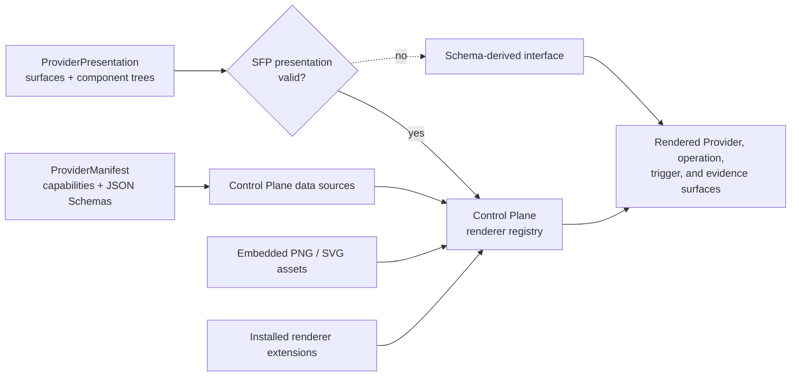
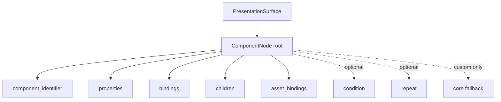

# Provider presentation

A Provider presentation is an optional, independently revised interface
declaration attached to an accepted [Provider manifest](provider-manifest.md).
It tells a Control Plane which surfaces a Provider offers and describes each
surface as a bounded tree of renderer components.

Presentation does not change an operation, trigger, schema, authorization
decision, or runtime value. If it is absent, unsupported, or invalid, the
operational manifest remains usable and the Control Plane can render directly
from its JSON Schemas.

## From manifest to interface



| Layer | Owns |
| --- | --- |
| Operational manifest | Capability identifiers, JSON Schemas, requirements, and execution semantics |
| SFP presentation contract | Surface identifiers, component-tree structure, bindings, conditions, repetition, extension metadata, safe assets, and limits |
| Control Plane renderer registry | The property schema and rendering behavior for each component identifier |
| Control Plane skin | Typography, color, spacing, framing, and product-wide visual language |

SFP carries declarative data only. It never carries HTML, CSS, JavaScript,
executable renderer bytes, an installation command, or a remote asset URL.

## Presentation targets and surfaces

A `ProviderPresentation` can attach a `PresentationTarget` to the Provider
itself and to any operation or trigger declared by the same manifest. Operation
and trigger map keys must match exact manifest identifiers.

Each target contains one or more named surfaces:

| Target | Surface identifier | Intended use |
| --- | --- | --- |
| Provider | `stateforge.ui/surface.provider.overview@1` | Provider identity, status, capabilities, and summary information |
| Operation | `stateforge.ui/surface.operation.request@1` | Construct and review an operation request |
| Operation | `stateforge.ui/surface.operation.run@1` | Follow an admitted operation while it runs |
| Operation | `stateforge.ui/surface.operation.result@1` | Inspect a terminal operation result |
| Trigger | `stateforge.ui/surface.trigger.policy@1` | Configure how a trigger participates in policy |
| Trigger | `stateforge.ui/surface.trigger.event@1` | Inspect one published trigger event |
| Operation or trigger | `stateforge.ui/surface.evidence@1` | Inspect evidence and audit material associated with that target |

Groups are optional. A Provider author creates visual grouping with ordinary
layout components such as a section, grid, tabs, or steps; the Protocol does
not impose a separate grouping model.

## The generic component tree

Every `PresentationSurface` has one root `ComponentNode`. A node selects a
renderer by versioned string identifier and supplies only the data needed to
configure it.



| Node field | Meaning |
| --- | --- |
| `component_identifier` | Versioned identifier resolved by the Control Plane renderer registry |
| `properties` | Renderer-specific static configuration; SFP treats it as inert JSON |
| `bindings` | Named inputs resolved from the data sources available to the current surface |
| `children` | Ordered child components |
| `asset_bindings` | Renderer slot names mapped to embedded asset digests |
| `condition` | Optional declarative existence or equality test controlling visibility |
| `repeat` | Optional bounded repetition over a collection binding |
| `fallback` | Required core-only tree used when a custom renderer is unavailable |

The Protocol validates the identifier and tree, bounds the document, verifies
references, and constrains which data sources exist on each surface. It does
not interpret component properties. The Control Plane validates those
properties against the renderer definition registered for the component
identifier.

## Core component catalog

SFP 1.0 defines a compact core catalog that every conforming Control Plane can
render:

| Category | Component identifiers |
| --- | --- |
| Layout | `layout.stack`, `layout.grid`, `layout.section`, `layout.tabs`, `layout.steps` |
| Input | `input.form`, `input.field`, `input.object`, `input.array`, `input.key_value`, `input.code`, `input.secret` |
| Content and structured data | `content.text`, `content.markdown`, `data.key_value`, `data.table`, `data.tree`, `data.code`, `data.diff`, `data.log` |
| Status and visualization | `status.badge`, `status.progress`, `status.timeline`, `data.metric`, `data.chart`, `data.topology`, `data.artifacts` |
| Media and actions | `media.image`, `action.operation_submit`, `action.operation_cancel` |

Each value above uses the `stateforge.ui` namespace and `@1` major version.
For example, the complete table identifier is
`stateforge.ui/data.table@1`.

These are identifiers, not protobuf message types. Adding a renderer does not
require adding a new component-specific message or enum to SFP.

### Portable core structure

Core identifiers also carry a small Protocol-owned structural contract. This
does not define styling or renderer properties; it guarantees that an accepted
core tree—including a custom component's fallback—can be interpreted the same
way by every conforming Control Plane.

| Core family | Surfaces | Children | Binding and asset slots |
| --- | --- | --- | --- |
| Layout | All | One or more | No bindings or assets |
| Form, object, array | Operation request or trigger policy | Optional nested controls | Required `schema`; optional public `value` |
| Field, key/value, code input | Operation request or trigger policy | None | Required `schema`; optional public `value` |
| Secret input | Operation request or trigger policy | None | Required `schema`; secret value remains private host state |
| Text and Markdown | All | None | Optional `value` |
| Key/value, tree, code, badge, progress, and metric | All | None | Required `value` |
| Table, log, timeline, chart, and artifacts | All | None | Required `rows`, `entries`, `events`, `series`, or `items` respectively |
| Diff | All | None | Required `before` and `after` |
| Topology | All | None | Required `nodes` and `edges` |
| Image | All | None | Required `source` asset |
| Submit action | Operation request | None | Host-controlled action; no binding or asset |
| Cancel action | Operation run | None | Host-controlled action; no binding or asset |

A core component cannot declare a fallback. Custom components must declare a
core-only fallback, and every node in that fallback is checked against this
same structural registry. Renderer-specific `properties` remain owned by the
Control Plane registry.

## Data bindings

A `DataBinding` selects one Control Plane-provided source and optionally a
JSON Pointer within it. An empty pointer selects the complete source. The
sources available depend on the surface, preventing a Provider from referring
to data that does not exist in that rendering context.

Examples include:

| Surface | Representative binding sources |
| --- | --- |
| Provider overview | Provider manifest and Provider runtime state |
| Operation request | Request schema and the public request draft |
| Operation run | Public admitted-request projection and live operation state |
| Operation result | Public request projection, result schema, result value, and operation evidence |
| Trigger policy | Trigger payload schema |
| Trigger event | Payload schema and published payload value |
| Evidence | Operation evidence or trigger value plus audit data |

A repetition creates a named item scope. Descendants can bind to
`stateforge.binding/repetition.item@1` only by naming an active scope. Each
repetition also declares a positive `max_items` ceiling.

Conditions support `EXISTS`, `NOT_EXISTS`, `EQUALS`, and `NOT_EQUALS`.
Existence conditions omit a comparison value; equality conditions require one,
including an explicitly supplied JSON `null`.

The request-value source is
`stateforge.binding/operation.request.public_value@1`. It is a safe projection,
not the submitted request: every value whose applicable input schema marks it
`writeOnly` is omitted. If an implementation cannot prove that a value is
public, it must omit that value. Secret-entry state remains private to the form
renderer and is never addressable by a presentation binding. The raw request
has no presentation binding identifier.

## Core example

The manifest fixture uses a core form for the operation request:

```json
{
  "componentIdentifier": "stateforge.ui/input.form@1",
  "properties": {
    "submitLabel": "Resolve reference"
  },
  "bindings": {
    "schema": {
      "sourceIdentifier": "stateforge.binding/operation.request.schema@1",
      "pointer": "",
      "scope": ""
    },
    "value": {
      "sourceIdentifier": "stateforge.binding/operation.request.public_value@1",
      "pointer": "",
      "scope": ""
    }
  },
  "children": [],
  "assetBindings": {}
}
```

The operation input JSON Schema remains authoritative. The renderer can produce
an appropriate form because the schema and public draft arrive through
bindings. Secret fields keep their values in private form state, so the
presentation cannot bind or display them. Presentation also cannot relax
validation or manufacture an operation field.

## Custom components and renderer extensions

A Provider may use its own component identifier, such as
`example.git/data.commit_graph@1`. A custom node has two additional
requirements:

1. its namespace has one matching `RendererRequirement`; and
2. the node includes a fallback tree composed only of core
   `stateforge.ui` components.

```json
{
  "componentIdentifier": "example.git/data.commit_graph@1",
  "properties": {},
  "bindings": {
    "result": {
      "sourceIdentifier": "stateforge.binding/operation.result.value@1",
      "pointer": "",
      "scope": ""
    }
  },
  "children": [],
  "assetBindings": {},
  "fallback": {
    "componentIdentifier": "stateforge.ui/data.tree@1",
    "properties": {},
    "bindings": {
      "value": {
        "sourceIdentifier": "stateforge.binding/operation.result.value@1",
        "pointer": "",
        "scope": ""
      }
    },
    "children": [],
    "assetBindings": {}
  }
}
```

The matching requirement carries identity and compatibility metadata:

```json
{
  "example.git": {
    "extensionIdentifier": "example.git/renderer@1",
    "extensionVersion": "1.0.0",
    "rendererApiVersion": "1.0.0",
    "artifactDigest": "sha256:aaaaaaaaaaaaaaaaaaaaaaaaaaaaaaaaaaaaaaaaaaaaaaaaaaaaaaaaaaaaaaaa",
    "permissions": []
  }
}
```

Every namespace beginning with `stateforge.` is reserved for identifiers
defined by StateForge contracts. A Provider-owned renderer must use a namespace
it owns; it cannot introduce custom components or renderer requirements under
`stateforge.ui`, `stateforge.ui.*`, or another `stateforge.*` namespace.

The renderer artifact is distributed separately from SFP. The Control Plane
uses the metadata to locate an already trusted or separately acquired bundle,
checks compatibility and permissions in its extension host, and registers the
component identifiers exposed by that bundle. SFP never downloads or executes
it.

If the extension is missing, incompatible, disabled, or rejected, the Control
Plane renders the core fallback. This preserves a functional interface without
limiting advanced Provider authors to the built-in catalog.

## Embedded assets

`PresentationAsset` carries bounded, content-addressed PNG or sanitized SVG
media. Nodes refer to assets through named `asset_bindings`. Every digest must
match the exact bytes, every reference must resolve, and unreferenced assets
are rejected.

Assets provide Provider-owned icons and visuals. The active Control Plane skin
still controls their framing, size, background, and placement.

## Validation and fallback

The Agent accepts the operational manifest before considering presentation.
The presentation is then evaluated independently:

| Presentation state | Result |
| --- | --- |
| Absent | Keep the manifest and render from its JSON Schemas. |
| Supported and valid | Cache the component tree and its independent revision. |
| Unsupported schema version | Keep the manifest and ignore presentation. |
| Invalid tree, source, extension metadata, asset, or revision | Keep the manifest and discard the complete presentation snapshot. |

The Protocol enforces limits for tree depth, total component count, children,
bindings, properties, repetition, extensions, permissions, assets, and
canonical bytes. Partial acceptance is not allowed.

`manifest_revision` excludes presentation. `presentation_revision` hashes the
complete presentation and is bound to the accepted manifest revision, so a
presentation cannot be reused with a different capability declaration.

## How it reaches the Control Plane

The Provider returns `ProviderPresentation` through the existing
`ManifestService.GetManifest` response. The Agent validates and caches the
manifest and presentation independently.

A future SF-AOP contract will transport the accepted snapshots to the Control
Plane. No second SFP presentation RPC is introduced. Once received, the
Control Plane resolves component identifiers through its renderer registry,
binds the current runtime data, applies its active skin, and renders the
surface.

For the exact service envelope, revision construction, limits, and public
Python validators, return to
[Provider manifest exchange](provider-manifest.md).

## Using the Python contract

| Module | Responsibility |
| --- | --- |
| [`contract.py`](https://github.com/stateforge-org/stateforge-protocol/blob/mvp/implementation/src/stateforge_protocol/sfp/manifest/v1/contract.py) | Owns the supported surface identifiers, core component catalog, binding-source identifiers, renderer metadata limits, and component-tree bounds. |
| [`validation.py`](https://github.com/stateforge-org/stateforge-protocol/blob/mvp/implementation/src/stateforge_protocol/sfp/manifest/v1/validation.py) | Exposes complete Manifest Exchange validation, independent presentation acceptance, presentation revision calculation, and presentation fallback. |

Provider and Agent implementations should import these canonical definitions
instead of duplicating component identifiers, source identifiers, or limits.
Renderer-specific property schemas belong to the Control Plane renderer
registry and are deliberately not defined by these Protocol modules.
