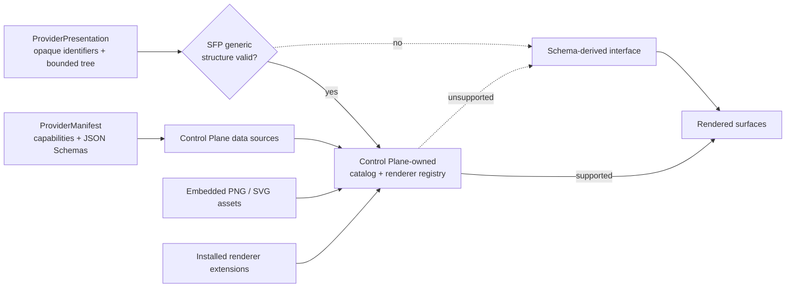
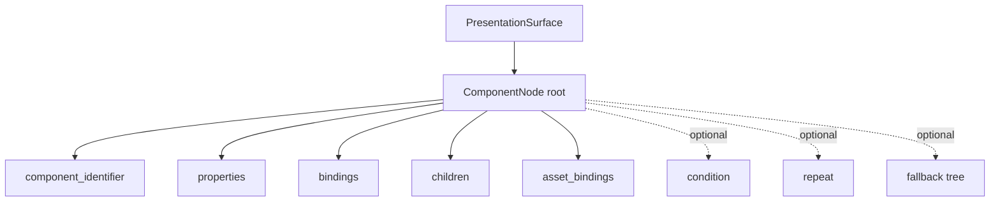

# Provider presentation

A Provider presentation is an optional, independently revised interface
declaration attached to an accepted [Provider manifest](provider-manifest.md).
It tells a Control Plane which surfaces a Provider offers and describes each
surface as a bounded tree of renderer components.

Presentation does not change an operation, trigger, schema, authorization
decision, or runtime value. If it is absent, unsupported, or invalid, the
operational manifest remains usable and the Control Plane can render directly
from its JSON Schemas.

## From manifest to interface



| Layer | Owns |
| --- | --- |
| Operational manifest | Capability identifiers, JSON Schemas, requirements, and execution semantics |
| SFP presentation contract | Generic bounded component-tree structure, bindings, conditions, repetition, asset bytes, and transport limits |
| Control Plane catalog and renderer registry | Surface and component applicability, property schemas, data-source resolution, renderer availability, and rendering behavior |
| Control Plane skin | Typography, color, spacing, framing, and product-wide visual language |

SFP carries declarative data only. It never carries HTML, CSS, JavaScript,
executable renderer bytes, an installation command, or a remote asset URL.

## Presentation targets and surfaces

A `ProviderPresentation` can attach a `PresentationTarget` to the Provider
itself and to any operation or trigger declared by the same manifest. Operation
and trigger map keys must match exact manifest identifiers.

Each target contains a map of named surfaces. The Control Plane catalog owns
surface identifiers and their applicability to Provider, operation, and trigger
targets. SFP accepts any well-formed surface identifier on any target; it does
not maintain the surface list or decide which target type or Control Plane
supports a surface.

Groups are optional. A Provider author creates visual grouping with ordinary
layout components such as a section, grid, tabs, or steps; the Protocol does
not impose a separate grouping model.

## The generic component tree

Every `PresentationSurface` has one root `ComponentNode`. A node selects a
renderer by versioned string identifier and supplies only the data needed to
configure it.



| Node field | Meaning |
| --- | --- |
| `component_identifier` | Versioned identifier resolved by the Control Plane renderer registry |
| `properties` | Renderer-specific static configuration; SFP treats it as inert JSON |
| `bindings` | Named inputs resolved from the data sources available to the current surface |
| `children` | Ordered child components |
| `asset_bindings` | Renderer slot names mapped to embedded asset digests |
| `condition` | Optional declarative existence or equality test controlling visibility |
| `repeat` | Optional bounded repetition over a collection binding |
| `fallback` | Optional declarative tree that the Control Plane may use according to its own policy |

The Protocol checks generic identifier syntax and bounded tree structure;
component identifiers, surface identifiers, binding slot names, asset slot
names, and property meanings are opaque to SFP. It does not maintain the
Provider Views catalog or decide whether a component is supported on a
surface. The Control Plane owns the catalog and renderer registry, validates
properties and applicability, resolves data sources, and decides how to handle
unknown or unsupported identifiers. A Control Plane is not required to render
every catalog component.
Component applicability is not decided by SFP.

The catalog's 30 component identifiers are maintained by the Control Plane.
Those names are ordinary versioned identifiers in this wire format—not
Protocol enums, component-specific protobuf messages, or a Protocol allowlist.
A catalog or renderer change does not require changing the SFP message schema.

## Data bindings

A `DataBinding` names a Control Plane-provided source and optionally a JSON
Pointer within it. An empty pointer selects the complete source. SFP treats
source identifiers and their availability as opaque; the Control Plane owns
the source catalog and decides which sources a given target and surface may
resolve. It must not resolve a source the active rendering context does not
provide.

A repetition creates a named item scope. Descendants can bind to
`stateforge.binding/repetition.item@1` only by naming an active scope. Each
repetition also declares a positive `max_items` ceiling. These are generic
tree and resource invariants; component-specific repetition behavior belongs
to the Control Plane catalog.

Conditions support `EXISTS`, `NOT_EXISTS`, `EQUALS`, and `NOT_EQUALS`.
Existence conditions omit a comparison value; equality conditions require one,
including an explicitly supplied JSON `null`.

`stateforge.binding/operation.request.public_value@1` denotes a safe
projection, not the submitted request: every value whose applicable input
schema marks it `writeOnly` is omitted. If the data-source owner cannot prove a
value is public, it must omit it. Secret-entry state remains private to the
Control Plane and is never addressable by a presentation binding. The raw
operation request binding identifier is forbidden by SFP.

## Example presentation

The manifest fixture uses a form component identifier for the operation request:

```json
{
  "componentIdentifier": "stateforge.ui/input.form@1",
  "properties": {
    "submitLabel": "Resolve reference"
  },
  "bindings": {
    "schema": {
      "sourceIdentifier": "stateforge.binding/operation.request.schema@1",
      "pointer": "",
      "scope": ""
    },
    "value": {
      "sourceIdentifier": "stateforge.binding/operation.request.public_value@1",
      "pointer": "",
      "scope": ""
    }
  },
  "children": [],
  "assetBindings": {}
}
```

The operation input JSON Schema remains authoritative. The renderer can produce
an appropriate form because the schema and public draft arrive through
bindings. Secret fields keep their values in private form state, so the
presentation cannot bind or display them. Presentation also cannot relax
validation or manufacture an operation field.

## Custom components and renderer extensions

A Provider may use its own component identifier, such as
`example.git/data.commit_graph@1`. A node may include a fallback tree and
`RendererRequirement` metadata. SFP transports these fields as bounded declarative data; it
does not require an identifier to be listed in a Protocol registry, require a
renderer requirement for a node, or restrict fallback nodes to a Protocol
catalog.

```json
{
  "componentIdentifier": "example.git/data.commit_graph@1",
  "properties": {},
  "bindings": {
    "result": {
      "sourceIdentifier": "stateforge.binding/operation.result.value@1",
      "pointer": "",
      "scope": ""
    }
  },
  "children": [],
  "assetBindings": {},
  "fallback": {
    "componentIdentifier": "stateforge.ui/data.tree@1",
    "properties": {},
    "bindings": {
      "value": {
        "sourceIdentifier": "stateforge.binding/operation.result.value@1",
        "pointer": "",
        "scope": ""
      }
    },
    "children": [],
    "assetBindings": {}
  }
}
```

Renderer metadata may carry identity and compatibility information for a
separately installed renderer:

```json
{
  "example.git": {
    "extensionIdentifier": "example.git/renderer@1",
    "extensionVersion": "1.0.0",
    "rendererApiVersion": "1.0.0",
    "artifactDigest": "sha256:aaaaaaaaaaaaaaaaaaaaaaaaaaaaaaaaaaaaaaaaaaaaaaaaaaaaaaaaaaaaaaaa",
    "permissions": []
  }
}
```

Renderer requirements cannot claim a `stateforge.*` namespace. Component
identifier support and ownership are resolved by the Control Plane catalog;
SFP does not use a namespace to classify components as built-in or custom.

The renderer artifact is distributed separately from SFP. The Control Plane
decides whether to trust, acquire, enable, and register it. SFP transports the
metadata as bounded data and never downloads or executes renderer code.

If the extension is missing, incompatible, disabled, or rejected, the Control
Plane applies its own fallback policy. Fallback availability and use are not
determined by SFP.

## Embedded assets

`PresentationAsset` carries bounded, content-addressed PNG or sanitized SVG
media. Nodes refer to assets through named `asset_bindings`. Every digest must
match the exact bytes, every reference must resolve, and unreferenced assets
are rejected. PNG validation also verifies the complete compressed stream,
decoded scanline layout and filter bytes under a decoded-size ceiling; valid
chunk framing and CRCs alone are not sufficient.

Assets provide Provider-owned icons and visuals. The active Control Plane skin
still controls their framing, size, background, and placement.

## Validation and fallback

The Agent accepts the operational manifest before considering presentation.
The presentation is then evaluated independently:

| Presentation state | Result |
| --- | --- |
| Absent | Keep the manifest and render from its JSON Schemas. |
| Structurally valid | Cache the component tree and its independent revision; renderer support is not decided here. |
| Unsupported schema version | Keep the manifest and ignore presentation. |
| Invalid generic structure, forbidden raw request binding, asset, or revision | Keep the manifest and discard the complete presentation snapshot. |

The Protocol enforces generic limits for tree depth, total component count,
children, bindings, properties, repetition, renderer metadata, permissions,
assets, and canonical bytes. It does not reject a presentation because a
component, surface, property, slot, or data source is unknown to SFP. Partial
acceptance is not allowed for structural or safety failures.

`manifest_revision` excludes presentation. `presentation_revision` hashes the
complete presentation and is bound to the accepted manifest revision, so a
presentation cannot be reused with a different capability declaration.

## How it reaches the Control Plane

The Provider returns `ProviderPresentation` through the existing
`ManifestService.GetManifest` response. The Agent validates and caches the
manifest and presentation independently.

SF-AOP transports the accepted snapshots to the Control Plane; SFP introduces
no separate presentation RPC. The Control Plane resolves component
identifiers through its renderer registry, binds the current runtime data,
applies its active skin, and renders the surface.

For the exact service envelope, revision construction, limits, and public
Python validators, return to
[Provider manifest exchange](provider-manifest.md).

## Using the Python contract

| Module | Responsibility |
| --- | --- |
| [`contract.py`](https://github.com/stateforge-org/stateforge-protocol/blob/mvp/implementation/src/stateforge_protocol/sfp/manifest/v1/contract.py) | Owns generic wire limits, repetition safety identifiers, renderer-metadata bounds, and component-tree bounds—not the Control Plane renderer catalog. |
| [`validation.py`](https://github.com/stateforge-org/stateforge-protocol/blob/mvp/implementation/src/stateforge_protocol/sfp/manifest/v1/validation.py) | Exposes complete Manifest Exchange validation, independent presentation acceptance, presentation revision calculation, and presentation fallback. |

Provider and Agent implementations should use these generic Protocol
definitions for wire validation and resource limits. The Control Plane owns
the renderer catalog, component and surface applicability, source availability,
property schemas, fallback behavior, and rendering semantics.
