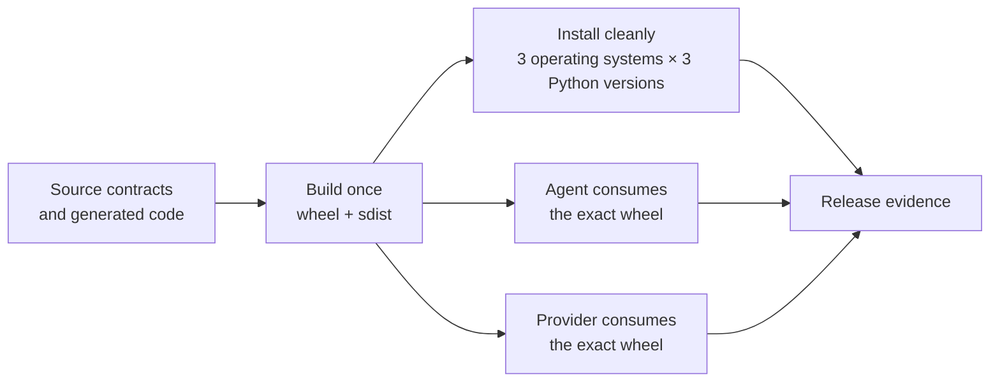

# CI/CD and artifact verification

StateForge Protocol verifies a release as a distributable contract, not only
as source code. The pipeline builds one wheel and one source distribution,
then passes those exact artifacts through clean installation and independent
Agent and Provider checks.

## Verification at a glance



<div class="sf-docs-card-grid sf-docs-card-grid--two">
  <article class="sf-docs-card">
    <span class="sf-docs-card__label">01 / SOURCE</span>
    <h3>The contract is internally consistent</h3>
    <p>
      Protobuf sources, generated bindings, schemas, fixtures, validators,
      documentation, and compatibility checks agree before packaging begins.
    </p>
  </article>
  <article class="sf-docs-card">
    <span class="sf-docs-card__label">02 / ARTIFACT</span>
    <h3>One build has one identity</h3>
    <p>
      The wheel and source distribution are built once and travel with their
      hashes, package version, source commit, and builder provenance.
    </p>
  </article>
  <article class="sf-docs-card">
    <span class="sf-docs-card__label">03 / INSTALL</span>
    <h3>The published package stands alone</h3>
    <p>
      Clean environments install the downloaded distributions outside the
      checkout and replay the packaged contract and conformance evidence.
    </p>
  </article>
  <article class="sf-docs-card">
    <span class="sf-docs-card__label">04 / CONSUMERS</span>
    <h3>Both runtimes consume the public contract</h3>
    <p>
      Immutable Agent and Provider revisions install the same wheel, run
      their complete quality suites, and pass Protocol-ownership audits.
    </p>
  </article>
</div>

## One build, exact bytes

[`protocol-build.yml`](https://github.com/stateforge-org/stateforge-protocol/blob/mvp/implementation/.github/workflows/protocol-build.yml)
is the only distribution build in the verification graph. It produces one
artifact bundle:

| File | Purpose |
| --- | --- |
| `stateforge_protocol-<version>-py3-none-any.whl` | Python wheel installed by the matrix and both consumers |
| `stateforge_protocol-<version>.tar.gz` | Source distribution independently installed by the matrix |
| `SHA256SUMS` | SHA-256 identities for the wheel, source distribution, and provenance record |
| `PROVENANCE` | Distribution name, version, source commit and ref, builder Python, runner OS, and architecture |

Every downstream job downloads this bundle and verifies `SHA256SUMS` before
installation. No downstream job rebuilds the package.

!!! important "A green consumer run refers to one exact wheel"

    Agent and Provider verification records both the wheel digest and the
    installed package's `direct_url.json`. A different wheel with the same
    version does not satisfy the check.

## Verification gates

| Gate | What runs | What it proves |
| --- | --- | --- |
| Source contracts | Dependency-lock check, Actionlint, Zizmor, Buf lint and format, deterministic generation, Buf compatibility, the complete test suite with coverage, Ruff, mypy, and strict documentation build | The source tree, generated outputs, automation, and documented contract agree |
| Distribution build | One wheel and one source distribution, followed by metadata, checksum, and provenance generation | The candidate has one attributable artifact identity |
| Installed package | Wheel and source-distribution installation in isolated virtual environments with the checkout removed from Python import resolution | The package contains its generated modules, public contracts, schemas, typing marker, and conformance fixtures |
| Agent consumer | Exact wheel installation, package-origin verification, Protocol-ownership audit, and the complete Agent quality suite | The Agent consumes this candidate through public Protocol APIs |
| Provider consumer | Exact wheel installation, package-origin verification, Protocol-ownership audit, and the complete Provider quality suite | StateForge Provider Python consumes this candidate through public Protocol APIs |

The installed-package gate runs every combination below:

| Runner | Python versions | Distribution forms |
| --- | --- | --- |
| Ubuntu 24.04 | 3.11, 3.12, 3.13 | Wheel and source distribution |
| macOS 14 | 3.11, 3.12, 3.13 | Wheel and source distribution |
| Windows Server 2022 | 3.11, 3.12, 3.13 | Wheel and source distribution |

The verifier executes from the runner's temporary directory with
`PYTHONPATH` and `PYTHONHOME` unset and Python isolated mode enabled. This
prevents the repository checkout from hiding missing package data or broken
imports.

## Independent consumer verification

Consumer refs may name branches, tags, or commits. The workflow resolves each
ref once, records the resulting commit, and uses that immutable commit for the
actual test job.

For each consumer, the workflow then:

1. verifies the distribution bundle checksums;
2. installs the exact Protocol wheel before installing the consumer;
3. proves the installed distribution originated from that wheel and matches
   its SHA-256 digest;
4. audits the consumer for copied service identities, copied Protocol limits,
   private validation imports, or use of generated bindings without the
   corresponding public contract and validator; and
5. runs formatting, linting, typing, tests, and a strict documentation build.

The ownership audit is intentionally separate from ordinary import success.
A consumer can import generated protobuf code successfully while still
creating a second, divergent copy of a Protocol-owned rule.

## Portable package build

Another repository can use the package action without copying the build
logic. The caller selects a Protocol revision, checks it out below its own
workspace, and invokes the action from that checkout:

```yaml title="Build StateForge Protocol from another repository"
- uses: actions/checkout@<immutable-action-sha>
  with:
    repository: stateforge-org/stateforge-protocol
    ref: <protocol-ref-or-commit>
    path: .stateforge-ci/protocol
    persist-credentials: false

- uses: ./.stateforge-ci/protocol/.github/actions/python/build
  with:
    output-directory: dist/protocol
    evidence-directory: evidence/protocol-build
```

The action resolves its source relative to its own location, so provenance
describes the Protocol checkout rather than the calling repository. Output and
evidence paths are normalized inside the caller workspace before the build
starts.

## Reusable workflow interfaces

| Workflow | Inputs | Outputs or result |
| --- | --- | --- |
| [`protocol-build-and-verify.yml`](https://github.com/stateforge-org/stateforge-protocol/blob/mvp/implementation/.github/workflows/protocol-build-and-verify.yml) | Artifact name, Buf comparison source, Agent ref, Provider ref, retention | Exact artifact name, package version, and wheel SHA-256 |
| [`protocol-source-verify.yml`](https://github.com/stateforge-org/stateforge-protocol/blob/mvp/implementation/.github/workflows/protocol-source-verify.yml) | Buf comparison source, evidence name, retention | Source-contract and quality evidence |
| [`protocol-build.yml`](https://github.com/stateforge-org/stateforge-protocol/blob/mvp/implementation/.github/workflows/protocol-build.yml) | Artifact name, evidence name, retention | Artifact name, package version, and wheel SHA-256 |
| [`protocol-installed-test.yml`](https://github.com/stateforge-org/stateforge-protocol/blob/mvp/implementation/.github/workflows/protocol-installed-test.yml) | Built artifact name, evidence prefix, retention | Nine isolated wheel and source-distribution verification jobs |
| [`protocol-consumer-test.yml`](https://github.com/stateforge-org/stateforge-protocol/blob/mvp/implementation/.github/workflows/protocol-consumer-test.yml) | Built artifact name, Agent ref, Provider ref, evidence prefix, retention | Agent and Provider compatibility evidence against immutable consumer commits |

[`protocol-ci.yml`](https://github.com/stateforge-org/stateforge-protocol/blob/mvp/implementation/.github/workflows/protocol-ci.yml)
runs the graph for pull requests and pushes to `main` and
`mvp/implementation`. Artifacts are retained for seven days.

[`protocol-release-candidate.yml`](https://github.com/stateforge-org/stateforge-protocol/blob/mvp/implementation/.github/workflows/protocol-release-candidate.yml)
is manually dispatched. It accepts the compatibility baseline, selected Agent
and Provider refs, and retention period; release-candidate evidence is retained
for 30 days by default.

## Evidence artifacts

Evidence is uploaded even when its producing stage fails.

| Stage | Representative evidence |
| --- | --- |
| Source | Contract-validation log, Python and documentation quality log, and bounded runner context |
| Build | Build log and bounded runner context; the distribution bundle separately retains checksums and provenance |
| Installed package | Wheel and source-distribution conformance JSON, installation logs, and per-matrix runner context |
| Agent consumer | Requested ref, resolved commit, wheel digest, installed-origin JSON, ownership findings, environment, and quality log |
| Provider consumer | Requested ref, resolved commit, wheel digest, installed-origin JSON, ownership findings, environment, and quality log |

The evidence collector keeps only an allow-listed runner summary and bounds
each retained file to 256 KiB by default. It does not dump the process
environment or upload arbitrary workspace contents.

## Workflow security

| Control | Enforcement |
| --- | --- |
| Minimal token scope | Workflows declare read-only repository contents permission |
| Immutable third-party automation | External actions are pinned to full commit SHAs |
| Credential isolation | Checkout persistence is disabled |
| Bounded execution | Every job has a timeout; CI runs cancel superseded work where appropriate |
| Static workflow checks | Actionlint validates syntax and expressions |
| Security audit | Zizmor runs offline and rejects medium-or-higher findings without a GitHub token |
| Dependency drift | The lock file is checked and caches are keyed from declared dependencies |

## Run source checks locally

After installing the `dev` and `docs` dependency groups, the source gates can
be run with:

```bash
uv lock --check --python "3.13"
actionlint -color
zizmor --offline --persona auditor --min-severity medium .
buf lint
buf format --diff --exit-code
python scripts/check_generated.py
buf breaking --against '.git#branch=origin/mvp/implementation'
python -m pytest --cov
python -m ruff format --check .
python -m ruff check .
python -m mypy src
python -m mkdocs build --strict
python -m build
```

These commands exercise the source and build gates. GitHub Actions remains the
proof for the complete operating-system matrix, exact artifact handoff, and
independent Agent and Provider compatibility.
