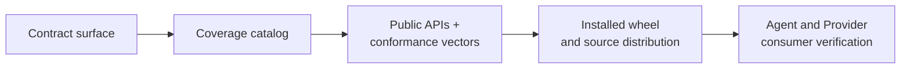

# Conformance coverage

SFP conformance means that independent implementations interpret the same
documents, messages, state transitions, and failure cases the same way. The
Protocol package records that proof in a machine-readable coverage catalog and
ships the catalog with the fixtures used to exercise every contract surface.

## From contract to evidence

Each layer answers a different question:

  <article class="sf-docs-card">
    01 / INVENTORY
    <h3>Is the complete surface declared?</h3>
    

      Every filesystem contract, gRPC service, composed recovery contract,
      and shared-endpoint aggregate has one catalog entry.
    

  </article>
  <article class="sf-docs-card">
    02 / CONTRACT
    <h3>Do the public APIs enforce it?</h3>
    

      Focused tests exercise the canonical contract modules, validators,
      schemas, valid vectors, invalid vectors, and boundary values.
    

  </article>
  <article class="sf-docs-card">
    03 / DISTRIBUTION
    <h3>Did the release preserve the contract?</h3>
    

      The built wheel and source distribution are installed in clean
      environments and replay the packaged conformance evidence.
    

  </article>
  <article class="sf-docs-card">
    04 / CONSUMERS
    <h3>Can both runtimes consume it?</h3>
    

      Agent and Provider verification uses the exact built Protocol wheel and
      checks that consumers import public contracts instead of copying them.
    

  </article>

Passing an earlier layer does not replace a later one. Source tests can prove a
validator is correct while an installed-package check still catches a missing
schema, fixture, generated module, or package-data rule.

## Covered contract surfaces

The coverage catalog follows the same lifecycle as the procedure
documentation.

### Establish and qualify

| Surface | Canonical API | Evidence exercises |
| --- | --- | --- |
| [`endpoint-discovery`](../procedures/endpoint-discovery.md) | `sfp.endpoint_discovery.v1.contract` | Descriptor parsing, canonical serialization, filename, identity, generation, socket path, permissions, and size limits |
| [`bootstrap`](../bootstrap.md) | `sfp.bootstrap.v1.contract` and `validation` | Handshake request and response validity, identity correlation, version selection, generation fencing, and session bounds |
| [`health`](../procedures/health.md) | `sfp.health_contract` with `grpc.health.v1` | Standard service identity, Provider-wide Watch key, lifecycle states, eligibility inputs, failure scenarios, and diagnostic bounds |
| [`manifest`](../procedures/provider-manifest.md) | `sfp.manifest.v1.contract` and `validation` | Declaration shape, embedded schemas, identifiers, session binding, independent manifest/presentation revisions, schema-addressed overlays, optional groups, safe assets, fallback, and invalid documents |
| [`capability-assessment`](../procedures/capability-assessment.md) | `sfp.capability_assessment.v1.contract` and `validation` | Request and response validity, session and manifest correlation, mixed support findings, invalid invariants, and requirement states |

### Exchange and recover

| Surface | Canonical API | Evidence exercises |
| --- | --- | --- |
| [`trigger-publication`](../procedures/triggers.md) | `sfp.trigger_publication.v1.contract` and `validation` | Stream opening, publications, canonical content fingerprints, replay, acknowledgements, rejection details, and correlation |
| [`operation-admission`](../procedures/operation-admission.md) | `sfp.operation_admission.v1.contract` and `validation` | Immutable requests, fingerprints, new admission, duplicate resolution, conflicts, modes, and error details |
| [`operation-lifecycle`](../procedures/progress-results-cancellation.md) | `sfp.operation_lifecycle.v1.contract` and `validation` | Watch cursors, legal transitions, progress, results, terminal immutability, skipped updates, cancellation, and errors |
| [`disconnection-recovery`](../procedures/disconnection-recovery.md) | `sfp.recovery` composed with procedure validators | Identity transitions, stale-session fencing, retained and lost operation state, trigger replay, cursors, and cancellation recovery |

### Shared endpoint

| Surface | Canonical API | Evidence exercises |
| --- | --- | --- |
| `shared-endpoint` | `sfp.shared_endpoint` | Complete service inventory and aggregate Provider send and receive ceilings derived from every registered procedure |

## Why some surfaces look different

Not every SFP procedure needs the same files. The catalog records the public
owner and the reason whenever a separate validator or service does not apply.

| Surface | Deliberate contract shape |
| --- | --- |
| Endpoint Discovery | A filesystem document rather than an RPC. Its public parser performs both structural and semantic validation. |
| Health | Uses the standard `grpc.health.v1.Health` service and status vocabulary. StateForge defines how that standard service represents Provider availability. |
| Disconnection Recovery | Composes session identity classification with the validators of the procedures being reconciled. It introduces no recovery RPC. |
| Shared Endpoint | Aggregates the registered procedure inventory and transport ceilings. It introduces no independent wire exchange. |

## Packaged evidence

The source catalog lives at
[`tests/fixtures/conformance/coverage.json`](https://github.com/stateforge-org/stateforge-protocol/blob/mvp/implementation/tests/fixtures/conformance/coverage.json).
During packaging, the complete fixture tree is installed under
`stateforge_protocol/fixtures/`. An installed verifier then loads the catalog,
imports each declared public module, resolves every schema and fixture root,
and checks that every declared surface produced a result.

Each catalog entry binds one contract surface to:

| Catalog field | Meaning |
| --- | --- |
| `id` and `kind` | Stable coverage identity and whether the surface is filesystem, gRPC, standard gRPC, cross-procedure, or aggregate |
| `serviceName` | Fully qualified gRPC service identity when the surface owns or uses a service |
| `contractModule` | Public module that owns the stable contract |
| `validationModule` | Public semantic validator, or an explicit explanation when the surface intentionally has none |
| `schemaResources` | Packaged machine-readable schemas required by the contract |
| `fixtureRoots` | Packaged valid, invalid, boundary, and scenario evidence |
| `sourceTests` | Focused tests that interpret the evidence against the public API |
| `installedResultKey` | Unique key proving the installed verifier exercised that surface |

!!! important "Fixtures are evidence, not a second specification"

    The protobuf sources, packaged schemas, public contract modules, and public
    validators remain authoritative. Fixtures demonstrate their behavior and
    protect it from regression; they do not redefine it.

## Conformance result

A contract change is conformant only when its catalog entry, public API,
focused vectors, packaged resources, installed distributions, and independent
consumers agree. An undeclared surface or a declared surface without executable
evidence blocks the Protocol release.

Conformance at this layer proves the portable SFP contract. Runtime decisions
that depend on a live Agent, Provider process, managed target, or local policy
remain the responsibility of the owning runtime, as described in
[Responsibility boundaries](responsibility-boundaries.md).
