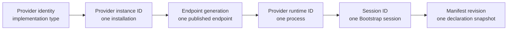

# SFP terminology glossary

SFP uses different identities for declarations, installations, processes,
sessions, operations, and publications. Those distinctions are protocol
fences, not naming trivia. Use this glossary when implementing or reviewing an
SFP peer.

## Identity chain

The chain narrows from a reusable Provider implementation to the exact runtime
declaration governing one active session. A value from one level never
substitutes for another.

## Terms commonly confused

| Do not confuse | Distinction |
|---|---|
| Provider identity / instance ID / runtime ID | An implementation type, one installed Provider, and one executing Provider process. |
| Endpoint generation / session ID | A published endpoint revision and the opaque fence minted by one successful Bootstrap exchange. |
| Wire version / manifest schema version / package version | The negotiated SFP contract, the manifest document format, and the released software artifact. |
| Manifest revision / request fingerprint | A digest of one Provider declaration and a digest of one immutable operation invocation. Neither is a signature. |
| Health / availability / capability / authorization | Process readiness, Agent-derived usability, runtime evidence for declared operations, and permission granted by policy. |
| Operation identifier / operation ID | A declared operation type such as `stateforge.git/reference.resolve@1` and one Agent-assigned UUIDv4 business attempt. |
| Trigger identifier / publication ID | A declared event type and one Provider-assigned UUIDv4 event occurrence. |
| gRPC status / domain outcome | Whether an RPC exchange completed and what happened to the operation or publication represented by it. |
| Retry / replay / reconnect / redispatch | Repeat an exchange, resend the same immutable event, create a new session, or start business work again. |

## Participants and transport

| Term | Meaning |
|---|---|
| **StateForge Protocol (SFP)** | The versioned local protocol between a StateForge Agent and independently running Provider processes. |
| **Agent** | The SFP client and coordinator. It discovers Providers, validates their declarations and evidence, admits operations, and accepts trigger publications. |
| **Provider** | A separate process that publishes an endpoint and exposes manifest-declared operations and triggers through SFP. |
| **Provider runtime** | The server and framework behavior inside a Provider process. It is not the Provider installation identity. |
| **SFP procedure** | One defined protocol interaction, including its messages, validation order, outcomes, and recovery rules. |
| **Shared endpoint** | The Provider's local gRPC server. Bootstrap, Manifest, Health, Capability Assessment, operations, and triggers share this endpoint. |
| **Multiplexed channel** | One local HTTP/2 connection carrying calls to the SFP services exposed by the shared endpoint. |
| **Unix socket** | The local filesystem-backed transport address published in the endpoint descriptor. |

## Identity, endpoint, and versioning

| Term | Meaning |
|---|---|
| **Provider identity** (`provider_identity`) | Author-declared dotted lowercase identity for the Provider implementation, such as `stateforge.git`. It is not unique to one installation. |
| **Provider instance ID** (`provider_instance_id`) | Stable canonical UUIDv4 for one Provider installation. It persists across process restarts and endpoint generations. |
| **Provider runtime ID** (`provider_runtime_id`) | UUIDv4 for one currently executing Provider process. A restart creates a new runtime ID. |
| **Discovery directory** | Agent-observed directory in which Providers atomically publish endpoint descriptors. |
| **Endpoint descriptor** | Bounded JSON record that correlates a Provider instance, endpoint generation, and Unix socket path. |
| **Endpoint generation** (`endpoint_generation`) | Monotonically increasing positive integer allocated by one Provider installation for each newly published endpoint. |
| **Provisional channel** | Channel established from a validated descriptor but not yet trusted as an SFP session. Bootstrap must confirm its identity and generation. |
| **Wire version** | SFP `(major, minor)` version selected during Bootstrap from the versions supported by both peers. |
| **SFP session** | Logical binding created by a successful Bootstrap exchange for one Provider instance, endpoint generation, runtime, and negotiated wire version. |
| **Session ID** (`session_id`) | Fresh opaque value minted by the Provider for one successful Bootstrap session. It is a correlation fence, not a credential. |
| **Session fence** | Identity values that bind a later call to the active session, normally Provider instance ID, endpoint generation, and session ID. |
| **Manifest schema version** | Version of the Provider manifest document structure. It is independent of the negotiated wire version. |
| **Manifest revision** (`manifest_revision`) | `sha256:` digest of the canonical Provider declaration. It selects one exact declaration snapshot; it is not a signature or source attestation. |
| **Package version** | Version of the released Python distribution. It does not replace the wire or schema versions. |

See [Versioning and compatibility](versioning-compatibility.md) for the rules
governing each version surface.

## Declarations and qualification

| Term | Meaning |
|---|---|
| **Provider manifest** | Complete revisioned declaration of a Provider's identity, operations, triggers, schemas, requirements, and compatibility. It contains no configured secret values. |
| **Operation declaration** | Manifest entry defining one operation identifier, input and result schemas, requirements, and profile claims. |
| **Trigger declaration** | Manifest entry defining one trigger identifier and its payload schema. |
| **Operation or trigger identifier** | Case-sensitive extensible identifier in `namespace/name@major` form. It names a declared type, not one occurrence. |
| **Runtime requirement** | Named prerequisite declared for an operation and evaluated against the target runtime during Capability Assessment. |
| **Platform compatibility** | Manifest-declared operating-system or architecture compatibility. It is static declaration data, not current runtime evidence. |
| **Configuration schema** | JSON Schema describing Provider configuration shape. Fields marked `writeOnly` may carry secrets and must not be echoed. |
| **Profile** | External versioned semantic or compliance contract that may be implemented by an operation. SFP carries the identifier but does not define the external semantics. |
| **Profile claim** (`implements`) | Operation declaration's claim that it implements a named profile. An empty list claims none. |
| **Required implementation role** | Invocation-selected subset of the operation's declared profile claims. Membership validation is not authorization or proof of compliance. |
| **Health** | Standard gRPC Health status for overall Provider process readiness, watched with an empty service name. |
| **Availability** | Agent-derived state describing whether the current Provider session can accept new work after transport, session, manifest, and Health checks. |
| **Eligibility** | Whether the Agent may use a Provider for a particular procedure after that procedure's prerequisites are satisfied. |
| **Capability Assessment** | Point-in-time, read-only evaluation of whether current runtime evidence supports requested declared operations. It does not authorize them. |
| **Capability finding** | Assessment result for one requested operation, including its support state and requirement findings. |
| **Authorization** | Permission granted by policy outside SFP. A valid declaration, healthy process, or supported capability never grants authorization by itself. |

## Operations

| Term | Meaning |
|---|---|
| **Operation identifier** (`operation_identifier`) | Manifest key naming the declared operation type. |
| **Operation ID** (`operation_id`) | Agent-assigned UUIDv4 for one immutable business attempt. Reusing it with different content is an idempotency conflict. |
| **Operation invocation** | Immutable request content for one operation ID: operation identifier, payload, deadline, pinned contract context, execution context, and required roles. |
| **Payload** | JSON input validated against the operation declaration's input schema. |
| **Execution context** | Agent-approved non-secret metadata that may affect runtime assessment or execution. |
| **Admission** | Provider decision that either creates exactly one operation record or resolves an already retained record for the same operation ID. |
| **`ADMIT_OR_RESOLVE`** | Admission mode that may create a new record when none exists, or return the identical retained record. |
| **`RESOLVE_ONLY`** | Admission mode that may only return retained evidence. It never creates or dispatches work. |
| **Admission disposition** | Successful result: `ACCEPTED_NEW` for a newly committed record or `RESOLVED_EXISTING` for an identical retained record. |
| **Request fingerprint** | SHA-256 digest of the canonical immutable invocation projection. It detects conflicting reuse of an operation ID; it is not authentication. |
| **Operation record** | Provider-retained admission evidence keyed by operation ID, including the fingerprint and original contract binding. |
| **Operation snapshot** | Complete current lifecycle state for an admitted operation, including sequence, progress, and any terminal outcome. |
| **Sequence** | Positive monotonically increasing number assigned to each committed operation state change. |
| **Cursor** | Agent's last validated sequence when resuming `WatchOperation`. |
| **Terminal state** | Immutable final operation state: `SUCCEEDED`, `FAILED`, or `CANCELLED`. |
| **Progress** | Optional nonterminal status carried by a snapshot. It is not proof of success or failure. |
| **Cancellation requested** | Committed request for cooperative interruption. It is not the terminal `CANCELLED` outcome. |
| **Operation effects** | Terminal report of side effects and cleanup state when an operation fails or is cancelled. |

## Triggers

| Term | Meaning |
|---|---|
| **Trigger identifier** (`trigger_identifier`) | Manifest key naming the declared trigger type. |
| **Publication ID** (`publication_id`) | Provider-assigned UUIDv4 for one immutable logical event, preserved across retries and reconnect replay. |
| **Trigger publication** | Immutable event occurrence containing a publication ID, trigger identifier, observation time, and payload. |
| **Content fingerprint** | Canonical digest used to distinguish an identical replay from conflicting reuse of a publication ID. |
| **Trigger stream** | Agent-initiated bidirectional stream on which the Provider sends publications and the Agent returns acknowledgements. |
| **Receive window** | Negotiated maximum number of publications that may remain in flight awaiting acknowledgement. |
| **Acknowledgement** | Terminal Agent decision for one publication ID on the stream. |
| **Acknowledgement disposition** | `ACCEPTED_NEW`, `ACCEPTED_DUPLICATE`, or `REJECTED`. |
| **Delivery responsibility** | Responsibility the Agent durably assumes before returning `ACCEPTED_NEW`. It does not promise exactly-once downstream business execution. |
| **Rejection** | Structured reason, retryability flag, and optional retry delay explaining why a publication was not accepted. |

## Failure, retry, and recovery

| Term | Meaning |
|---|---|
| **gRPC status** | Transport/RPC result indicating whether the requested protocol exchange completed. It is separate from a domain outcome. |
| **Domain outcome** | Typed result represented inside a successful exchange, such as operation `FAILED` or trigger `REJECTED`. |
| **Local protocol failure** | Consumer-detected invalid framing, ordering, correlation, or transition that requires the local peer to reject or close the exchange. |
| **Correlation** | Matching a response, snapshot, or acknowledgement to the exact request, identity, and active fences that produced it. |
| **Fence** | Value that prevents stale or foreign state from being accepted as current, such as generation, session ID, manifest revision, or fingerprint. |
| **Idempotency** | Guarantee that retrying one immutable logical request does not create a second operation or publication. |
| **Retry** | Repeat the same protocol exchange after a retryable failure, preserving its immutable identity and content where required. |
| **Replay** | Resend the same immutable publication or request after delivery became uncertain. Replay is not a new event or attempt. |
| **Reconnect** | Establish a new transport connection, perform Bootstrap again, and obtain a fresh session before reconciling retained state. |
| **Redispatch** | Start the underlying business work again. Missing or uncertain evidence never authorizes automatic redispatch. |
| **Retained evidence** | Provider or Agent state that proves a prior admission, lifecycle update, publication decision, or expiry. |
| **Tombstone** | Retained proof that an operation record existed but expired. It prevents absence from being mistaken for permission to create new work. |
| **Indeterminate** | State used when available evidence cannot prove a supported capability or terminal business outcome. |
| **Fail closed** | Stop admission or preserve uncertainty when required identity, authorization, declaration, or runtime evidence cannot be proven. |

## Related references

- [SFP status and error handling](status-errors.md)
- [Security model and local trust boundary](security-trust-boundary.md)
- [Responsibility boundaries](responsibility-boundaries.md)
- [Generated Python contracts](python-contracts.md)
