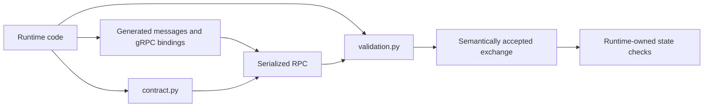

# Python contracts

The `stateforge-protocol` package is the canonical Python surface for SFP. It
provides generated protobuf messages and gRPC bindings, versioned procedure
constants, semantic validators, and the small cross-procedure helpers needed
to host one shared Provider endpoint.

Provider authors using StateForge Provider Python normally use the framework's
declarative API instead. The modules on this page are for Agent, Provider
runtime, and independent SFP implementations.

## Choose the right layer



| You need to… | Import… | What it owns |
| --- | --- | --- |
| Build or read protobuf messages | `*_pb2` | Wire fields, protobuf types, and serialization |
| Call or implement a gRPC service | `*_pb2_grpc` | Client stubs, servicer bases, and server registration |
| Configure a procedure boundary | `contract` | Service identity, message limits, collection bounds, and stable constants |
| Accept a message or exchange | `validation` | Context-independent semantic validation and correlation |
| Configure the multiplexed endpoint | `stateforge_protocol.sfp.shared_endpoint` | Complete service inventory and aggregate gRPC ceilings |
| Classify a reconnect | `stateforge_protocol.sfp.recovery` | Identity continuity between two already validated sessions |

!!! important

    Constructing a generated protobuf message proves only that its fields can
    be represented on the wire. It does not prove that the message satisfies
    the StateForge contract. Validate it before using it.

## Procedure packages

Each versioned procedure keeps its generated and handwritten APIs together.
The import path is part of the contract version; do not import a private
module or copy constants into a consumer.

| Procedure | Python surface | Primary RPC or artifact |
| --- | --- | --- |
| [Endpoint Discovery](../procedures/endpoint-discovery.md) | `sfp.endpoint_discovery.v1.contract` | Endpoint descriptor and Unix socket names |
| [Bootstrap](../bootstrap.md) | `sfp.bootstrap.v1` | `BootstrapService.Handshake` |
| [Provider Manifest](../procedures/provider-manifest.md) | `sfp.manifest.v1` | `ManifestService.GetManifest` |
| [Health](../procedures/health.md) | `sfp.health_contract` plus `grpc_health.v1` | Standard `grpc.health.v1.Health` service |
| [Capability Assessment](../procedures/capability-assessment.md) | `sfp.capability_assessment.v1` | `CapabilityAssessmentService.AssessCapabilities` |
| [Operation Admission](../procedures/operation-admission.md) | `sfp.operation_admission.v1` | `OperationAdmissionService.StartOperation` |
| [Operation Lifecycle](../procedures/progress-results-cancellation.md) | `sfp.operation_lifecycle.v1` | `WatchOperation` and `CancelOperation` |
| [Trigger Publication](../procedures/triggers.md) | `sfp.trigger_publication.v1` | `TriggerPublicationService.StreamTriggers` |
| [Recovery](../procedures/disconnection-recovery.md) | `sfp.recovery` | Cross-procedure identity classification; no separate RPC |

For a protobuf-backed procedure, its version package contains:

```text
stateforge_protocol.sfp.<procedure>.v1
├── <procedure>_pb2.py       # messages and enums
├── <procedure>_pb2_grpc.py  # stubs, servicers, registration
├── contract.py              # names and normative limits
└── validation.py            # semantic validators
```

The generated modules also ship `.pyi` typing information. Never edit generated
`_pb2` or `_pb2_grpc` modules; change the owning `.proto` source and regenerate
them.

The canonical sources are the
[protobuf definitions](https://github.com/stateforge-org/stateforge-protocol/tree/mvp/implementation/proto/stateforge_protocol/sfp)
and the
[versioned Python packages](https://github.com/stateforge-org/stateforge-protocol/tree/mvp/implementation/src/stateforge_protocol/sfp).

## Validate an exchange

Validate outgoing data before sending it, then validate the successful
response together with the exact request that produced it. Exchange validators
check both message bodies and their context-independent correlation.

```python
from stateforge_protocol.sfp.operation_admission.v1 import (
    operation_admission_pb2,
    operation_admission_pb2_grpc,
    validation,
)


async def start_operation(
    stub: operation_admission_pb2_grpc.OperationAdmissionServiceStub,
    request: operation_admission_pb2.StartOperationRequest,
) -> operation_admission_pb2.StartOperationResponse:
    validation.validate_start_operation_request(request)
    response = await stub.StartOperation(request)
    validation.validate_admission_exchange(request, response)
    return response
```

The same pattern applies to each procedure:

1. build a generated request;
2. validate the request before transmission;
3. call the generated gRPC stub;
4. validate the response or complete exchange; and
5. apply checks that depend on the runtime's current state.

### Public validator inventory

| Procedure | Message validation | Correlation and derived values |
| --- | --- | --- |
| Bootstrap | `validate_handshake_request`, `validate_handshake_response` | `validate_protocol_version` |
| Provider Manifest | `validate_manifest_document`, `validate_manifest_response` | `compute_manifest_revision`, `validate_manifest_key` |
| Capability Assessment | `validate_assess_capabilities_request`, `validate_assess_capabilities_response` | `validate_assessment_exchange` |
| Operation Admission | Request, response, record, and error-detail validators | `validate_admission_exchange`, `canonical_invocation`, `compute_request_fingerprint` |
| Operation Lifecycle | Watch, Cancel, snapshot, and error-detail validators | Watch/Cancel exchange, transition, and terminal-replay validators |
| Trigger Publication | Stream, publication, and acknowledgement validators | Stream-open and publication/acknowledgement exchange validators; canonical content and fingerprint helpers |

Every validator raises the procedure's public validation error, such as
`OperationAdmissionValidationError`. Error messages identify the violated
contract without echoing business payloads or secret configuration.

Endpoint Discovery is a filesystem contract rather than a protobuf procedure.
Its public `contract` module owns `EndpointDescriptor`, `parse_descriptor`,
filename derivation, permissions, size bounds, and generation validation.

## Contract constants

Protobuf defines field types, but it cannot configure gRPC message ceilings or
express every aggregate JSON and collection bound. Import those limits from the
procedure's `contract` module.

```python
from stateforge_protocol.sfp.manifest.v1 import contract

service_name = contract.SERVICE_NAME
maximum_request_bytes = contract.MAX_REQUEST_BYTES
maximum_response_bytes = contract.MAX_RESPONSE_BYTES
maximum_operations = contract.MAX_OPERATIONS
```

Common categories include:

| Category | Examples |
| --- | --- |
| RPC size | `MAX_REQUEST_BYTES`, `MAX_RESPONSE_BYTES` |
| Canonical content | JSON depth, node count, string length, and preimage size |
| Collections | Operations, triggers, findings, roles, observers, or in-flight publications |
| Stable identities | `SERVICE_NAME`, descriptor suffix, transport name, reason-code vocabulary |
| Flow control | Pending snapshots, observers, retry bounds, and stalled-delivery deadlines |

Capability Assessment's core reason codes are extensible identifiers rather
than a closed enum. Import constants such as
`REASON_CODE_ACCESS_DENIED` and `REASON_CODE_REQUIREMENT_UNMET`; do not copy
their dotted strings into a runtime.

## Configure the shared endpoint

One Provider gRPC server hosts Bootstrap, standard Health, and every SFP
procedure. `shared_endpoint` derives transport ceilings from the complete
service inventory.

=== "Provider server"

    ```python
    import grpc

    from stateforge_protocol.sfp import shared_endpoint

    server = grpc.aio.server(
        options=(
            (
                "grpc.max_receive_message_length",
                shared_endpoint.MAX_PROVIDER_RECEIVE_BYTES,
            ),
            (
                "grpc.max_send_message_length",
                shared_endpoint.MAX_PROVIDER_SEND_BYTES,
            ),
        )
    )
    ```

=== "Agent channel"

    ```python
    import grpc

    from stateforge_protocol.sfp import shared_endpoint

    channel = grpc.aio.insecure_channel(
        "unix:///run/stateforge-agent/providers/provider.sock",
        options=(
            (
                "grpc.max_send_message_length",
                shared_endpoint.MAX_PROVIDER_RECEIVE_BYTES,
            ),
            (
                "grpc.max_receive_message_length",
                shared_endpoint.MAX_PROVIDER_SEND_BYTES,
            ),
        ),
    )
    ```

`shared_endpoint.PROCEDURE_LIMITS` lists the service name and both message
directions for every registered procedure. The aggregate ceiling prevents gRPC
from rejecting a valid procedure message before its handler runs.

!!! note

    The shared ceiling does not replace per-procedure validation. A Manifest
    request larger than `manifest.MAX_REQUEST_BYTES` remains invalid even when
    the shared endpoint can receive a larger Capability Assessment request.

## Cross-procedure APIs

### Standard Health

StateForge uses the generated `grpc_health.v1` messages and service. The
handwritten `stateforge_protocol.sfp.health_contract` module identifies the
authoritative empty-service Watch, named diagnostic services, and Health
message limits.

```python
from grpc_health.v1 import health_pb2

from stateforge_protocol.sfp import health_contract

request = health_pb2.HealthCheckRequest(
    service=health_contract.AUTHORITATIVE_WATCH_SERVICE
)
```

### Recovery identity

Recovery composes existing procedures rather than defining another service.
Classify two independently validated endpoint/session identities before
deciding which retained state may be reconciled.

```python
from stateforge_protocol.sfp.operation_admission.v1 import (
    operation_admission_pb2,
)
from stateforge_protocol.sfp.recovery import classify_recovery

transition = classify_recovery(previous_identity, current_identity)

if transition.requires_resolve_only:
    # A generation boundary forbids creating absent work during recovery.
    admission_mode = operation_admission_pb2.ADMISSION_MODE_RESOLVE_ONLY
```

The classifier proves identity continuity only. It does not inspect Provider
storage or prove that an operation record, lifecycle snapshot, or pending
trigger survived.

## Validation and runtime ownership

| The Protocol package can decide… | The runtime must decide… |
| --- | --- |
| Whether one message satisfies its versioned structural and semantic contract | Whether the peer is the currently selected endpoint and session |
| Whether a response correlates with its request | Whether the request belongs to the runtime's active retry or stream |
| Whether canonical bytes, revisions, or fingerprints are correct | Whether payload/result data satisfies the manifest schema selected for this operation or trigger |
| Whether a lifecycle transition is valid from two supplied snapshots | Whether retained state is current, durable, and authorized for this caller |
| Whether reconnect identities form a valid transition | Whether the Provider actually retained the referenced work |

Protocol validators use private `stateforge_protocol.sfp._validation`
mechanics for schema loading, ProtoJSON projection, bounded traversal, and
canonical JSON. Consumers must import the public procedure validator instead
of `_validation` or reimplementing those mechanics.

Keep live session, filesystem, retry, cache, admission, and policy checks in
the Agent or Provider runtime. If a context-independent wire rule is missing,
fix it in the owning Protocol procedure rather than creating a second contract
in a consumer repository.
