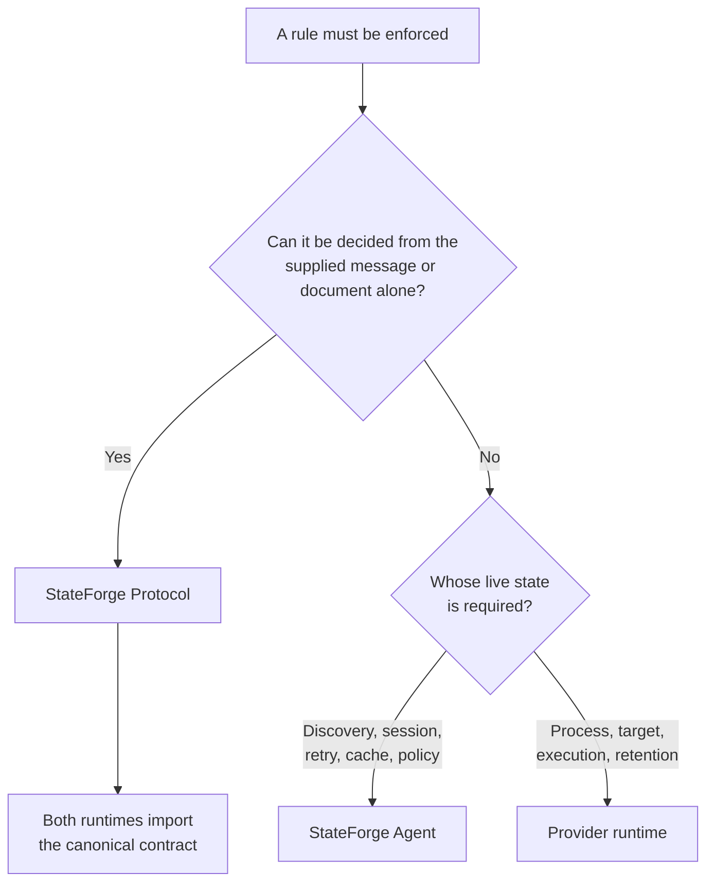

# Responsibility boundaries

SFP has three cooperating owners. The Protocol defines the portable contract;
the Agent and Provider enforce it while making decisions that depend on their
own live state. A rule should have one authoritative owner, even when both
runtimes enforce it at their side of an RPC boundary.

  <article class="sf-docs-card">
    PORTABLE CONTRACT
    <h3>Protocol</h3>
    

      Defines wire shapes, fixed identities, limits, canonical values, state
      transitions, and every validity decision that independent
      implementations must make the same way.
    

  </article>
  <article class="sf-docs-card">
    CLIENT RUNTIME
    <h3>Agent</h3>
    

      Owns discovery trust, the selected endpoint and session, request
      construction, availability, retries, caches, cursors, and orchestration.
    

  </article>
  <article class="sf-docs-card">
    SERVER RUNTIME
    <h3>Provider</h3>
    

      Owns the serving process, endpoint publication, declaration snapshots,
      target inspection, operation execution, trigger retention, and optional
      persistence.
    

  </article>

## Decide where a rule belongs

| Question | Owner | Example |
| --- | --- | --- |
| Must every implementation accept or reject the same value? | Protocol | UUID shape, message size, identifier grammar, legal lifecycle transition |
| Does the decision require the Agent's current observation or policy? | Agent | Whether a descriptor file is trusted, a session is current, or a retry remains eligible |
| Does the decision require the serving process or managed target? | Provider | Whether the process is stopping, a requirement is satisfied, or an operation record still exists |

!!! important "Import the rule; do not mirror it"

    A copied service name, limit, regular expression, or semantic check is a
    second contract even when its value currently matches. Agent and Provider
    implementations import the Protocol-owned definition and add only their
    live-state checks.

## Ownership through the SFP lifecycle

The tables below identify the owner of each observable decision. They describe
responsibility, not a required internal architecture.

### Discover and connect

| Resource | Protocol owns | Agent owns | Provider owns |
| --- | --- | --- | --- |
| Shared scalars | Canonical UUIDv4 and protobuf-integer semantics | Minting and retaining Agent-owned identities | Minting and retaining Provider-owned identities |
| [Endpoint Discovery](../procedures/endpoint-discovery.md) | Descriptor document, names, modes, transport, identity, generation, and size limits | Directory trust, safe observation, replacement detection, and channel creation | Installation identity, generation allocation, socket binding, atomic publication, and cleanup |
| [Bootstrap](../bootstrap.md) | Service identity, message limits, version and envelope semantics, and session-ID bounds | Offered versions, deadline, response correlation, selected connection, and retry policy | Live-endpoint comparison, version selection, fresh session allocation, and stopping state |
| Shared endpoint | Procedure inventory and aggregate transport ceilings | Client-channel construction | Server registration and construction |

### Qualify the Provider

| Procedure | Protocol owns | Agent owns | Provider owns |
| --- | --- | --- | --- |
| [Provider Manifest](../procedures/provider-manifest.md) | Declaration shape, schemas, identifiers, limits, canonical revision, and semantic validation | Schema offer, response correlation, accepted revision, retry, and cache policy | Author declarations, immutable served snapshot, and local construction budgets |
| [Health](../procedures/health.md) | Standard service identity, authoritative Watch key, message limits, and status vocabulary | Watch lifecycle, availability generation, fail-closed admission, and retry | Health hook, current process status, startup, degradation, recovery, and shutdown transitions |
| [Capability Assessment](../procedures/capability-assessment.md) | Request, response, support states, reasons, limits, and context-independent exchange correlation | Current-session prerequisites, requested operation set, normalization, cache scope, invalidation, and retry | Target resolution, declaration lookup, requirement-check execution, and point-in-time evidence |

### Exchange work and recover

| Procedure | Protocol owns | Agent owns | Provider owns |
| --- | --- | --- | --- |
| [Trigger Publication](../procedures/triggers.md) | Stream envelope, session and manifest binding, canonical content, acknowledgement semantics, and validation | Durable acceptance, duplicate inventory, acknowledgement state, and stream orchestration | Publication identity, retention, replay, flow control, and optional persistence |
| [Operation Admission](../procedures/operation-admission.md) | Immutable invocation, fingerprint, modes, dispositions, errors, and exchange validation | Authorization result, request construction, current prerequisites, retry mode, and unresolved-outcome handling | Atomic admission registry, capacity, dispatch, retention, and optional persistence |
| [Operation Lifecycle](../procedures/progress-results-cancellation.md) | State machine, sequence and cursor rules, terminal immutability, cancellation outcomes, limits, and validation | Watch cursors, stream retry, result consumption, and cancellation orchestration | Execution state, snapshot commits, observer delivery, result production, cancellation, and retention |
| [Recovery](../procedures/disconnection-recovery.md) | Identity-transition classification, stale-session fencing, and reconciliation rules | Rediscovery, bounded backoff, availability, cache invalidation, saved cursors, and indeterminate-outcome handling | Retained records, optional persistence, and proof of recovered operation or publication state |

## Worked example: capability evidence changes

Suppose an operation requires write access to `/var/lib/example`, and that
permission disappears after an earlier successful assessment.

| Decision | Owner | Reason |
| --- | --- | --- |
| Is the assessment request structurally and semantically valid? | Protocol | The answer is derivable from the request alone. |
| Does it reference the Agent's active session and accepted manifest? | Agent | Only the Agent knows which session and declaration it currently trusts. |
| Does the request match the Provider's live session and served manifest? | Provider | Only the serving process knows its current session and snapshot. |
| Can the target currently write to `/var/lib/example`? | Provider | This requires a point-in-time check against the managed environment. |
| May an earlier assessment remain cached after availability or context changes? | Agent | Cache scope and invalidation depend on Agent-owned runtime observations. |
| Are the returned support state, requirement state, reasons, and correlation valid? | Protocol | Every implementation must interpret the response identically. |

The Provider reports new evidence; it does not change the operation's manifest
declaration. The Agent decides whether that evidence is current enough for a
later admission attempt.

## Public Protocol surfaces

Consumers use the public surface that owns the rule they are enforcing.

| Surface | Responsibility |
| --- | --- |
| Generated `*_pb2` and `*_pb2_grpc` modules | Protobuf messages, enums, client stubs, servicer bases, and registration helpers |
| Versioned `contract.py` | Service identity, message bounds, collection limits, identifiers, and stable procedure constants |
| Versioned `validation.py` | Context-independent message and exchange validation with a procedure-owned error surface |
| [`primitives.py`](https://github.com/stateforge-org/stateforge-protocol/blob/mvp/implementation/src/stateforge_protocol/sfp/primitives.py) | Scalar semantics shared by multiple procedures |
| [`endpoint_discovery.v1.contract`](https://github.com/stateforge-org/stateforge-protocol/blob/mvp/implementation/src/stateforge_protocol/sfp/endpoint_discovery/v1/contract.py) | Complete filesystem descriptor document contract and parser |
| [`health_contract.py`](https://github.com/stateforge-org/stateforge-protocol/blob/mvp/implementation/src/stateforge_protocol/sfp/health_contract.py) | StateForge's use of the standard gRPC Health service |
| [`shared_endpoint.py`](https://github.com/stateforge-org/stateforge-protocol/blob/mvp/implementation/src/stateforge_protocol/sfp/shared_endpoint.py) | Complete service inventory and Provider-oriented transport ceilings |
| [`recovery.py`](https://github.com/stateforge-org/stateforge-protocol/blob/mvp/implementation/src/stateforge_protocol/sfp/recovery.py) | Identity continuity across two independently validated sessions |

See [Python contracts](python-contracts.md) for imports and usage examples.

## Keep runtime state outside Protocol

Protocol validators decide only facts available from their arguments. They do
not read a live directory, select the active session, inspect a Provider
process, run a requirement check, authorize an operation, manage a retry, or
prove that retained state still exists.

Agent and Provider implementations may wrap a public validator to translate
its error or combine it with local state. They must not import the private
`stateforge_protocol.sfp._validation` module. That module contains reusable
validation mechanics for the Protocol package; it is not an alternative public
contract.

If a context-independent rule is missing, add it to the owning Protocol
procedure. If a decision requires current state, keep it in the runtime that
owns that state.
