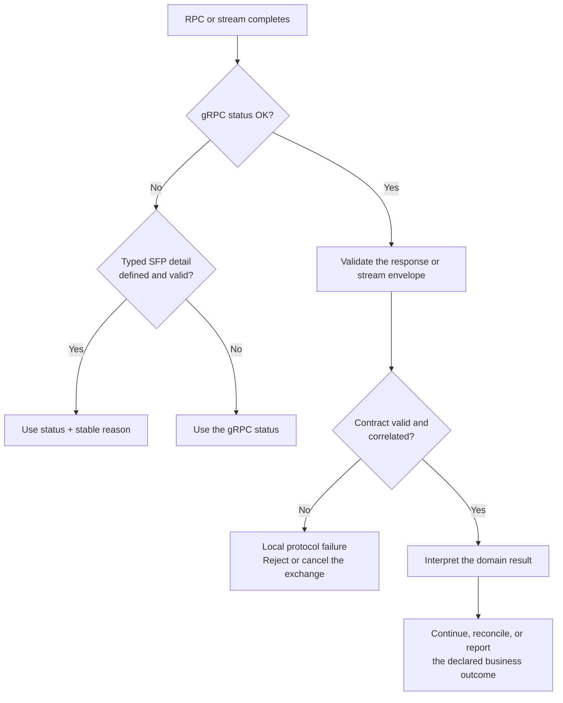

# SFP status and error handling

SFP reports failures at different layers. Start with the RPC status, then read
the procedure-specific result that belongs to that layer. A non-OK gRPC status
describes a call or stream; it does not by itself prove what happened to
business work.

  <article class="sf-docs-card">
    RPC OR STREAM
    <h3>gRPC status</h3>
    

      Reports whether one RPC or stream completed successfully. Use the code
      first to choose correction, reconnection, or bounded retry behavior.
    

  </article>
  <article class="sf-docs-card">
    TYPED DETAIL
    <h3>Structured reason</h3>
    

      Operation Admission and Operation Lifecycle attach a stable reason to
      non-OK status. Software branches on the enum, never diagnostic text.
    

  </article>
  <article class="sf-docs-card">
    SUCCESSFUL EXCHANGE
    <h3>Domain outcome</h3>
    

      A successful RPC may still report unsupported capability, rejected
      publication, failed operation, or unsupported cancellation.
    

  </article>
  <article class="sf-docs-card">
    RECEIVING PEER
    <h3>Local protocol failure</h3>
    

      A client can reject a malformed or mismatched response locally even
      when the server returned an otherwise successful transport status.
    

  </article>

## Choose the correct error channel

The order matters:

1. Read the gRPC status.
2. For Operation Admission or Lifecycle, validate and unpack the typed detail.
3. On `OK`, validate the complete response, session fences, and correlation.
4. Only then interpret a domain result such as a capability finding,
   acknowledgement disposition, admission disposition, operation snapshot, or
   cancellation disposition.

## Status reference

This table describes the meanings assigned by the current SFP procedures. A
status not listed here has no additional SFP-specific retry promise.

| gRPC status | SFP meaning | First response |
| --- | --- | --- |
| `INVALID_ARGUMENT` | The message is malformed or violates context-independent field, bound, framing, or identifier rules. | Correct the request. Never retry the unchanged invalid message. |
| `FAILED_PRECONDITION` | The message may be well-formed, but current session, endpoint, manifest, declaration, retained state, or another required fence does not permit it. | Refresh or re-establish the named prerequisite. Do not silently weaken the fence. |
| `RESOURCE_EXHAUSTED` | A serialized message, observer, queue, flow-control window, or other bounded resource exceeded its contract or current capacity. | Use the procedure detail to decide whether to reduce content, wait for capacity, or reattach with bounded backoff. |
| `UNIMPLEMENTED` | The unchanged endpoint or declaration cannot perform the requested contract: no common version or schema, an undeclared operation, or unsupported Health Watch. | Do not retry indefinitely without a relevant endpoint, offer, declaration, or implementation change. |
| `UNAVAILABLE` | The Provider, session, channel, or service is temporarily unable to serve the exchange. | Fail closed, reconnect or revalidate, and retry only under bounded policy. |
| `ALREADY_EXISTS` | The submitted identity conflicts with retained content, or a mutually exclusive stream already exists. | Resolve the existing state. Never change content while reusing the same identity. |
| `DEADLINE_EXCEEDED` | The RPC deadline elapsed, or Operation Admission rejected a new invocation whose execution deadline had already elapsed. | Distinguish call timeout from the structured admission reason. A call timeout alone may leave the business outcome unknown. |
| `CANCELLED` | The caller cancelled an RPC or the transport closed it. | Treat the exchange as interrupted. It does not prove that an admitted operation stopped. |
| `OUT_OF_RANGE` | An Operation Lifecycle observer supplied a cursor newer than the retained snapshot. | Verify the saved cursor and recovery state; never reset it silently. |
| `NOT_FOUND` | Standard gRPC Health `Check` received an unknown or wildcard-like service name. | Correct the diagnostic lookup. Health `Watch` uses `SERVICE_UNKNOWN` instead. |
| `INTERNAL` | The serving implementation failed its own contract, such as constructing an invalid response. | Reject the response, retain sanitized diagnostics, and do not treat the exchange as successful. |

!!! important "A status is not retry authorization"

    Retry eligibility also depends on the procedure, structured reason,
    immutable request identity, current session and endpoint, and whether the
    caller can prove that business work was not already admitted.

## Procedure map

| Procedure | Non-OK wire statuses | Successful domain or local signal |
| --- | --- | --- |
| [Endpoint Discovery](../procedures/endpoint-discovery.md) | None; discovery is a filesystem contract, not an RPC. | Descriptor parsing, identity correlation, and channel-creation failures remain local to the Agent. |
| [Bootstrap](../bootstrap.md) | `INVALID_ARGUMENT`, `RESOURCE_EXHAUSTED`, `FAILED_PRECONDITION`, `UNIMPLEMENTED`, `UNAVAILABLE`, `INTERNAL` | A response with mismatched identity, generation, or selected version is a Local protocol failure; bind no session. |
| [Provider Manifest](../procedures/provider-manifest.md) | `INVALID_ARGUMENT`, `RESOURCE_EXHAUSTED`, `FAILED_PRECONDITION`, `UNIMPLEMENTED`, `INTERNAL`, `UNAVAILABLE`, `DEADLINE_EXCEEDED`, `CANCELLED` | Invalid response correlation, schema, or revision is a local manifest rejection. |
| [Health](../procedures/health.md) | `NOT_FOUND` for unknown `Check`; `RESOURCE_EXHAUSTED`, `UNIMPLEMENTED`, or `UNAVAILABLE` may terminate `Watch`. | `SERVICE_UNKNOWN` is a Watch response value, not a gRPC error. Every Watch failure makes the Agent fail closed. |
| [Capability Assessment](../procedures/capability-assessment.md) | `INVALID_ARGUMENT`, `FAILED_PRECONDITION`, `RESOURCE_EXHAUSTED`, `UNAVAILABLE`, `DEADLINE_EXCEEDED`, `CANCELLED`, `INTERNAL` | `UNSUPPORTED`, `SUPPORTED_WITH_REQUIREMENTS`, and `INDETERMINATE` are normal per-operation findings. |
| [Trigger Publication](../procedures/triggers.md) | Provider: `INVALID_ARGUMENT`, `FAILED_PRECONDITION`, `ALREADY_EXISTS`, `UNAVAILABLE`. | A publication may receive `REJECTED` on an otherwise healthy stream. Agent-detected framing or flow-control violations are local errors followed by stream cancellation. |
| [Operation Admission](../procedures/operation-admission.md) | `INVALID_ARGUMENT`, `UNIMPLEMENTED`, `FAILED_PRECONDITION`, `RESOURCE_EXHAUSTED`, `UNAVAILABLE`, `ALREADY_EXISTS`, `DEADLINE_EXCEEDED`, or unexpected `INTERNAL`. | `ACCEPTED_NEW` and `RESOLVED_EXISTING` are the only successful dispositions. Rejections carry `OperationAdmissionErrorDetail`. |
| [Operation Lifecycle](../procedures/progress-results-cancellation.md) | `INVALID_ARGUMENT`, `FAILED_PRECONDITION`, `OUT_OF_RANGE`, `RESOURCE_EXHAUSTED`, `UNAVAILABLE`; transport may also end as `CANCELLED` or `DEADLINE_EXCEEDED`. | Operation `FAILED` and `CANCELLED` are business states inside an `OK` lifecycle stream. Cancellation dispositions are also successful RPC responses. |
| [Disconnection Recovery](../procedures/disconnection-recovery.md) | No recovery RPC; recovery composes Bootstrap, Admission, Lifecycle, and Trigger Publication signals. | Missing evidence remains indeterminate. It never becomes success, failure, cancellation, or permission to redispatch. |

## Structured SFP error details

Only Operation Admission and Operation Lifecycle currently define typed details
for non-OK gRPC status. Each detail is packed into
`google.rpc.Status.details` as a `google.protobuf.Any` with its versioned type
identity.

=== "Operation Admission"

    Every rejected `StartOperation` uses `OperationAdmissionErrorDetail` when
    request decoding permits it. The detail may contain a validated operation
    ID, stable reason, retryability, optional bounded retry delay, and sanitized
    explanation.

    | Structured reason | gRPC status | Meaning |
    | --- | --- | --- |
    | `ADMISSION_ERROR_REASON_INVALID_OPERATION_REQUEST` | `INVALID_ARGUMENT` | The immutable request is malformed or schema-invalid. |
    | `ADMISSION_ERROR_REASON_OPERATION_NOT_DECLARED` | `UNIMPLEMENTED` | The accepted manifest does not declare the operation. |
    | `ADMISSION_ERROR_REASON_OPERATION_INCOMPATIBLE` | `FAILED_PRECONDITION` | The requested schema or profile context is incompatible. |
    | `ADMISSION_ERROR_REASON_OPERATION_PRECONDITION_FAILED` | `FAILED_PRECONDITION` | A live session, manifest, health, or requirement fence is stale. |
    | `ADMISSION_ERROR_REASON_PROVIDER_CAPACITY_EXHAUSTED` | `RESOURCE_EXHAUSTED` | Admission capacity is temporarily exhausted. |
    | `ADMISSION_ERROR_REASON_PROVIDER_UNAVAILABLE` | `UNAVAILABLE` | The Provider is temporarily unavailable. |
    | `ADMISSION_ERROR_REASON_IDEMPOTENCY_CONFLICT` | `ALREADY_EXISTS` | The operation ID already names different immutable content. |
    | `ADMISSION_ERROR_REASON_OPERATION_DEADLINE_EXPIRED` | `DEADLINE_EXCEEDED` | The execution deadline elapsed before a new record was admitted. |
    | `ADMISSION_ERROR_REASON_OPERATION_RECORD_UNAVAILABLE` | `FAILED_PRECONDITION` | Resolve-only lookup cannot prove a retained record. |
    | `ADMISSION_ERROR_REASON_OPERATION_RECORD_EXPIRED` | `FAILED_PRECONDITION` | A retained tombstone proves that the record expired. |

=== "Operation Lifecycle"

    A failed `WatchOperation` or `CancelOperation` uses
    `OperationLifecycleErrorDetail`. It carries the operation ID when valid, a
    stable reason, and sanitized explanation. Retryability follows the reason
    and current runtime state rather than a boolean inside this detail.

    | Structured reason | gRPC status | Meaning |
    | --- | --- | --- |
    | `LIFECYCLE_ERROR_REASON_INVALID_REQUEST` | `INVALID_ARGUMENT` | The lifecycle request is malformed or out of bounds. |
    | `LIFECYCLE_ERROR_REASON_SESSION_PRECONDITION_FAILED` | `FAILED_PRECONDITION` | The session or endpoint binding is stale. |
    | `LIFECYCLE_ERROR_REASON_OPERATION_RECORD_UNAVAILABLE` | `FAILED_PRECONDITION` | No trustworthy retained admission record is available. |
    | `LIFECYCLE_ERROR_REASON_OPERATION_RECORD_EXPIRED` | `FAILED_PRECONDITION` | A tombstone proves the record expired. |
    | `LIFECYCLE_ERROR_REASON_OPERATION_STATE_UNAVAILABLE` | `FAILED_PRECONDITION` | The admission exists but its lifecycle state cannot be proved. |
    | `LIFECYCLE_ERROR_REASON_FINGERPRINT_MISMATCH` | `FAILED_PRECONDITION` | The supplied fingerprint does not match the admitted invocation. |
    | `LIFECYCLE_ERROR_REASON_CURSOR_AHEAD` | `OUT_OF_RANGE` | The requested cursor is newer than current retained state. |
    | `LIFECYCLE_ERROR_REASON_OBSERVER_CAPACITY_EXHAUSTED` | `RESOURCE_EXHAUSTED` | No additional observer can currently attach. |
    | `LIFECYCLE_ERROR_REASON_SLOW_OBSERVER` | `RESOURCE_EXHAUSTED` | A stalled observer exceeded its bounded delivery window. |
    | `LIFECYCLE_ERROR_REASON_PROVIDER_UNAVAILABLE` | `UNAVAILABLE` | The Provider cannot currently serve lifecycle state. |

Validate a detail with the matching versioned Protocol validator before using
it. Reject an unknown type, an invalid reason/status pairing, an oversized
detail, or unsanitized fields as a local protocol failure. Diagnostic
`explanation` text is for operators and must never drive software behavior.

## Successful calls can report negative outcomes

Do not convert every negative domain result into a gRPC error.

| Domain signal | Why it remains inside an `OK` exchange |
| --- | --- |
| Capability `UNSUPPORTED` or `INDETERMINATE` | The assessment succeeded and produced valid point-in-time evidence. |
| Trigger acknowledgement `REJECTED` | The stream is valid; one publication was not accepted, with a typed rejection reason and retry guidance. |
| Admission `RESOLVED_EXISTING` | The Provider successfully resolved the same immutable operation without dispatching again. |
| Cancellation `UNSUPPORTED` or `ALREADY_TERMINAL` | The cancellation decision succeeded even though it did not stop active work. |
| Operation `FAILED` | Observation succeeded and returned the operation's actual terminal business state. |

Conversely, a non-OK Watch status, lost acknowledgement, cancelled call, or
deadline does not create a business outcome. Preserve uncertainty until a
later validated response or retained record resolves it.

## Local protocol failures

Some violations are visible only to the receiving client. A Provider cannot
send a second gRPC status after returning `OK`, and the Agent cannot send a
server status backward on the response side of Trigger Publication. The
receiver therefore records a local protocol failure and rejects the response
or cancels the stream.

Common examples include:

- a Bootstrap version that the Agent did not offer;
- response identity, generation, session, or manifest fences that do not match;
- a manifest revision that does not match its canonical declaration;
- a trigger publication sent before stream readiness or beyond the selected
  receive window; and
- an invalid structured error detail or lifecycle snapshot.

Local error names may mirror a gRPC code for diagnostics, but they are not a
status transmitted to the peer. Recovery still follows the owning procedure's
fencing and reconnection rules.

## Safe retry checklist

Before retrying any failed exchange:

1. Revalidate the current endpoint, session, availability, and accepted
   manifest required by that procedure.
2. Preserve the original operation or publication identity only when the
   semantic content is exactly unchanged.
3. Respect typed retryability and `retry_after` when the procedure supplies
   them; otherwise apply finite deadlines and bounded backoff.
4. Never interpret timeout, cancellation, channel loss, record expiry, or
   missing state as proof that business work did not occur.
5. Use resolve, Watch, or replay mechanisms before considering new work. A new
   business attempt requires new authorization and a new identity.

## Canonical sources

| Source | Owns |
| --- | --- |
| Procedure `contract.py` modules | Stable message limits, service identities, and procedure-specific constants. |
| Procedure `validation.py` modules | Context-independent request, response, structured-detail, and exchange validation. |
| [`operation_admission.proto`](https://github.com/stateforge-org/stateforge-protocol/blob/mvp/implementation/proto/stateforge_protocol/sfp/operation_admission/v1/operation_admission.proto) | Admission status/reason vocabulary and `OperationAdmissionErrorDetail`. |
| [`operation_lifecycle.proto`](https://github.com/stateforge-org/stateforge-protocol/blob/mvp/implementation/proto/stateforge_protocol/sfp/operation_lifecycle/v1/operation_lifecycle.proto) | Lifecycle status/reason vocabulary and `OperationLifecycleErrorDetail`. |
| [`health_contract.py`](https://github.com/stateforge-org/stateforge-protocol/blob/mvp/implementation/src/stateforge_protocol/sfp/health_contract.py) | StateForge's standard gRPC Health names, bounds, and status vocabulary. |
| Procedure fixtures and contract tests | Executable status/reason pairs, failure scenarios, and recovery expectations. |

For exact message fields and procedure-specific retry rules, follow the links
in the [procedure map](../procedures/index.md). For ownership of live-state decisions,
see [Responsibility boundaries](responsibility-boundaries.md).
