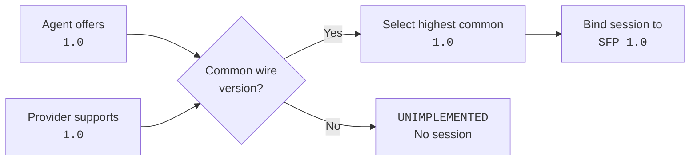

# Versioning and compatibility

StateForge uses several independent version identifiers because they answer
different questions. A package upgrade does not automatically change the wire
contract, and a new operation identifier does not automatically require a new
SFP version.

The important rule is simple: compare each version only at the boundary that
owns it.

## Version map

<div class="sf-docs-card-grid sf-docs-card-grid--two">
  <article class="sf-docs-card">
    <span class="sf-docs-card__label">DISTRIBUTION</span>
    <h3><code>stateforge-protocol 0.1.0</code></h3>
    <p>
      Identifies one published Python artifact. It is selected by dependency
      management and is never negotiated between an Agent and Provider.
    </p>
  </article>
  <article class="sf-docs-card">
    <span class="sf-docs-card__label">WIRE SESSION</span>
    <h3><code>SFP 1.0</code></h3>
    <p>
      Selected during Bootstrap from the versions supported by both peers and
      fixed for the resulting session.
    </p>
  </article>
  <article class="sf-docs-card">
    <span class="sf-docs-card__label">CONTRACT FAMILY</span>
    <h3><code>*.v1</code></h3>
    <p>
      Names one versioned wire and Python API family. Wire packages use
      <code>stateforge.sfp</code>; Python imports use
      <code>stateforge_protocol.sfp</code>.
    </p>
  </article>
  <article class="sf-docs-card">
    <span class="sf-docs-card__label">DOCUMENT SHAPE</span>
    <h3>Schema <code>1</code></h3>
    <p>
      Identifies a particular descriptor or manifest document shape. Each
      schema is accepted or negotiated by its own procedure.
    </p>
  </article>
</div>

The complete set of versioned surfaces is:

| Surface | Current example | What it identifies | How it is selected |
| --- | --- | --- | --- |
| Documentation tree | `v0.1.0` | Documentation for one published contract release | The reader chooses it from the documentation version selector |
| Python distribution | `stateforge-protocol==0.1.0` | One installable package artifact | Package dependency resolution |
| SFP wire contract | `1.0` | The protocol spoken by one Agent–Provider session | Bootstrap chooses the highest version supported by both peers |
| Protobuf and Python package | `stateforge.sfp.bootstrap.v1` / `stateforge_protocol.sfp.bootstrap.v1` | One versioned procedure API and service namespace | The implementation imports and registers that contract family |
| Endpoint descriptor schema | `"1"` | The filesystem document published before connection | The reader accepts exactly a schema it implements |
| Provider manifest schema | `1` | The declaration shape returned by Manifest Exchange | The Provider chooses the highest schema offered and supported |
| Agent software version | `agent_runtime.software_version` | The running Agent software release | Supplied by the Agent; required but never used to select the SFP wire version |
| Provider implementation | `1.0.0` | The running Provider software release | Declared by the Provider; never used as the SFP wire version |
| Operation or trigger identifier | `stateforge.git/reference.resolve@1` | One versioned domain action or event | Declared in the accepted manifest and matched exactly |
| Profile claim | `example.profile.v1.read_only` | A versioned semantic or compliance claim | Interpreted by the specification that defines that profile |

## How wire negotiation works



The current contract defines SFP `1.0`, while the negotiation mechanism can
represent additional `major.minor` versions:

1. The Agent sends a nonempty, duplicate-free set of supported wire versions.
   Offer order carries no preference.
2. The Provider validates the request and intersects that set with its own
   supported versions.
3. The Provider selects the highest common `(major, minor)` pair and returns
   it in `HandshakeResponse`.
4. The Agent accepts the response only if the selected version was actually
   offered and every endpoint fence still matches.
5. That version belongs to the newly created session. Reconnection performs a
   new handshake and creates a fresh session.

### Interactive walkthrough

Choose a scenario to follow version selection, rejection, and renegotiation.

```stateforge-procedure
source: version-negotiation.yaml
scenario: success
```

Wire versions have no patch component. Patch versions belong to software
artifacts, not Agent–Provider negotiation.

If the peers have no version in common, the Provider returns
`UNIMPLEMENTED`. The Agent does not bind a session and does not retry the same
unchanged endpoint generation indefinitely. A later endpoint generation or a
changed supported-version set may be evaluated again.

## Independent schema negotiation

Bootstrap selects the SFP wire version first. Other versioned data remains
independent:

| Contract | Compatibility behavior |
| --- | --- |
| Endpoint descriptor | The Agent parses only a descriptor schema it recognizes. An unknown schema is not interpreted as schema `1`. |
| Provider manifest | After Bootstrap, the Agent offers supported manifest schema versions and the Provider returns the highest common version. No common schema produces `UNIMPLEMENTED`. |
| Operation and trigger declarations | Identifiers are exact, extensible strings. `@1` is part of the declared domain identifier; it is not SFP `1.0`. |
| Profile claims | The profile's defining specification owns its version meaning. SFP validates and transports the claim without inventing that meaning. |

This separation allows a package to add a new domain identifier or schema
version without pretending that every such addition is a new transport
protocol.

## What compatibility means

Compatibility has both a serialized and a semantic side.

### Serialized compatibility

Existing protobuf package names, service and method identities, field numbers,
and field types remain stable inside a versioned contract family. Protocol CI
compares protobuf changes with the target branch using Buf's `FILE`
compatibility policy and verifies that checked-in generated bindings match the
sources.

### Semantic compatibility

A protobuf change can remain decodable while still changing the StateForge
contract. The following are also compatibility-sensitive:

- required presence and default meanings;
- accepted value ranges, identifiers, and message limits;
- canonical projections, fingerprints, and revisions;
- status-code and retry behavior;
- ordering, replay, retention, and terminal-state rules; and
- ownership of validation and live-state decisions.

Contract tests protect these semantics. A change that would make existing
conforming peers disagree cannot be introduced as a silent rewrite of the
same versioned contract.

## Choose the correct version boundary

| Change | Version boundary to review |
| --- | --- |
| Fix implementation behavior without changing the public contract | Python distribution or Provider implementation release |
| Add a new operation, trigger, or profile identifier under existing extensibility rules | The identifier or profile version; not automatically the SFP wire version |
| Change the endpoint descriptor document incompatibly | Endpoint descriptor schema |
| Change the Provider declaration shape incompatibly | Manifest schema |
| Change a procedure's RPC shape or semantics incompatibly | Versioned procedure package and SFP wire compatibility |
| Improve prose without changing behavior | Documentation release only |

Adding a field or relaxing a rule may be serialized-compatible, but it still
requires semantic review. The contract version is determined by observable
peer behavior, not only by whether protobuf can decode the bytes.

## Runtime obligations

| Runtime | Required behavior |
| --- | --- |
| Agent | Offer only fully implemented wire versions, validate the selected version, bind it to the current session, and renegotiate after reconnection. |
| Provider | Support only fully implemented versions, select the highest common version, return `UNIMPLEMENTED` when none exists, and keep the selection fixed for the session. |
| Both peers | Import the exact versioned Protocol constants and validators instead of copying service names, limits, parsers, or validation rules. |

Neither peer determines compatibility by comparing Python package versions,
Agent software versions, or Provider implementation versions.

## How compatibility is verified

The repository uses complementary checks because no single tool covers every
compatibility boundary:

| Check | Protects |
| --- | --- |
| Buf lint, format, and `FILE` compatibility | Protobuf source structure and serialized API compatibility |
| Deterministic generation check | Agreement between protobuf sources and published Python bindings |
| Procedure contract tests | Semantic validation, limits, errors, canonicalization, and state rules |
| Installed-package tests | The wheel and source distribution expose the promised public modules and data |
| Agent and Provider consumer tests | Real consumers remain compatible with the exact built artifact |

See [Conformance coverage](conformance-coverage.md) for evidence across every
procedure and [CI/CD and artifact verification](ci-automation.md) for the
artifact pipeline.

## Related references

<div class="sf-docs-card-grid sf-docs-card-grid--two">
  <a class="sf-docs-card" href="../../bootstrap/">
    <span class="sf-docs-card__label">NEGOTIATION</span>
    <h3>Handshake and version negotiation</h3>
    <p>Follow the exact request, selection, response, and failure behavior.</p>
  </a>
  <a class="sf-docs-card" href="../../procedures/provider-manifest/">
    <span class="sf-docs-card__label">SCHEMA</span>
    <h3>Provider manifest exchange</h3>
    <p>See independent manifest-schema negotiation and declaration versions.</p>
  </a>
  <a class="sf-docs-card" href="../python-contracts/">
    <span class="sf-docs-card__label">PYTHON</span>
    <h3>Generated Python contracts</h3>
    <p>Import messages, service bindings, constants, and validators by version.</p>
  </a>
  <a class="sf-docs-card" href="../ci-automation/">
    <span class="sf-docs-card__label">VERIFICATION</span>
    <h3>Artifact verification</h3>
    <p>Understand the compatibility and consumer checks applied before release.</p>
  </a>
</div>
